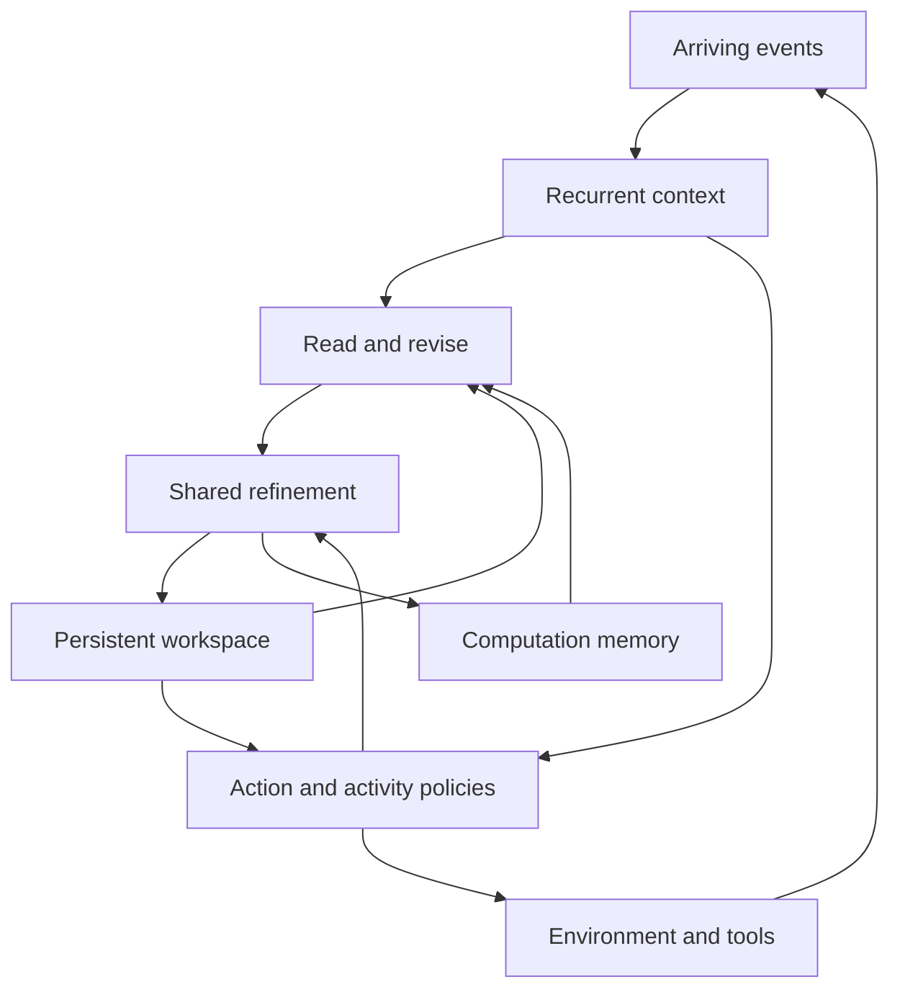

# Model architecture

Continual Decision Model (CDM) combines a recurrent context, a persistent latent workspace, bounded memory of previous computation, and learned action and activity policies. The model keeps working across observations and outputs. Its action head can respond to the current situation while a shared Transformer continues an unfinished computation.

The [PyTorch prototype](cdm/model.py) implements the recurrent context, shared workspace refinement, factor-conditioned memory reading, and action/activity/value heads. The [dynamic-grid experiment](experiments/continual_grid/README.md) separately compares explicit planning states. [RUNNING.md](RUNNING.md) lists executable commands; [TRAINING.md](TRAINING.md) specifies the progression from supervised learning to learned activity and continued adaptation.

## State

| State | Contents | Update |
| --- | --- | --- |
| Context \(h_t\) | Received observations, executed actions, elapsed time, current goal, pending requests | On arriving events and elapsed time |
| Workspace \(Z_t\) | A fixed number of latent slots holding ongoing inference | Context-conditioned reading, revision, and shared refinement |
| Computation memory \(M_t\) | Selected intermediate states and the conditions under which they were computed | After useful computation; bounded retention |
| Progress \(p_t\) | Computation depth, timing, recent operations, predicted operation value | At operation boundaries |
| Experience \(D\) | Observation–action–outcome trajectories | During interaction; consumed by training |
| Parameters \(\theta\) | Encoders, recurrence, refinement, memory operations, and policy heads | Offline training and later online updates |

Computation memory and experience have different roles. A computation record helps resume or adapt an unfinished calculation. An experience supplies observations and outcomes for prediction and learning. They may refer to the same interaction without being interchangeable.



## Context and action

For received event features \(e_t\), goal \(g_t\), and elapsed time \(\Delta t\),

\[
h_t=R_\theta(h_{t-1},e_t,a_{\mathrm{executed}},\Delta t,g_t),
\qquad c_t=P_\theta(h_t,g_t).
\]

The implemented core uses a GRU. Gated matrix recurrence is the next backbone comparison with the same inputs, workspace, and output heads. The [sequence-model review](ref/SEQUENCE_MODELS.md) describes these existing recurrence families. The prototype defaults to width 128, four workspace slots, eight memory records, and four attention heads; these are configurable engineering settings.

A goal change enters the context at the next assimilation. The event-driven extension will retain both capture and arrival times for delayed observations and represent outstanding tool calls until their results arrive. Sensor observations, model predictions, and summaries of internal computation will use distinct input types.

The action head reads fresh context and the latest completed workspace:

\[
a_t\sim\pi_{\mathrm{act},\theta}(a\mid c_t,Z_{\mathrm{ready}}).
\]

All comparison models receive the same fresh-context path. An external action therefore need not wait for a full planning cycle. A valid applied control continues between updates; the task defines its duration and how a new control replaces it.

## Persistent computation

The workspace has \(S\) slots of width \(d\). A shared Transformer refines it repeatedly:

\[
Z^{k+1}=F_\theta(Z^k,c_t).
\]

In the prototype, refinement adds a projected current context to each slot and applies self-attention across slots. Recent observations enter through the recurrent context; retrieved records enter through the workspace initialization. Residual updates let further computation develop the existing partial state.

At each short computation boundary, new events update \(c_t\). Further refinement uses that context. The workspace is consequently a state of ongoing calculation, rather than a sequence that must finish before another input can enter.

An optional action-conditioned prediction head estimates future observations, rewards, and outcomes. Explicit imagined rollouts are a comparison with the same interaction budget; they are not required to define the workspace.

## Computation records

The prototype stores a fixed-capacity ring of whole-workspace records:

\[
m_j=(U_j,\xi_j,g_j,d_j,\nu_j,k_j,n_j),
\]

where \(U_j\) contains intermediate computation, \(\xi_j\) is its generating recurrent context, \(g_j\) and \(d_j\) are its goal and environment descriptors, \(\nu_j\) is the parameter version, and \(k_j\) tracks computation depth. After mixing records, depth is a weighted history statistic rather than an exact count of the operations needed to reconstruct the mixed state. Reading excludes records from other parameter versions. The current workspace is also a read candidate.

The ring has fixed capacity \(B\). Its initial writing rule appends the completed workspace at selected boundaries. Learned writing and eviction follow the comparison with this fixed rule. A continuation state can contain more than the final action, allowing subsequent refinement to resume intermediate work.

The event index \(n_j\) identifies the received observation prefix available when a record was written. The event-driven extension adds source-specific observation scopes and timestamps. Exact duplicate handling belongs in that extension's reader. Retrieval updates computational features; it does not create another sensor observation or automatically increase an observation count.

## Condition-factorized reading and revision

The implemented reader learns separate goal, environment, and recurrent-context similarity terms, together with a depth score. For compatible record \(j\),

\[
s_j=\frac{
\langle q_g(g_t),q_g(g_j)\rangle+
\langle q_d(d_t),q_d(d_j)\rangle+
\langle q_c(c_t),k_c(\xi_j)\rangle}{\sqrt{3d}}
+b_\theta(\log(1+k_j)),
\qquad \alpha_j=\operatorname{softmax}_j(s_j).
\]

The weighted workspace \(\bar U=\sum_j\alpha_j U_j\) is revised from differences between current and retrieved context, goal, and environment representations. A slotwise gate mixes reuse, revision, and fresh initialization:

\[
\widetilde Z_{t,s}
=\rho_{s,0}\bar U_s
+\rho_{s,1}\left(\bar U_s+A_\theta(\bar U_s,\Delta c,\Delta g,\Delta d)\right)
+\rho_{s,2}I_\theta(c_t)_s,
\qquad \sum_{r=0}^{2}\rho_{s,r}=1.
\]

Shared Transformer refinement continues from \(\widetilde Z_t\). The factors are learned representations of supplied descriptors. Training varies goals, environment conditions, and observations independently and jointly to test whether the reader learns useful reuse under these changes.

The current reader mixes whole-workspace records before slotwise adaptation. A later groupwise reader can preserve several distinct candidate continuations. The associated comparison asks whether mixing destroys useful alternatives and whether joint slot interactions justify the additional computation.

The proposed contribution is learned reuse of partial computation under changing conditions, trained for subsequent decisions. It includes continued refinement and reuse after a context returns. Exact context restoration is compared with snapshot retrieval. Partial restoration and continuous change test whether conditional reuse adds more than caching.

Low-rank context correction remains an optional revision parameterization. The earlier [transport study](research/COMPUTATION_TRANSPORT.md) is a separate numerical experiment and comparison, rather than the defining CDM mechanism.

## Activity policy

The prototype provides observation, computation, and action logits together with a value head. The full activity interface below adds explicit retrieval and waiting. Its policy inputs will also include timing and pending requests when trained in an event-driven environment.

| Activity | Output | Effect |
| --- | --- | --- |
| Observe | Sensor, measurement configuration, or information request | Receives additional input after its delay |
| Compute | Refinement depth or a prediction branch | Develops the current workspace |
| Retrieve | Query and record budget | Makes earlier computation available for adaptation |
| Act | Control, tool arguments, or communication request | Changes the environment or communicates a result |
| Wait | Reconsideration interval | Keeps the present action while requests or physical processes proceed |

The fast action readout remains available at every boundary, including when the selected activity is internal computation. The runtime supplies clocks, inputs, and operation execution. The trained policy decides which operation to perform and what to do with its result.

An operation is useful when its expected future return exceeds that of available alternatives after its duration and resource use. A large uncertainty or a large planning error alone does not determine the choice: an inexpensive measurement may resolve little, while a brief computation may substantially improve an action, or vice versa.

The initial experiments use fixed compute budgets and scripted measurement schedules. Next train operation values from paired continuations and learn the activity policy. Learning-operation selection and autonomous subgoal generation extend this interface later.

## Execution and GPU layout

The prototype exposes each operation separately so an environment can advance between them:

```python
state = model.assimilate(state, observations, goals, environments,
                         previous_action=previous_action, elapsed=elapsed)
state, memory_read = model.read_memory(state)
state = model.refine(state, steps=1)
output = model.readout(state)
state = model.write_memory(state)
```

The neural actor will first use short serial blocks in the changing environment: assimilate arriving events, read or revise state, complete a bounded refinement block, then emit an action and choose the next activity. Its environment advances during operations. Capture, arrival, incorporation, action generation, and action application receive separate timestamps in this integration.

Use fixed slot count, fixed memory capacity, and fixed retrieval count for dense batched kernels. Gathered records feed ordinary projections and attention. Selective activity does not imply lower latency by itself; factor construction, lookup, padding, data movement, and action readout are included in end-to-end timing.

Larger neural configurations retain this layout. Scale width, recurrent depth, and environment batch size after measuring quality against computation. Training batches parallelize independent trajectories. Within one trajectory, context recurrence and successive refinement retain their temporal dependence.

Separate perception and control streams or devices can be evaluated after the serial actor. Parameter version, state version, and transfer time accompany such execution. Batch-one action latency is measured independently from training throughput.

## Learning during extended operation

Deploy with fixed parameters first, while recurrent state, workspace, and computation memory continue to change. Then train selected prediction or policy heads online, followed by adapters or shared-core updates.

A background learner can replay received experience, train predictions, compare imagined trajectories, and distill deeper decisions into a faster policy. Its benefit is measured on later interaction. Stored computation carries its parameter version; updates to state-producing parameters require state reconstruction or a tested conversion between versions.

This separates three mechanisms that can each improve behavior: retained activation state, reusable computation records, and learned parameter changes. [TRAINING.md](TRAINING.md) defines their training order and comparisons; [CONTINUAL_COMPUTATION.md](research/CONTINUAL_COMPUTATION.md) develops the central scientific hypothesis.
