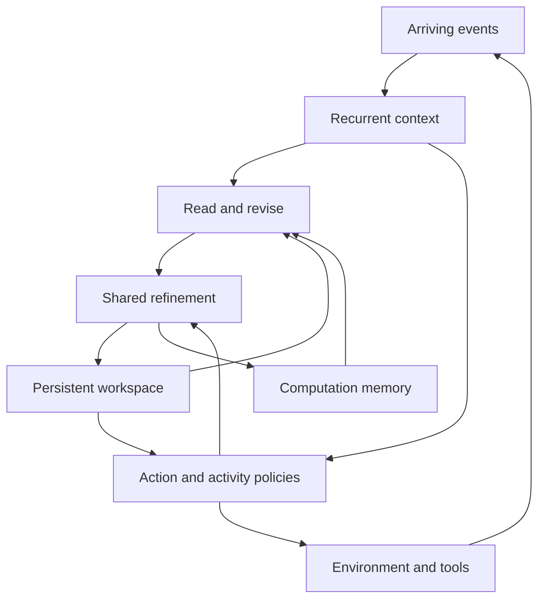

# Model architecture

The CDM target architecture combines a recurrent context, a persistent latent workspace, bounded memory of previous computation, and learned action and activity policies. It should retain goals and unfinished inference across outputs and keep decisions available during further computation. Current operations execute in serial blocks; concurrent real-time action and learning remain an implementation step. [STATUS.md](STATUS.md) distinguishes the target from the trained models.

The [PyTorch prototype](cdm/model.py) implements the recurrent context, shared workspace refinement, factor-conditioned memory reading, and action/activity/value heads. The [dynamic-grid experiment](experiments/continual_grid/README.md) separately compares explicit planning states. [RUNNING.md](RUNNING.md) lists executable commands; [TRAINING.md](TRAINING.md) specifies the progression from supervised learning to learned activity and continued adaptation.

## Next integrated model

The next main implementation extends the sequence core into an acting and learning model. Its running state is

\[
S_t=(h_t,Z_t,M_t,D_t,\eta_t,q_t,g_t),
\]

where \(h_t\) is the current recurrent context, \(Z_t\) the unfinished latent computation, \(M_t\) reusable records, \(D_t\) received experience, \(\eta_t\) instance-specific adaptive parameters and optimizer state, \(q_t\) pending operations and elapsed-time information, and \(g_t\) the continuing goal and current subgoals. Shared parameters \(\theta\) are optimized across training lifetimes.

Use the existing GRU as the reference fast update and a shared Transformer block over persistent slots as the refinement core. Compare a gated matrix recurrence at matched model size and runtime after the common trainer works. Input/output modules map structured sensors, images, instructions, and tool events into this same state. A language decoder is invoked for communication; ordinary control reads the current context and completed workspace directly.

An action-conditioned prediction head models future received observations, task outcomes, and elapsed durations. It supports measurement selection, action comparison, and learning from received results. Prediction learning and the activity policy share the context/workspace representation. A goal-conditioned readout proposes subgoals or measurement settings, with their contribution trained through subsequent task return.

The activity output specifies an operation, its target, and its work budget: which sensor or tool to query; which workspace slots or prediction branch to refine; which memories to retrieve; which experience and parameter group to update; or when to reconsider. Physical control remains a separate output available at fast update boundaries. Concurrent background activity and external action therefore need not be exclusive categorical choices.

The first online parameter group \(\eta_t\) consists of prediction and action adapters. Keeping the shared state-producing coordinates fixed within an adaptation interval allows those updates to use the current workspace. The outer training still optimizes the shared recurrence, refinement, world prediction, and activity policy together. Subsequent consolidation can update \(\theta\); it must also account for the cost of bringing retained state into the updated representation. Retention through a parameter update is part of the model design.

One model means shared trained representations, objectives, and persistent state, not a requirement that every operation execute in one kernel. Frozen image or language encoders can provide initial features, with their costs and training status reported. The current convolutional maze planner remains a comparison; it is not silently substituted for the GRU/Transformer core.

## State

| State | Contents | Update |
| --- | --- | --- |
| Context \(h_t\) | Received observations, executed actions, elapsed time, current goal, pending requests | On arriving events and elapsed time |
| Workspace \(Z_t\) | A fixed number of latent slots holding ongoing inference | Context-conditioned reading, revision, and shared refinement |
| Computation memory \(M_t\) | Selected intermediate states and the conditions under which they were computed | After useful computation; bounded retention |
| Operations \(q_t\) | Computation depth, timing, pending requests, recent operations, predicted operation value | At operation boundaries |
| Experience \(D\) | Observation–action–outcome trajectories | During interaction; consumed by training |
| Goals \(g_t\) | Continuing objective and proposed subgoals | On received instructions and learned subgoal choices |
| Local adaptation \(\eta_t\) | Prediction/action adapters and their optimizer state | Model-selected learning operations within one lifetime |
| Shared parameters \(\theta\) | Encoders, recurrence, refinement, memory operations, and policy heads | Training across lifetimes and measured consolidation |

Computation memory and experience have different roles. A computation record helps resume or adapt an unfinished calculation. An experience supplies observations and outcomes for prediction and learning. They may refer to the same interaction without being interchangeable.



## Context and action

For received event features \(e_t\), goal \(g_t\), and elapsed time \(\Delta t\),

\[
h_t=R_\theta(h_{t-1},e_t,a_{\mathrm{executed}},\Delta t,g_t),
\qquad c_t=P_\theta(h_t,g_t).
\]

The implemented core uses a GRU. Gated matrix recurrence is the next backbone comparison with the same inputs, workspace, and output heads. The [sequence-model survey](ref/SEQUENCE_MODELS.md) describes these existing recurrence families. The prototype defaults to width 128, four workspace slots, eight memory records, and four attention heads; these are configurable engineering settings.

A goal change enters the context at the next assimilation. The event-driven extension will retain both capture and arrival times for delayed observations and represent outstanding tool calls until their results arrive. Sensor observations, model predictions, and summaries of internal computation will use distinct input types.

The action head reads fresh context and the latest completed workspace:

\[
a_t\sim\pi_{\mathrm{act},\theta}(a\mid c_t,Z_{\mathrm{ready}}).
\]

All comparison models receive the same fresh-context path. An external action therefore need not wait for a full planning cycle. A valid applied control continues between updates; the task defines its duration and how a new control replaces it.

## Persistent computation

The workspace has \(S\) slots of width \(d\). A shared Transformer refines it repeatedly:

\[
Z^{k+1}=F_\theta(Z^k,c_t).
\]

In the prototype, refinement adds a projected current context to each slot and applies self-attention across slots. Recent observations enter through the recurrent context; retrieved records enter through the workspace initialization. Residual updates let further computation develop the existing partial state.

At each short computation boundary, new events update \(c_t\). Further refinement uses that context. The workspace is consequently a state of ongoing calculation, rather than a sequence that must finish before another input can enter.

The next integrated model includes action-conditioned prediction of future received observations, rewards, and outcomes. Explicit imagined rollouts remain a comparison at the same interaction budget; prediction can also be read directly without expanding a search tree.

## Computation records

The prototype stores a fixed-capacity ring of whole-workspace records:

\[
m_j=(U_j,\xi_j,g_j,d_j,\nu_j,k_j,n_j),
\]

where \(U_j\) contains intermediate computation, \(\xi_j\) is its generating recurrent context, \(g_j\) and \(d_j\) are its goal and environment descriptors, \(\nu_j\) is the parameter version, and \(k_j\) tracks computation depth. After mixing records, depth is a weighted history statistic rather than an exact count of the operations needed to reconstruct the mixed state. Reading excludes records from other parameter versions. The current workspace is also a read candidate.

The ring has fixed capacity \(B\). Its initial writing rule appends the completed workspace at selected boundaries. Learned writing and eviction follow the comparison with this fixed rule. A continuation state can contain more than the final action, allowing subsequent refinement to resume intermediate work.

The event index \(n_j\) identifies the received observation prefix available when a record was written. The event-driven extension adds source-specific observation scopes and timestamps. Exact duplicate handling belongs in that extension's reader. Retrieval updates computational features; it does not create another sensor observation or automatically increase an observation count.

## Condition-factorized reading and revision

The implemented reader learns separate goal, environment, and recurrent-context similarity terms, together with a depth score. For compatible record \(j\),

\[
s_j=\frac{
\langle q_g(g_t),q_g(g_j)\rangle+
\langle q_d(d_t),q_d(d_j)\rangle+
\langle q_c(c_t),k_c(\xi_j)\rangle}{\sqrt{3d}}
+b_\theta(\log(1+k_j)),
\qquad \alpha_j=\operatorname{softmax}_j(s_j).
\]

The weighted workspace \(\bar U=\sum_j\alpha_j U_j\) is revised from differences between current and retrieved context, goal, and environment representations. A slotwise gate mixes reuse, revision, and fresh initialization:

\[
\widetilde Z_{t,s}
=\rho_{s,0}\bar U_s
+\rho_{s,1}\left(\bar U_s+A_\theta(\bar U_s,\Delta c,\Delta g,\Delta d)\right)
+\rho_{s,2}I_\theta(c_t)_s,
\qquad \sum_{r=0}^{2}\rho_{s,r}=1.
\]

Shared Transformer refinement continues from \(\widetilde Z_t\). The factors are learned representations of supplied descriptors. Training varies goals, environment conditions, and observations independently and jointly to test whether the reader learns useful reuse under these changes.

The current reader mixes whole-workspace records before slotwise adaptation. A later groupwise reader can preserve several distinct candidate continuations. The associated comparison asks whether mixing destroys useful alternatives and whether joint slot interactions justify the additional computation.

The proposed contribution is learned reuse of partial computation under changing conditions, trained for subsequent decisions. It includes continued refinement and reuse after a context returns. Exact context restoration is compared with snapshot retrieval. Partial restoration and continuous change test whether conditional reuse adds more than caching.

Low-rank context correction remains an optional revision parameterization. The earlier [transport study](research/COMPUTATION_TRANSPORT.md) is a separate numerical experiment and comparison, rather than the defining CDM method.

## Computation organised by premise

Records conditioned on their generating factors are one route to reuse. A second route organises the workspace itself by what each part depends on, so that a change invalidates only the computation built on the changed premise and that computation is rebuilt from the parts that remain valid. The spatial planners in [cdm/planner.py](cdm/planner.py) test this on mazes whose doors, obstacles, and goals change during computation ([experiments/dynamic_maze](experiments/dynamic_maze/README.md)).

The factorized planner keeps a map workspace \(m\), computed from the map alone, and a goal workspace \(g\):

\[
m\leftarrow G_m(m,x_{\mathrm{map}}),\qquad
g\leftarrow G_g\big(g,m,x_{\mathrm{map}},m(\gamma),\mathbb 1_\gamma\big),
\]

where \(m(\gamma)\) is the map workspace read at the goal cell \(\gamma\) and broadcast to every cell. When the goal moves, \(g\) is rebuilt from \([m,m(\gamma),x_{\mathrm{map}},\mathbb 1_\gamma]\) and \(m\) is kept. When the map changes, both continue under the new map. The read at the goal cell acts as a goal embedding computed from the map, as in [universal value function approximators](https://proceedings.mlr.press/v37/schaul15.html) and the [successor representation](https://doi.org/10.1162/neco.1993.5.4.613); here the re-targeted plan is refined further by the same block, and the map computation is repaired in place when doors or obstacles move. Restart, carry, restart on goal moves, snapshot and nearest-context retrieval, and learned per-cell or whole-map readers over stored workspaces share the refinement block and readout of the single-workspace planner, at matched computation per refinement.

## Activity policy

The existing sequence prototype provides observation, computation, and action logits together with a value head. The next integrated model trains the full interface below, using the same context, workspace, goal, pending requests, and summaries of its learning state. Useful self-assessment quantities include predicted task success, prediction uncertainty, operation duration, and expected improvement from an operation; observed outcomes train these estimates.

| Activity | Output | Effect |
| --- | --- | --- |
| Observe | Sensor, measurement configuration, or information request | Receives additional input after its delay |
| Compute | Refinement depth or a prediction branch | Develops the current workspace |
| Retrieve | Query and record budget | Makes earlier computation available for adaptation |
| Act | Control, tool arguments, or communication request | Changes the environment or communicates a result |
| Learn | Experience selection, parameter group, and update budget | Updates prediction or action adapters; later task return trains the choice |
| Set subgoal | Intermediate target, experiment, or information objective | Directs subsequent work within the continuing task |
| Wait | Reconsideration interval | Keeps the present action while requests or physical processes proceed |

The fast action readout remains available at every boundary, including when the selected activity is internal computation. The runtime supplies clocks, inputs, and operation execution. The trained policy decides which operation to perform and what to do with its result.

An operation is useful when its expected future return exceeds that of available alternatives after its duration and resource use. A large uncertainty or a large planning error alone does not determine the choice: an inexpensive measurement may resolve little, while a brief computation may substantially improve an action, or vice versa.

The [continual agent](experiments/continual_agent/README.md) implements a first version of this interface for grid tasks. Each tick its activity head chooses how many refinements to run (0, 1, 2 or 4), whether to request a full observation, and whether to move; refinements and movement share the tick, and the observation returns two ticks later while the agent continues. Its state is the planner's workspace, the last seen map with the age of every cell, and counters of time since the last request and survey. The head is trained with PPO on reward minus computation and observation costs. Refinements it leaves unused pay for online learning steps of the planner. Learning-operation selection, joint training of head and planner, and autonomous subgoal generation extend this interface.

## Execution and GPU layout

The prototype exposes each operation separately so an environment can advance between them:

```python
state = model.assimilate(state, observations, goals, environments,
                         previous_action=previous_action, elapsed=elapsed)
state, memory_read = model.read_memory(state)
state = model.refine(state, steps=1)
output = model.readout(state)
state = model.write_memory(state)
```

The integrated actor uses short bounded blocks and a fast action path. Event-time training advances the environment through every operation's duration while applied control continues; it also models new observations arriving during that interval. A separate execution mode runs the environment clock independently of neural computation and learning. Capture, arrival, incorporation, action generation, and action application receive separate timestamps. An uninterrupted GPU kernel cannot be instantly preempted by the model, so refinement block size determines the earliest point at which new input can change that computation.

Use fixed slot count, fixed memory capacity, and fixed retrieval count for dense batched kernels. Gathered records feed ordinary projections and attention. Selective activity does not imply lower latency by itself; factor construction, lookup, padding, data movement, and action readout are included in end-to-end timing.

Larger neural configurations retain this layout. Scale width, recurrent depth, and environment batch size after measuring quality against computation. Training batches parallelize independent trajectories. Within one trajectory, context recurrence and successive refinement retain their temporal dependence.

Implement continuing control alongside refinement and learning in the same development cycle. Streams alone do not guarantee concurrency when a long GPU kernel occupies the device; measure kernel duration and action delay under the actual workload. Parameter publication occurs at operation boundaries, with transfer and state-update time included. Batch-one action latency is measured independently from training throughput. Quiet intervals may select little compute or useful replay; measure device energy to distinguish reduced work from a lower-power operating mode.

## Learning during extended operation

Training learns both shared parameters \(\theta\) and an activity policy for updating the instance-specific parameters \(\eta_t\) from experience. At deployment, \(\eta_t\), state, memory, and experience persist across requests and changes of operating conditions. Each independently evaluated agent owns its adaptation state.

An online learning operation has a duration and a chosen input batch. It may train prediction from delayed observations and executed actions, rehearse earlier experience, or distill deeper computation into a fast readout. Prediction loss supplies an update direction; improvement in later task return supplies the value of choosing that update. The activity policy is not rewarded just for executing an update or reducing loss on its training batch.

Consolidation evaluates newly acquired abilities on later and returning tasks. When shared state-producing parameters change, reconstruct from a retained event prefix or use a trained state conversion and include its latency. A reconstruction for an explicitly measured parameter conversion differs from silently clearing state whenever a task changes.

The existing operation script pools several streams and triggers learning from accumulated compute credits. It implements useful comparisons, but does not yet implement the learned per-instance adaptation specified here. [TRAINING.md](TRAINING.md) defines the optimization and [EXPERIMENTS.md](EXPERIMENTS.md) the acquisition, retention, and transfer comparisons.

