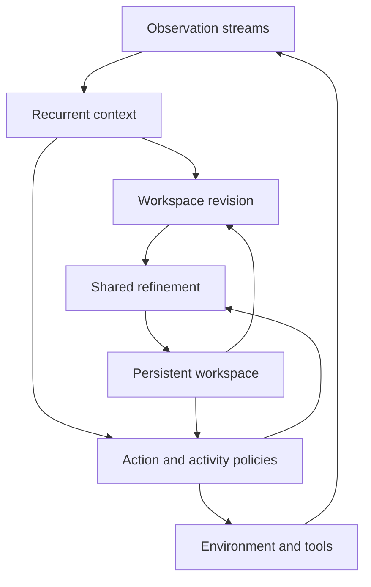

# Model architecture

**Implementation status:** this document specifies the neural CDM to build. The runnable code currently implements the separate [numerical transport experiment](experiments/transport/README.md).

CDM uses a recurrent state to track the current situation, a persistent latent workspace for continuing inference, and learned policies for actions and internal activities. Observation encoding, reasoning, prediction, and action are trained together on time-ordered interactions.



## State and computation

| Object | Representation | Update |
| --- | --- | --- |
| Context state \(h\) | Recurrent per-layer state | Arriving observations, executed actions, elapsed time, and goal updates |
| Workspace \(z\) | Fixed-capacity latent slots | Observation-conditioned revision and shared Transformer refinement |
| Progress features \(p\) | Timing, operation history, pending requests, predicted computation value | Completed operations and received outcomes |
| Experience memory \(M\) | Timestamped observation–action–outcome records | Selected retention and retrieval |
| Parameters \(\theta\) | Encoders, state transitions, prediction and policy networks | Offline training and scheduled online learning |

Goals and uncertain environment properties are represented through learned context and workspace features. Their encoding need not use natural language or assign one semantic label to each slot.

For event features \(e_t\), the main operations are

\[
h_t=R_\theta(h_{t-1},e_t,a_{\rm executed},\Delta t,g_t),
\qquad c_t=P_\theta(h_t,g_t).
\]

At the next completed computation boundary,

\[
\widetilde z_t=T_\phi(z_{t-1},c_{t-1},p_t,c_t-c_{t-1}),
\qquad z_t=F_\theta^{m_t}(\widetilde z_t,c_t).
\]

\(R\) assimilates events; \(F\) is a shared Transformer block operating on persistent slots and current context. \(T\) is a candidate revision operation. These equations describe one context interval. If another event arrives during refinement, incorporate it at the next short boundary and continue under the updated context.

The fast action policy reads the latest context and the latest completed workspace:
\(a_t\sim\pi_{\rm act}(c_t,z_{\rm ready},p_t)\).
An activity policy selects the next observation, retrieval, refinement operation, subgoal update, or wait interval. Actions already executing may continue while internal work proceeds.

## Observation and output interfaces

Each input includes source, capture time, arrival time, modality, and content. Encoders produce features for numeric sensors, images, audio, video, text, and tool results. The first neural experiment uses numeric sensors and structured goals; richer encoders can be attached through the same event interface.

Outputs include continuous controls, discrete instrument or tool commands, measurement requests, structured plans, and communication. Language, speech, or image generation uses task-specific decoders conditioned on the state. Internal operations can exchange latent representations directly.

A tool request remains a pending operation until its result arrives. A new instruction changes the goal or context. A gap in input permits continued reasoning, retrieval, prediction, or background learning. The model's own predictions are tagged separately from observations when reused as input.

The initial Python interface is a specification for implementation:

```python
state, decision, predictions = model.step(
    state=state,
    arrived_events=events,
    elapsed_time=elapsed_time,
    goal=goal,
    resources=resources,
)
```

`decision` contains an activity, arguments, and the current external action. State persists across calls and communication turns. Independent environment instances have separate state. Checkpoints distinguish model parameters, optimizer state, replay data, and live interaction state.

## Recurrent encoder and workspace

The initial engineering baseline uses Mamba-2 event recurrence and a small attention workspace. Compare it with a gated-delta recurrent core and a recurrent-memory Transformer using the same encoders, training trajectories, and output heads. The [sequence review](ref/SEQUENCE_MODELS.md) describes their update rules and computational differences.

Retain the earlier pilot settings as a starting configuration: eight recurrent blocks, width 512, and sixteen workspace slots. Compare one, two, four, and eight shared refinement steps before learning variable budgets. Report the measured parameter count, state bytes, training memory, and latency.

Workspace slots attend to one another, current context, recent observations, and retrieved records. Their task is to support useful predictions and decisions, including after interruptions. An action-conditioned prediction head estimates future observations, outcomes, and rewards. An optional explicit world model supports imagined trajectories; compare this with implicit latent refinement.

A learned projection of completed workspace updates can enter the context core as a typed internal event. This lets later observation and activity choices depend on reasoning progress without treating a simulated outcome as a received measurement.

## Observation-conditioned revision

The focused candidate is

\[
T_\phi(z,c,p,\Delta c)
=z+U_\phi(z,c,p)\,[V_\phi(z,c,p)^\top\Delta c].
\]

For flattened workspace dimension \(n\), context dimension \(d\), and rank \(r\), \(U\) has shape \(n\times r\) and \(V\) has shape \(d\times r\). Apply the factors directly. Compare ranks 4, 8, and 16 initially; factor generation, memory movement, and the update all count toward runtime.

The revision changes the state used by later inference. All comparison models also receive the latest observations at their action heads. This separates the benefit of a persistent internal update from the benefit of simply correcting the current action.

The additive form preserves the workspace when \(\Delta c=0\). It is a local response model; substantial context changes may require further refinement or reconstruction. Compare it with an unconstrained learned residual update, a fresh initializer, and ordinary carry-and-refine. These alternatives also test whether the low-rank factorization is useful.

The [mechanism note](research/COMPUTATION_TRANSPORT.md) derives finite-step and fixed-point sensitivities. Shared refinement and revision should be trained primarily for later task outcomes. Matching a same-depth reference state is an auxiliary experiment.

## Proactive activity selection

The activity policy receives context, workspace, elapsed time, pending operations, and resource use. Its initial choices are:

| Activity | Arguments | Consequence |
| --- | --- | --- |
| Observe | Sensor, resolution, measurement configuration | A delayed observation and measurement cost |
| Compute | Refinement block or imagined branch | Updated workspace after computation time |
| Retrieve | Query and record budget | Earlier observations and outcomes enter context |
| Act | Control or tool arguments | A change in the environment |
| Wait | Reconsideration time | Existing actions and pending operations continue |

Begin with a fixed overarching goal. Later add learned subgoals and learning-operation selection. Predictive heads estimate uncertainty, expected outcome, and the value of further observation or computation. Train choices from subsequent return, including time and resource costs.

This policy supplies the model's initiative. Continuous model execution supplies opportunities to choose; training determines whether the choices are productive.

## Time and execution

Record observation capture, arrival, incorporation, action generation, and action application separately. The simulator advances during encoding, retrieval, refinement, output generation, and physical execution.

Implement the first actor as short serial computation blocks. At each boundary it consumes newly arrived events, updates the context, and selects the next operation. A currently applied control persists between updates. This gives a measurable maximum interval before observations can affect computation.

After profiling, perception and action computation may run on separate streams or devices. That is an execution option, with state versions and transfer time included in measurements. Separate software tasks on one GPU do not by themselves provide independent low-latency execution.

Fast output can use current context before deeper workspace refinement finishes. Variable computation budgets therefore change the amount of internal work without requiring every action to wait for a complete plan.

## Experience and continued learning

Start with retained activations and fixed deployment parameters. Add bounded retrieval, then online updates to prediction and policy heads, then adapters or full-core training. Compare these changes separately and jointly.

A background learner consumes recent interactions and selected earlier experience. Actors use identified parameter snapshots. When state-producing parameters change, reconstruct state from a recent observation prefix or test a learned state conversion; record the treatment used.

Quiet intervals can be used for replay, world-model rollouts, prediction training, and distillation from deeper to faster decisions. Learning during those intervals is evaluated by later task performance and acquisition speed. The cost of maintaining the learner is included in the total computation budget.

## GPU computation

Fixed state capacity and workspace size bound actor memory. Matrix recurrence, attention over short slot sequences, batched projections, and low-rank products provide the main kernels. Parallel training uses independent environments and sequence batches; internal recurrence within one trajectory remains sequential.

Use mixed precision after numerical checks, profile kernel and transfer costs, and optimize the complete observation-to-action path. Chunked recurrent training can improve throughput where the chosen recurrence supports it. Runtime blocks are chosen for response latency rather than copied from training chunk sizes.

[TRAINING.md](TRAINING.md) specifies learning and distributed execution. [EXPERIMENTS.md](EXPERIMENTS.md) specifies the measurements used to choose the final backbone and revision mechanism.
