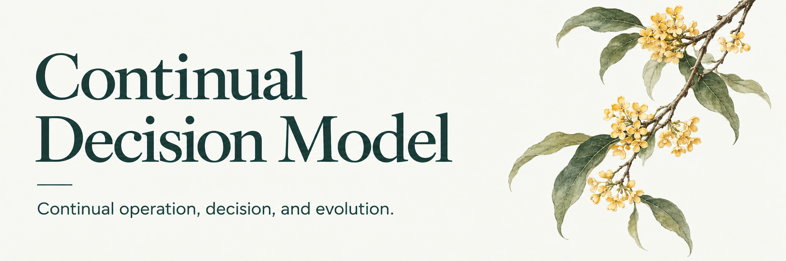

<p>
  
</p>

[Results](experiments/discoveryworld/RESULTS.md) · [Downloads](experiments/discoveryworld/RELEASE.md) · [Progress](HANDOFF.md) · [Status](STATUS.md) · [Research](RESEARCH.md) · [Model](DESIGN.md) · [Experiments](EXPERIMENTS.md) · [Run](RUNNING.md) · [References](ref/README.md)

**CDM studies how a model can keep perceiving, reasoning, acting, and learning while the world changes.** Internal state persists across interactions. The model learns external actions and the choice of its next observation or computation. A conversation is one event in that continuing process.

An observation can become outdated while inference is still running. The research question is how to preserve useful computation, incorporate new observations, and spend additional computation where it improves subsequent decisions.

The latest [physical-learning study](experiments/physical_belief/README.md)
connects accumulated knowledge to the predictions used for measurement and
control. Six joint trainings from two independent parents complete **117/120
and 116/120** new native tasks, against **115/120** for each parent, with **9.9%
and 15.1% fewer actual actions**. Matched ordinary continuation does not reproduce
this improvement. Cross-task memory contributes inconsistently: resetting the
same trained memory yields one more completion in each repetition, and rapid
recovery of a returning relationship remains unresolved. The results separate
the value of the complete training method from the effect of retaining memory.

The ongoing [continual physical-learning study](experiments/continual_physics/README.md)
connects those predictions to a persistent neural state and learned choices of
computation and online learning. All eight trainings and twelve primary native
conditions are complete; the full models fall below the preceding models.
They reveal mismatched training/execution costs
and a failure-feedback gap in decision confidence. Correcting the latter
raises one fixed model from 83/120 to 105/120 on new instances; its strong
parent still reaches 119/120. Both additional recurrent references are complete
and also fall below their parents. Four new trainings use a [native execution model](experiments/continual_physics/EXECUTION.md)
that reproduces device adjustment, feedback and actual operation costs.

Two completed comparisons inform this study. An independent
[Bayesian active-calibration reference](experiments/classical_calibration/RESULTS.md)
with relationship memory completes **118/120** new instances with **98.41** mean
native actions. Separately, [state interventions](experiments/continual_experiment/results/neural_state_controls.md)
on the earlier joint model locate its cross-task benefits and return costs in
GRU history; carrying its workspace does not change the measured task outcomes.
These comparisons guide the ongoing model study and its next state-update experiment.

A second native task, [Combinatorial Chemistry](experiments/continual_chemistry/README.md),
uses the recurrent architecture with a learned model of experimental outcomes.
On **60 new native instances**, all six conditions complete every task. Two
jointly trained models use **143.35 and 278.37** mean actions, against **367.38**
for the matched recipe-enumeration reference. Removing direct experimental
history from the first model raises its cost to **343.75** actions. This supports
learning useful relationships from earlier experiments. The two training runs
differ substantially, and the additional benefit of the recurrent-state readout
remains uncertain. [Complete comparisons](experiments/continual_chemistry/README.md#native-confirmation-of-history-conditioned-decisions)
include both runs, interventions and recipe-group uncertainty. Chemistry and
physical control currently use separately trained task adaptations.
An additional [Bayesian reference](experiments/continual_chemistry/BAYESIAN_REFERENCE.md),
given the public reaction-function family, completes the same 60 tasks in
98.60 mean operations. This stronger prior and the learned models' different
information requirements are explicit in the comparison.
The [v0.12.0 release](https://github.com/Cherish0925/continual-decision-model/releases/tag/v0.12.0)
provides all 320 training instances and four fixed chemical checkpoints.

## Current results

The scientific-task studies train the continuing core to choose what to measure
and when to test a setting, expand practice through alternative calibration
relations, and jointly learn physical prediction and experimental action. Earlier activity
scheduling and online cost-prediction studies remain part of the record.

[Results](experiments/discoveryworld/RESULTS.md) ·
[Method and reproduction](experiments/discoveryworld/ACTIVE_LEARNING.md) ·
[Models and experiment records](experiments/discoveryworld/RELEASE.md)

| Study | Result | Interpretation |
| --- | --- | --- |
| Physical prediction and action, two independent parents | **117/120 and 116/120** native completions, with **105.63 and 106.93** actions per task; matched parents both complete 115/120 with 117.18 and 125.91 actions | The complete training method improves native action efficiency. Same-weight memory interventions do not establish reliable old-context recovery. |
| Active measurement, two training seeds | Both persistent models complete **52/52** new instances from the training relation families, using **100.15 and 90.69** native actions on average; full measurement needs **242.13** | The trained policy learns to acquire useful evidence before collecting every measurement. |
| Continuing-state comparison | Across all 64 instances, persistent models complete **53/64 and 60/64**; separately trained ledger controls complete **51/64** each | Continuing state affects experimental decisions. Resetting the same trained weights gives 51/64 and 54/64. Transfer to the reserved relation varies across training seeds. |
| Alternative calibration practice, two independent parents | On a separate 64-instance cohort, both rehearsal models complete **62/64**, versus **54/64 and 60/64** for matched extra training | Both match full measurement's exact completed instances, with **53.1% and 54.6% fewer native actions**. Both complete all 12 instances of the relation without original native training examples. |
| Experience across experimental instances | On 184 instances in 20 changing-relation streams, carrying trained state completes **179/184 and 176/184**, with **32.9% and 31.7% fewer actions** than resetting the same weights at task boundaries | State reuses recent experimental experience. There is no consistent overall advantage over the frozen parents, and no clear efficiency gain on the first return to an earlier relation. |
| Joint activity and learning, two continuations | On a new 184-instance cohort, full models complete **179/184 and 174/184**, using **148.58 and 193.76** actions per instance; calibration rehearsal completes **179/184** with **116.32** | The shared training path runs, but the new models do not improve the quality–cost tradeoff over this reference. Online cost calibration and experimental decision quality must be evaluated separately. |
| Learning during process control | Retained online updates give error **0.153 ± 0.003**, versus **0.307** when discarded at matched compute, over three training seeds | Training through the updates used during deployment makes online learning useful in the controlled process tasks. |

The scientific experiments use nine explicit affine hypotheses and a numerical
setting tool. Rehearsal holds recorded measurements and public calibrations
fixed, generating alternative target relations for training. The relation
without native training examples is therefore practiced through generated
hypotheses. All policies run from task reset and pay for navigation, measurement
and adjustment. The matched controls, failures and instance-level data are
retained in the [results](experiments/discoveryworld/RESULTS.md).

Earlier scientific studies established autonomous execution and learned
selection between complete setting experiments. They also found that additional
forecasting or computation did not reliably improve decisions. The
[full record](experiments/discoveryworld/RESULTS.md) preserves those findings.
The [task-stream comparison](experiments/discoveryworld/results/active_stream.md)
measures experience carried between instances. The subsequent
[joint comparison](experiments/continual_experiment/README.md) connects activity
selection and parameter learning to the same policy. Useful adaptive computation,
rapid recovery after interference and learning that improves later experimental
decisions are now studied through the [physical-belief comparison](experiments/physical_belief/README.md).
Useful autonomous computation and reliable recovery after interference remain open.

## Model

The active-experiment policy reads structured public measurements and operation
feedback. Training updates **26.65 million parameters**, including **23.11 million**
in the inherited GRU and Transformer workspace. State continues across
measurements and the two experimental targets. The frozen visual encoders are
not used in this particular comparison.

The physical-learning model jointly updates that action core and 73 shared
parameters defining physical priors, uncertainty and context retrieval. Bayesian
posterior updates run during deployment and change the setting predictions.
The action network uses nine physical-context tokens when deciding what to measure.
This study fixes one workspace refinement per event and uses structured inputs.

The earlier integrated activity-and-learning model stores **42.93 million parameters**,
of which **27.82 million** participate in joint training. Its per-stream fast
and slow adapters add 128 online-updated scalar values. The new policy chooses
external experiments and internal refinement, retrieval and learning activities;
the numerical tools still fit physical relations and execute precise settings.

The earlier multimodal policy combines frozen SigLIP image/text features with
a persistent state, an action reader and exact experimental records. Its decision
network has about **0.053B** parameters; frozen perception adds about **0.375B**.
The successful early-reader comparison trained only 442,753 parameters; later
studies jointly trained the recurrent core and its task interfaces.

[DESIGN.md](DESIGN.md) specifies the broader model, including activity selection,
episodic retrieval and continued learning. The on-demand Qwen3.5-2B semantic
interface is implemented separately; it is not used by the successful scientific
policy. Qwen3.6-35B-A3B is a proposed offline teacher and has not generated the
current demonstrations. [TRAINING.md](TRAINING.md) distinguishes these routes
from the completed experiments.

The existing trained studies use these implementations:

- **Sequence core** ([cdm/model.py](cdm/model.py)): a GRU context over observations, goals, environment descriptors, previous actions and elapsed time; a workspace of latent slots refined by one shared Transformer block; a bounded record bank that stores intermediate work with its generating context, goal, observation-prefix index, parameter version and depth; conditioned reading with slotwise reuse, revision and initialization gates; action, activity and value heads.
- **Spatial planner** ([cdm/planner.py](cdm/planner.py)): a convolutional workspace over a grid, refined by one gated block and read out as an action and a distance for every cell. After a change it can restart, carry, retrieve stored workspaces, or read them with learned attention; it can read its workspace at the goal cell, rebuild channels through a learned keep-or-rebuild gate, split its workspace into map and goal parts, and read the age of every cell of a partial map.
- **Continual agent** ([experiments/continual_agent](experiments/continual_agent/README.md)): the spatial planner with an information state (the last seen map and the age of each cell) and an activity head that chooses each tick how many refinements to run, whether to request a full observation and whether to move, trained on reward minus computation and observation costs. Computation it leaves unused pays for online learning of the planner.
- **Continual core** ([cdm/core.py](cdm/core.py), [experiments/lifetime](experiments/lifetime/README.md)): one model that runs a process for a whole lifetime. A GRU fast state, a persistent workspace refined by a shared Transformer block over recent experience, and predictions of the next reading for every action through an instance-owned adapter feed heads that choose, every tick, the control, a precise measurement, and whether the compute until the next tick goes to refinement or to an update of the adapter. Trained with recurrent PPO over instrument and thermal process lifetimes; also run against processes on their own wall clock.

[DESIGN.md](DESIGN.md) gives the equations and interfaces; [research/CONTINUAL_COMPUTATION.md](research/CONTINUAL_COMPUTATION.md) develops the central hypothesis and summarises what has been measured.

## Implemented and measured

| Study | Implementation | Result |
| --- | --- | --- |
| [Neural pilot](experiments/neural_pilot/results/REPORT.md) | Five seeds, three model variants, supervised sequential contextual recall | Query accuracy: memory **56.20%**, persistent workspace **36.03%**, restarted workspace **38.44%** |
| [Dynamic grid](experiments/continual_grid/RESULTS.md) | Five seeds, three change regimes, two computation budgets; world advances during planning | Reuse helps at low budgets; this local factorization does not outperform nearest-context retrieval |
| [Numerical transport](experiments/transport/RESULTS.md) | Changing quadratic objectives and finite-depth state reconstruction | Tested correction loses to strong solvers; reconstruction quality and task quality differ |
| [Changing maze](experiments/dynamic_maze/RESULTS.md) | Neural latent planners act every tick while doors, obstacles and goals change; 14 variants with five seeds and 3 partial-view variants with three; shared budgets | A read of the workspace at the goal cell lets a goal change reach every cell in one refinement (affected cells right: 92.6% against 43.0% for carry); a learned keep-or-rebuild gate makes 83% right before any refinement without a hand-made split; at the training size the best planner earns the optimal policy's return within 0.01 with one refinement per tick |
| [Continual agent](experiments/continual_agent/RESULTS.md) | One running process over a stream of changing sites: partial view, asynchronous surveys, requests with idle periods; PPO-trained choice of refinements, surveys and moves; learning from unused compute | Three PPO seeds per planner: the learned activity head beats the best hand-written schedule on two of three planners (+0.048, +0.014) and ties on the third, with 42–51% fewer refinements and more surveys. Learning paid from unused compute raises the running agent's reward on larger mazes with a full view (+0.026, six paired runs); with a partial view it has not improved reward |
| [Lifetime](experiments/lifetime/RESULTS.md) | One 35.9 M-parameter model over instrument, thermal and vehicle lifetimes with unannounced, returning condition changes. First round: eight settings, five seeds of 2·10⁷ interactions each. Second round: the model trained through its deployed learning steps, workspace across events and copies of processes, three seeds; held-out dynamics; three families; control against an independent clock with power | First round: prediction supervision lowers tracking error from 0.146 to 0.109 without the policy reading a prediction; refinement and online learning add nothing, and the instance's updates slightly hurt. Second round: trained through the learning steps it actually takes, the model's own updates halve its error against discarding them at matched compute (0.153 against 0.307), on held-out dynamics and against a real clock. Unrolling the workspace and an adapter bank did not help; activity-value guidance was not effectively tested; retention of returning conditions and proactive work are not yet achieved ([phase review](research/PHASE_REVIEW.md)) |

[STATUS.md](STATUS.md) maps the full objective to code, measured results, and remaining work. Physical-learning models and complete records are in [v0.11.0](https://github.com/Cherish0925/continual-decision-model/releases/tag/v0.11.0). Joint-activity models, prepared data and complete comparisons are in [v0.10.0](https://github.com/Cherish0925/continual-decision-model/releases/tag/v0.10.0). Task-stream models are in [v0.9.0](https://github.com/Cherish0925/continual-decision-model/releases/tag/v0.9.0). Active-learning models and experiment records are in [v0.8.0](https://github.com/Cherish0925/continual-decision-model/releases/tag/v0.8.0). Earlier checkpoints and evaluations are in [v0.2.0](https://github.com/Cherish0925/continual-decision-model/releases/tag/v0.2.0), [v0.2.1](https://github.com/Cherish0925/continual-decision-model/releases/tag/v0.2.1) and, for the continual core, [v0.3.0](https://github.com/Cherish0925/continual-decision-model/releases/tag/v0.3.0) (first round) and [v0.4.0](https://github.com/Cherish0925/continual-decision-model/releases/tag/v0.4.0) (second round).

The neural pilot trains action prediction with a fixed memory-write schedule. The changing-maze planners and the continual agent run on GPUs; their training, evaluation and analysis commands are in the [maze](experiments/dynamic_maze/README.md#run) and [agent](experiments/continual_agent/README.md#run) READMEs.

## Run

Python 3.12 is the recorded environment. The numerical experiments require NumPy; the neural core uses PyTorch. Installation, CPU reproduction, CUDA commands, and profiling are in [RUNNING.md](RUNNING.md).

```bash
python experiments/continual_grid/run_experiment.py --output-dir runs/continual-grid
python experiments/neural_pilot/train.py --device cpu --output-dir runs/neural-pilot
```

Each command writes configuration and raw measurements to its run directory. Archived measurements remain alongside their experiment.

## Research map

Start at [HANDOFF.md](HANDOFF.md): what the experiments established, what failed and why, what is implemented against what is specified, and the next steps.

| Document | Contents |
| --- | --- |
| [HANDOFF.md](HANDOFF.md) | Research progress, evidence, unfinished questions and next steps |
| [STATUS.md](STATUS.md) | Capability coverage, measured performance, released artifacts, remaining research |
| [research/PHASE_REVIEW.md](research/PHASE_REVIEW.md) | Where the project stands after two rounds: goals, results, unsuccessful methods, hypotheses and the next phase |
| [RESEARCH.md](RESEARCH.md) | Objectives, proactivity, continuous operation, learning, applications |
| [DESIGN.md](DESIGN.md) | State, model operations, interfaces, and execution |
| [TRAINING.md](TRAINING.md) | Data, losses, activity learning, adaptation, GPU training |
| [EXPERIMENTS.md](EXPERIMENTS.md) | Current studies, primary comparisons, instrument task, scaling |
| [RUNNING.md](RUNNING.md) | Executable commands and next implementation steps |
| [ref/](ref/README.md) | 122 source records, reading depth, and closest related methods |

Target applications include robotics, electromechanical control, autonomous experiments, edge devices, and digital research. They require timely decisions, persistent context, and learning across continued interaction. [Eidolve](https://github.com/Cherish0925/eidolve) is a related knowledge and memory project; CDM can also connect to other tool and memory environments.

Original code and documentation use the [MIT License](LICENSE). External papers and implementations retain their own licenses. [CITATION.cff](CITATION.cff) identifies this project; include the commit used when reporting an experiment.
