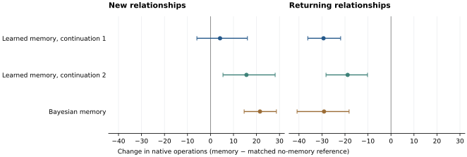

# Learning when previous experiments apply

The response-learning study established useful adaptation within one apparatus.
Its fitted correction reduced chemical operations in both joint-training
repetitions, but the supporting experimental ledger disappeared at the next
task. This study preserves those observations and learns to judge their
applicability from the results of new experiments.

The question is whether an agent can recover useful experimental knowledge
after interference, while adapting promptly when a relationship is new.
Returning tasks and new tasks are measured separately: rapid reuse can coexist
with expensive commitment to an inappropriate memory.

## Model and learning

One set of shared core weights serves physical control and chemistry, with
separate recurrent states for the two interfaces. Each chemistry task has its
own current ledger. At a task boundary, a six-slot archive retains up to the
latest 32 returned observations per task, replacing its oldest slot. Archive
entries contain public input proportions, available components, and observed
before/after outcomes. No recipe identity, instance seed, or scheduled return
label enters the model.

Each archived ledger defines a response predictor using the current shared
conditional-response network and the existing four-step functional update.
The predictor is reconstructed from observations, rather than an old hidden
state or a saved correction matrix. A separate predictor uses only evidence
from the current task. Mixture probabilities combine these possibilities.

For predictor j, the evidence accumulated before decision t is

```text
L_j(t) = sum_{s < t} log p_j(y_s | x_s, history_before_s).
```

Each term is computed before receiving the observation it scores. The learned
reader uses evidence relative to the current-task predictor, the number of
current returns, archive length, and archive age. Old predictors share a fixed
total prior mass; adding duplicate records cannot increase that mass by itself.
The current-task predictor remains an explicit alternative. Incompatible
public ingredient sets exclude an archive from the mixture.

The returned measurement is sometimes censored: unchanged rust c reveals only
that the latent response is at least c. Predictions are mixed at the latent
response level, then mapped to the observable outcome. Inner response fitting
and expert evidence use the same observation semantics.

The next actual return supplies the proper likelihood loss. It trains the
response network, functional update, and memory reader. The action policy also
trains from subsequent native-operation rewards and uses the mixed prediction
to rank experiments. In the inherited action interface, predicted probabilities
are detached from the policy-gradient path; the reader receives prediction
gradients, not a direct action-reward gradient. Shared core and action
parameters participate in joint training.

Task boundaries and archive writes are explicit. Writes are automatic, and
response fitting uses four internal updates. The inherited LEARN/CONSOLIDATE
activities continue to update the separate cost model. This experiment tests
learned knowledge reuse; it does not implement autonomous archive writing,
response-compute scheduling, or consolidation into long-term neural weights.

## Training and independent execution

Two existing jointly trained parents each initialize a memory condition and
a no-memory condition. These are paired continuations, not four independently
pretrained models. All four use 200 optimizer windows, batch 32, and 16 physical
plus 16 chemical requests per window. Chemistry selects and executes its own
experiments. Current responses, actual operation costs, and subsequent returns
provide training targets; unchosen experiments supply no outcome labels.

Training lifetimes contain twelve tasks with sampled novelty and return lags.
Raw archives persist between gradient windows; neural graphs detach between
windows. The matched no-memory condition performs the archive computation but
does not use archived forecasts. Its network and within-task update are trained
separately from the same starting weights and request budget.

The native cohort contains twenty twelve-task streams. Every stream uses one
public ingredient-count setting, so ingredient count alone cannot identify
which of its six chemical relationships has returned. The order is
`A B C A D E B F A C F D`, with a different native instance for every occurrence.
Physical tasks are interleaved between chemistry tasks. Model states remain
separate across domains and weights are shared.

There are 240 chemical and 240 physical instances per full condition. Of the
chemical tasks, 120 return to a previous relationship and 107 use named
compositions absent from training. The response family is still the official
cosine-threshold family; this is not transfer to unseen chemical laws. The
cohort was selected from new seed ranges before candidate execution, without
selecting outcomes. Budget is 400 physical or 1,000 chemical native operations.

| Comparison | What changes |
|---|---|
| Initial parent | Before this continuation, with no archive use |
| Trained no-memory model | Same initial weights and request budget; current-task response fitting retained |
| Learned experimental memory | Response predictors and applicability reader jointly trained |
| Same weights, archive disabled | Removes historical predictions from the trained memory model |
| Same weights, fixed evidence reader | Replaces the learned reader by its initialized evidence-weighting rule, including the same initial prior |
| Direct recipe retrieval | Tries recent observed-successful recipes still legal in this task, then uses the independently trained no-memory model |
| Same weights, neural state reset | Clears chemistry h/z at task boundaries, retaining its experimental archives |
| Bayesian memory / reset | Known reaction-family reference, with or without six archived task posteriors |

The fixed reader starts with current-task log prior 1 and total archived log
prior 0. It then accumulates predictive evidence with unit coefficient. This
matches the learned reader's initialization, avoiding a changed prior in the
comparison of learning itself. The Bayesian reference has a stronger explicit
prior: all official cosine-response hypotheses through six mixture parts. Its
memory uses half uniform prior and half the average of past task posteriors;
two-step experimental selection charges actual native operations.

All final endpoints are retained. Interventions confined to chemistry skip
repeating independent, unchanged physical executions. Completion, operation
counts including failures, and measured runtime are reported. Paired intervals
resample whole twelve-task streams, preserving dependence between task returns.
Same-history prediction analysis compares cached forecasts before each actual
return, separating memory's predictive effect from changed experiment choice.

## Completed native comparison

All four window-200 trainings and all sixteen native conditions have completed.
The 5,280 executions compare methods on the same 480 distinct task instances;
they are not 5,280 independent tasks. Every neural chemical condition completes
240/240 except direct recipe retrieval, which completes 238/240 in each
continuation. Bayesian memory and reset both complete 240/240.

Mean native operations include unsuccessful attempts and failures:

| Chemical condition | All, 1 | New, 1 | Return, 1 | All, 2 | New, 2 | Return, 2 |
|---|---:|---:|---:|---:|---:|---:|
| Initial parent | 78.22 | 79.17 | 77.28 | 84.30 | 84.80 | 83.79 |
| Trained no-memory | 91.26 | 93.85 | 88.67 | 83.90 | 84.74 | 83.07 |
| Learned experimental memory | 78.67 | 98.00 | 59.33 | 82.31 | 100.38 | 64.23 |
| Same weights, archive disabled | 89.12 | 88.60 | 89.63 | 89.21 | 91.10 | 87.32 |
| Fixed evidence reader | 77.65 | 96.58 | 58.73 | 81.98 | 100.80 | 63.17 |
| Direct successful-recipe retrieval | 132.70 | 171.56 | 93.83 | 126.58 | 161.23 | 91.92 |
| Neural state reset; archives retained | 77.62 | 96.30 | 58.93 | 81.13 | 103.43 | 58.83 |

Returning tasks use **33.1% and 22.7% fewer operations** than the independently
trained no-memory references. The paired differences are −29.33 [−36.18, −21.88]
and −18.83 [−28.25, −10.21]. Overall differences are −12.59 [−19.24, −5.63]
and −1.60 [−10.33, +7.52]; only the first continuation establishes an overall
advantage in this comparison. Against the frozen initial parents, both new-task
costs increase and neither overall difference is established. New-task transfer
cost therefore matters alongside successful recovery.



Intervals resample complete twelve-task streams. Each neural row compares with
its independently trained no-memory model; the Bayesian row compares with its
reset version. Negative differences mean fewer native operations.

The known-family Bayesian reference uses 90.47 operations overall, versus 94.25
for reset. Memory saves 29.10 [18.21, 40.83] operations on returns but adds
21.53 [14.63, 28.67] on new relations. The neural memory models use fewer
operations overall than this reference in both continuations; only the first
paired interval excludes zero. These methods have different learned and
explicit priors, as specified above.

The learned applicability reader does not outperform its initialized evidence
rule. Resetting chemical h/z while retaining the archive also does not remove
the return benefit. The established gain belongs to using experimental records
and predictive evidence; this study does not establish an additional gain from
learned reading or persistent neural state.

| Physical condition | Completed, 1 | Operations, 1 | Completed, 2 | Operations, 2 |
|---|---:|---:|---:|---:|
| Initial parent | 233/240 | 115.40 | 229/240 | 107.17 |
| Trained no-memory | 231/240 | 115.53 | 232/240 | 114.36 |
| Experimental memory | 232/240 | 113.59 | 234/240 | 104.44 |

These physical results retain the other task's actual outcomes; they do not
establish a uniform cross-domain improvement. Timing in the machine-readable
table includes concurrent CPU execution. The no-memory comparison still
computes and discards archive forecasts, so its runtime is not an optimized
no-memory deployment benchmark.

[All conditions and paired intervals](results/experimental_memory.json),
[every native execution](results/experimental_memory_instances.csv), and
[the fixed cohort](results/experimental_memory_cohort.json) preserve the full
comparison.

### Predictions on the same experiments

On the 1,322 and 1,378 actually chosen chemical experiments, historical
predictions lower next-return NLL from 0.7488 to 0.7227 and 0.7304 to 0.7100.
Both whole-stream difference intervals exclude zero. The effect separates
clearly by context: return NLL improves from 0.9054 to 0.7651 and 0.8538 to
0.7350, while new-task NLL worsens by approximately 0.043 in each continuation.

There are only 19 and 39 return queries absent from both current and archived
measurements when an applicable archive is present. Their mean improvements
are 0.2783 and 0.2012 nats; only the second interval excludes zero. This small
subset supports further investigation of prediction transfer, not a broad
claim that every reused benefit comes from generalizing to unmeasured recipes.
The six slots retain the latest six tasks, including duplicates; sufficiently
old relationships can be evicted. This capacity limit is preserved in the
[per-prediction analysis](results/memory_predictions.csv).

[Prediction summaries](results/memory_predictions.json) use forecasts cached
before their scored return, without changing the model's chosen history.

## Reproduction

From the repository root, with the published parent assets restored under their
documented relative paths:

```bash
python -m experiments.continual_experiment.launch_experimental_memory \
  --initial-root runs/continual_physics/response_replay_20261031/joint \
  --output runs/experimental_memory/train --updates 200 --batch 32

PYTHONHASHSEED=0 python -m experiments.continual_experiment.memory_manifest \
  --output runs/experimental_memory/cohort --workers 20

python -m experiments.continual_experiment.evaluate_memory \
  --training-root runs/experimental_memory/train \
  --manifest runs/experimental_memory/cohort/manifest.json \
  --output runs/experimental_memory/native --workers 10

PYTHONHASHSEED=0 OPENBLAS_NUM_THREADS=1 python -m experiments.continual_experiment.memory_reference \
  --manifest runs/experimental_memory/cohort/manifest.json \
  --output runs/experimental_memory/references \
  --initial-rng-root runs/experimental_memory/native/initial_rng --workers 20

python -m experiments.continual_experiment.analyze_memory_predictions \
  --native-root runs/experimental_memory/native \
  --manifest runs/experimental_memory/cohort/manifest.json \
  --output runs/experimental_memory/analysis

python -m experiments.continual_experiment.memory_controls \
  --training-root runs/experimental_memory/train \
  --manifest runs/experimental_memory/cohort/manifest.json \
  --output runs/experimental_memory/native --workers 8

python -m experiments.continual_experiment.export_memory_results \
  --input runs/experimental_memory
```

## Development comparison: retaining exact observations

An additional comparison asks whether re-fitting an archived ledger loses
important precision at already measured inputs. Within a candidate context,
an improving observation fixes the latent response; a non-improving observation
places a lower bound on it. The optional observed-response constraint applies
these facts to matching proportions, leaving other predictions unchanged.
Context selection still uses current experimental evidence.

This comparison uses eight six-task development streams, including instances
evaluated in earlier work. Each continuation uses one fixed intermediate
checkpoint for every condition (window 50 for continuation 1 and 100 for
continuation 2). These endpoints are not selected for the final comparison.

| Development condition | Operations, continuation 1 | Operations, continuation 2 |
|---|---:|---:|
| Experimental memory | 62.08 | 62.40 |
| Preserve exact observed responses | 62.08 | 62.40 |
| Same weights, archives disabled | 85.38 | 93.42 |
| Same weights, fixed evidence reader | 62.08 | 62.67 |

All 48 tasks complete in every condition. The exact-observation intervention
changes the tails of archived forecasts on repeated inputs, but neither the
chosen experiments nor their predicted actual outcomes change. The existing
functional fit already preserves these observations sufficiently for this
development comparison. More exact storage alone gives no additional task
benefit here. The complete comparison uses separately trained references,
new instances and the fixed final window-200 endpoints.

## Development: prediction inside an experimental plan

The two-experiment planner now conditions its hypothetical memory weights on
each predicted return. Previously it updated the hypothetical ledger and neural
state but left archive evidence unchanged. Imagined branches are isolated from
the actual experimental record. Explicit planning can also be selected when
the learned action policy is active.

The same development checkpoints and 48-task cohort give:

| Selection | Operations, 1 | Operations, 2 |
|---|---:|---:|
| Learned action policy | 62.08 | 62.40 |
| One-experiment completion/cost | 94.15 | 77.17 |
| Two experiments, frozen memory evidence | 74.46 | 79.52 |
| Two experiments, updated memory evidence | 70.81 | 78.48 |

Every condition completes 48/48. Accounting for memory evidence changes choices
and improves the two-experiment mean in both continuations, but neither planned
policy surpasses the existing learned policy. More forecast computation is not
adopted as the default from these results. These are development measurements,
not an additional independent confirmation set.

## Learning applicability from action returns

The completed comparison motivates a second paired training: can subsequent
task cost train better use of old knowledge? Four continuations start from the
two window-200 memory models. Each pair receives the same additional 100 joint
windows and request budget. Both use a reader learning rate of 0.001; one keeps
prediction-only supervision and the other also receives action-return credit.
The other parameter rates and objectives remain unchanged.

The action path uses detached expert forecasts and detached accumulated evidence.
Only the applicability reader receives the new gradient. Expert response models
continue to learn from actual outcome likelihood, and the shared core/action
interface retains its existing training. Before any optimizer update, enabling
the gradient path leaves action scores exactly unchanged. This separates an
effect of learning from a changed execution rule.

The evaluation queue uses ten new twelve-task streams: 120 physical and 120
chemical instances, including 60 chemical returns. It compares both final
endpoints with their memory parents, the earlier no-memory reference, and
same-weight archive/evidence interventions. The simulator families remain the
same. Results are pending; this modification is not yet an established gain.

```bash
python -m experiments.continual_experiment.train_memory_decisions \
  --initial-root runs/experimental_memory/train \
  --output runs/experimental_memory/decision_train --updates 100 --batch 32

PYTHONHASHSEED=0 python -m experiments.continual_experiment.memory_manifest \
  --output runs/experimental_memory/decision_cohort --streams 10 \
  --instances-per-difficulty 400 --chemical-seed-start 410000 \
  --physical-seed-start 490000 --workers 20

python -m experiments.continual_experiment.evaluate_memory_decisions \
  --training-root runs/experimental_memory/decision_train \
  --parent-root runs/experimental_memory/train \
  --manifest runs/experimental_memory/decision_cohort/manifest.json \
  --output runs/experimental_memory/decision_native --workers 8
```

## Relation to prior work

[MetaFun](https://proceedings.mlr.press/v119/xu20i.html) studies learned iterative
functional updates. [Episodic recall in meta-learning](https://proceedings.mlr.press/v80/ritter18a.html)
addresses repeated tasks and recovery of previous solutions.
[VariBAD](https://www.jmlr.org/papers/v22/21-0657.html) connects inferred task
uncertainty to action selection, and
[CN-DPM](https://openreview.net/forum?id=SJxSOJStPr) develops expert mixtures
for continual learning. Kernel adaptation, episodic recall, and task inference
are established ideas. This study asks whether a shared experimental model can
learn useful applicability judgments from its own returned observations, and
whether those judgments improve native task costs beyond fixed retrieval and
separately trained references. Its scientific contribution depends on that
comparison and the conditions under which reuse succeeds or fails.
