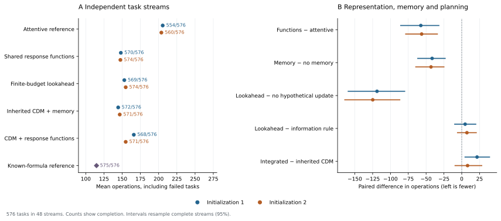
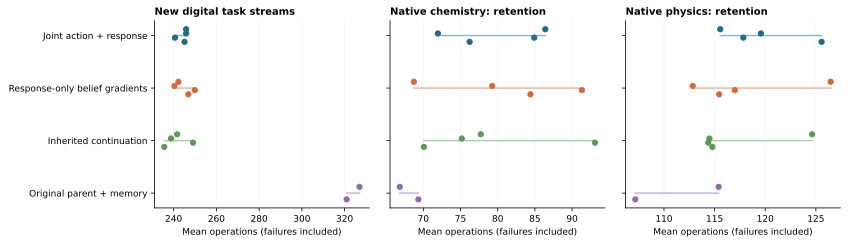

# Learning response functions from experiments

The [completed joint-learning comparison](#completed-joint-learning-results)
extends this study to twelve full shared-core continuations, broader task
transfer and native retention. The earlier frozen-core study is preserved below.

This study follows the [response-family comparison](RESPONSE_FAMILIES.md).
Its question is whether learning a joint prediction of several experiments
helps an agent infer an unfamiliar relationship and choose its next experiment.
The inherited CDM and its twelve experimental ledgers remain the practical
reference. A separate integration retains that model's action interface.

## What an observation should change

Two models can assign the same success probability to every individual
experiment and disagree about what one result implies for another experiment.
For example, under two equally likely relationships, experiments A and B may
always succeed together, or exactly one may succeed. Both have marginal success
probability one half. A failed A rules out B in the first case and identifies B
as successful in the second.

We represent this dependence with a learned latent response function. A single
latent index is shared by all proposed experiments. Measurements change the
posterior over those indices and therefore change predictions of experiments
that have not been performed.

## Predictive model

The model learns 512 latent vectors and a shared neural decoder. The decoder
maps a composition and latent vector to probabilities of four intrinsic response
levels. These are probabilistic functions: a component can remain uncertain
about an individual outcome. The prior depends on the public ingredient count.
Neither the generating formula nor the simulator's relationship identity is
an input.

For measured history \(H=\{(x_i,b_i,y_i)\}\), where \(b_i\) is the pre-experiment
response level, the posterior is

\[
w_k(H)\propto \pi_k\prod_i p_\theta(y_i\mid x_i,b_i,z_k).
\]

The observed response is the minimum of the intrinsic level and \(b_i\).
Consequently, no improvement at level one is evidence for intrinsic levels
one, two **or** three. The likelihood sums this censored tail. It does not
label all such measurements as intrinsic level one.

Training maximizes the conditional **joint** likelihood of later measurements
given an earlier context. The same latent explains the sequence. The final
decoder multiplies projected composition features by latent-dependent scales
and adds latent-dependent offsets. An additive decoder is retained as a
comparison. There are 106,500 and 94,020 parameters, respectively.

This is a finite latent-variable response model, related to
[Neural Processes](https://arxiv.org/abs/1807.01622). The factorized references
use a [Conditional Neural Process](https://proceedings.mlr.press/v80/garnelo18a.html)
and an attention-based conditional predictor informed by
[Attentive Neural Processes](https://arxiv.org/abs/1901.05761).
The latter is our deterministic cross-attention implementation, not a claim to
reproduce the original paper's full latent architecture. Function mixtures,
conditioning and experimental information gain are established ideas.

## Shared training observations

All three predictors receive the same measured corpus: 8,192 response laws
with three ingredients and 8,192 with four. Each has 48 distinct measurements,
for 786,432 measured input–output pairs. The five training families are cosine,
metric, interaction, inhibition and multiple solutions. Generating laws are
used by the simulator to return observations; formula labels are not stored in
the training tensors.

A new replica starts after six measurements or an earlier completion. Each
replica is charged preparation, experiment and completion operations. This
produces more informative observations than repeatedly measuring a nearly
finished device. It is a declared digital training protocol, not a claim about
official DiscoveryWorld trajectories. At execution there is one apparatus per
task, with a 1,000-operation limit and no free resets.

The first comparison trains two initializations of each predictor for 6,000
updates. Development results motivate a fixed 24,000-update comparison of the
additive decoder, multiplicative decoder and attentive reference. Each uses
batch 128, identical per-seed sample sequences, AdamW at initial rate 0.0003,
and the same cosine schedule. Context lengths are 0, 2, 4, 8, 16 or 24.
The last update is the evaluated endpoint. The comparison matches observations
and updates; parameter counts and floating-point operations differ.

Both training initializations share a corpus. They measure optimization
variation, not independent data collection. The archived CDM parents have
different earlier training histories; comparisons with them test practical
performance and do not isolate the effect of joint likelihood alone.

## Actions, memory and compute

The standalone policy compares immediate completion per operation, completion
plus information gain, and an approximate two-step rule. The information
coefficient is fixed at 0.5. The first two-step approximation uses the ratio of
cost to success probability for its continuation value. Development results
show it can be poor. That continuation is a repeated-trial approximation,
whereas the executable task excludes already failed recipes.

A subsequent finite-order comparison replaces that approximation with the
expected cost of trying **different** remaining experiments within the remaining
budget. Its first hypothetical observation changes the posterior; its tail
uses a fixed completion order. This is one adaptive lookahead with an ordered
tail, not a complete search tree. A matched `finite_marginal` intervention
retains actual observation updates but disables the hypothetical posterior
update. Both include the four-operation exit and failed-task costs.

The standalone model retains up to twelve actual ledgers. At a task boundary,
each ledger is reconditioned under the same decoder. Their mean posterior
receives prior mass 0.45 and the fresh prior receives 0.55. This tests inference
from retained observations; it does not consolidate knowledge into weights
during deployment.

The CDM integration uses a separate, fixed prior of one half over the inherited
predictor and the new response-function predictor. Observed sequence likelihood
updates that mixture. The old archive reader continues receiving its original
pre-return predictions. The inherited progress/cost ranking, actor residual,
GRU, workspace and physical interface remain intact. The integration adds the
new predictor without updating those inherited weights. It is not a new joint
core training or a demonstration of autonomous compute allocation.

## Evaluation

The existing 192-task development cohort selects a rule for each predictor by
summed completion over both initializations, then mean operations. A separate
576-task test cohort was generated before these comparisons: 48 complete
twelve-task streams, including wider parameters and the withheld
interaction–inhibition combination. Discrete target compositions can recur
across splits. This is a digital extension, distinct from official native
tasks and from broad cross-domain generalization.

All methods receive only actual returned observations during execution.
Costs include failed tasks. Paired intervals resample complete streams, keeping
task-return dependencies together. The known-formula reference has additional
generator knowledge. The same-weight no-memory and hypothetical-update controls
answer different questions and are reported separately.

Native chemical comparisons reuse the saved initial states and twenty
twelve-task streams from the earlier memory study. The integration's physical
weights and shared-core weights are identical to their respective parents;
native chemical executions check the changed interface. The separated-domain
state protocol does not demonstrate transfer through a common evolving state.

## Completed results



[Machine-readable comparisons](results/function_belief.json),
[all task rows](results/function_belief_instances.csv),
[native comparisons](results/function_belief_native.json), and
[training curves](results/function_belief_training.csv) are the numeric sources.

Twelve predictor trainings are complete. Their recorded optimization loops
sum to 697.9 seconds on the two H100s; this excludes corpus generation, process
startup and task execution. These are small predictor trainings. The inherited
CDM core is frozen throughout this study.

Each cell below gives **completed tasks / 576; mean operations**, including
failed tasks. The two columns are independent predictor initializations on
the same corpus and task streams.

| Method | Initialization 31 | Initialization 32 |
| --- | ---: | ---: |
| Attentive conditional reference | 554; 205.56 | 560; 203.76 |
| Additive function decoder, information rule | 569; 156.17 | 566; 163.03 |
| Modulated function decoder, information rule | 570; 148.16 | 574; 147.53 |
| Same functions, no task archive | 575; 189.72 | 575; 190.63 |
| Original CDM with twelve ledgers | 572; 144.48 | 571; 146.64 |
| CDM with direct evidence-mixture integration | 568; 165.95 | 571; 154.81 |
| Known-formula reference | 575; 114.75 | Same reference |

Relative to the attentive reference, the modulated model saves 57.40
[32.05, 85.64] and 56.23 [34.16, 78.66] operations, with 16 and 14 additional
completions. Its differences from the original CDM are +3.68 [−14.71, 22.67]
and +0.89 [−20.85, 23.82]. These results establish a competitive learned
response representation; superiority over the existing strong model remains
unestablished.

The archive saves 41.57 [23.24, 61.71] and 43.10 [24.95, 64.49] operations
relative to removing it from the same weights. Completion falls by five and
one tasks, respectively. Retention therefore improves mean search cost while
sometimes transferring an unsuitable prior. Cost and completion must be read
together.

### The continuation model changes the value of lookahead

| Planning rule, same response functions | Initialization 31 | Initialization 32 |
| --- | ---: | ---: |
| Repeated-trial approximation with hypothetical updates | 512; 319.57 | 508; 338.18 |
| Same approximation without hypothetical updates | 540; 229.18 | 542; 234.17 |
| Finite non-repeating completion order with hypothetical updates | 569; 152.94 | 574; 154.80 |
| Same finite order without hypothetical updates | 568; 271.79 | 571; 279.66 |

Under the finite-order model, hypothetical posterior updates save 118.86
[80.03, 159.32] and 124.85 [86.91, 164.06] operations. Both controls still learn
from **actual** returned experiments. The intervention isolates the use of
hypothetical observations in choosing the next experiment.

Under the repeated-trial approximation, the same kind of update instead adds
90.39 [54.15, 125.35] and 104.02 [68.12, 140.67] operations. More detailed
reasoning can optimize an inaccurate continuation model. Correcting that
model changes the sign of this intervention. The finite planner still does
not outperform the cheaper information rule; useful conditional inference
does not establish a benefit from additional computation over the best rule.

### Direct integration does not preserve native efficiency

On the original native chemical cohort, the evidence-mixture integration
completes 239/240 and 240/240 tasks at 91.93 and 91.35 operations. The inherited
parents complete 240/240 at 66.84 and 69.34. The new predictor therefore does
not replace the recommended native model. Its shared core and physical
interface have unchanged weights; the changed chemical predictions and their
use by the inherited ranking cause a different policy.

The current evidence supports learning coherent alternatives and using them
in an appropriate finite-cost decision model. It leaves decision-level
integration, autonomous compute allocation, independent-time operation and
parameter consolidation open. The next integrated training must optimize
subsequent native task cost as well as predictive likelihood. A likelihood
mixture alone has not supplied that connection.

## Reproduce

Run from the repository root in the project's environment:

```bash
python -m experiments.continual_experiment.train_relation_belief \
  --prepare --data runs/continual_physics/function_belief_20261103/data
python -m experiments.continual_experiment.run_relation_training \
  --root runs/continual_physics/function_belief_20261103 --phase initial --updates 6000
python -m experiments.continual_experiment.run_relation_training \
  --root runs/continual_physics/function_belief_20261103 --phase refinement --updates 24000
python -m experiments.continual_experiment.compare_relation_belief \
  --root runs/continual_physics/function_belief_20261103 \
  --models long modulated attentive_long --series refined --candidate modulated
python -m experiments.continual_experiment.compare_relation_belief \
  --root runs/continual_physics/function_belief_20261103 --stage test \
  --models long modulated attentive_long --series refined --candidate modulated
python -m experiments.continual_experiment.compare_relation_belief \
  --root runs/continual_physics/function_belief_20261103 \
  --models modulated --rules finite_plan finite_marginal --series finite
```

The final finite-planning comparisons use the same test manifest and the
`evaluate_relation_belief` entry with `--selection finite_plan` or
`--selection finite_marginal`. The integration entry is:

```bash
python -m experiments.continual_experiment.integrate_relation_belief \
  --parent runs/continual_physics/experimental_memory_20261101/train/memory911/initial.pt \
  --predictor runs/continual_physics/function_belief_20261103/train/modulated31/last.pt \
  --output runs/continual_physics/function_belief_20261103/integrated/cdm31.pt
```

Repeat for predictor 32 and parent 912. Evaluate those checkpoints with
`evaluate_response_families`, then `evaluate_shared_tasks --chemistry-only
--state-sharing separated --memory-mode evidence --memory-slots 12`. The
saved native initial states and full command plans accompany the release.

Training records retain every declared endpoint. Evaluation refuses unfinished
checkpoints. The initial development run that overlapped attentive training was
excluded and repeated on the fixed final checkpoints before rule selection.

## Joint prediction and action learning

The follow-up asks whether the response model can learn distinctions that
improve subsequent experimental decisions. The preceding integration changed
predictions used by an already trained policy. Here the inherited forecasts
and action scores are preserved initially, and an additional action residual
learns from both observed responses and subsequent task return.

For each candidate experiment and possible **observable** result, the model
computes the corresponding posterior mean of its latent response functions.
The action residual receives the probability-weighted change from the current
mean, the four outcome probabilities, expected information gain and the
inherited action features. It does not receive a simulator formula, target
composition or law identifier. The final linear layer starts at zero, so
attaching it preserves the parent's action scores exactly before training.
This is one hypothetical conditioning step, not an imagined full execution
tree. Precise recipe execution remains the existing tool interface.

In equations, let $w_k$ be the probability of response function $k$ after
the observed history, and let $p_k(y\mid x)$ predict the observable outcome
of candidate experiment $x$. The hypothetical update is
$w_k^{x,y}=w_k p_k(y\mid x)/\sum_j w_j p_j(y\mid x)$.
The decision head receives the four separate vectors
$p(y\mid x)[\sum_k w_k^{x,y}z_k-\sum_k w_k z_k]$, together with
the outcome probabilities, information gain and inherited action features.
Keeping these vectors separate matters: their probability-weighted sum is
zero, whereas each outcome can imply a different next action.

The action-return gradient now reaches the same latent vectors and decoder
that predict observed responses. The inherited action path previously evaluated
response forecasts without gradients. The new differentiable path is explicit;
the parent forecast path and memory mechanism keep their existing behavior.
Actual selected experiments supply a censored response likelihood with weight
0.5. The existing actor-critic objective, physical learning loss and chemical
response/cost losses are retained.

There are three fixed continuation conditions:

| Condition | Response-function training | Decision training |
| --- | --- | --- |
| Joint | Selected-response likelihood and subsequent action return | Inherited policy and new belief residual |
| Prediction only | Selected-response likelihood; belief features detached from action return | Identical residual, shared core and task interfaces |
| Inherited continuation | No added response-function model | Existing policy, shared core and task interfaces |

The first two conditions have identical parameters and forward computations.
Their distinction is the gradient from decisions into response hypotheses.
All conditions train the common GRU and Transformer workspace and both task
interfaces. Each has four continuation runs, derived from two released
parents; runs 201/203 share parent 911, and 202/204 share parent 912. Their
continuation RNG seeds are 1701--1704; their response-predictor initialization
seeds are 201--204. The four response predictors share the
preceding measured corpus. These are four continuation repetitions, not four
independent pretrained backbones or independently collected corpora.

Each continuation uses 256 optimizer windows, batch 12, eight physical requests
and eight chemical requests per lane and window. Its endpoint is the final
window. No final-test checkpoint selection is used. Chemical training expands
the five earlier response families with absolute-distance and bottleneck
responses. Public ingredient identifiers are consistently permuted within a
twelve-task lifetime. This changes observable names without revealing the
hidden law or altering which simulator relationships are sampled. Training
continues to use three/four ingredients and primitive recipes of at most six
parts.

The continuation comparison matches update counts, external-request allowance
and initial simulator seeds. Policies select their own experiments, so their
subsequent measured observations and completed training tasks can differ.

Learning sequential experimental decisions from history is related to
[Deep Adaptive Design](https://proceedings.mlr.press/v139/foster21a.html);
conditioning decisions on task uncertainty is related to
[VariBAD](https://arxiv.org/abs/1910.08348). The comparison here concerns the
use of a learned response-function distribution by a continuing shared model,
its action-gradient contribution and retention under changing task conditions.
It does not claim to introduce latent beliefs or adaptive design themselves.

### What the broader test measures

The fixed cohort contains **84 independently generated twelve-task streams**,
or **1,008 task instances**, across these groups:

| Group | Streams | Change relative to training |
| --- | ---: | --- |
| New parameters | 24 | New sampled laws and task-return sequences |
| Wider parameters | 12 | Wider metric and interaction parameters |
| Held-out combination | 12 | Interaction and inhibition jointly determine responses |
| Held-out threshold relation | 12 | Conjunction of total and worst-component discrepancy |
| New target ratios | 12 | Primitive targets require seven/eight parts, absent from both training stages |
| Five ingredients | 12 | One more ingredient than either training stage |

Twelve additional streams replay the first twelve streams of the standard
stream group with consistently renamed public ingredients: 144 task replays.
They are paired sensitivity tests, excluded from the primary 1,008-task
aggregate and its uncertainty intervals. New random parameters do not
guarantee unique discrete target ratios; only the explicitly withheld target
group provides that separation.

The original parents with twelve ledgers and a simple information-gain policy
using each frozen pretrained response model are evaluated on the same streams.
The information policy has no joint core continuation, so that comparison is
practical rather than an equal-training-data attribution. The matched
prediction-only condition isolates the new gradient connection more closely.
Costs include failures, and intervals resample whole streams separately for
each training repetition. Naming replays and repeated methods are never
counted as additional independent tasks.

Native evaluations repeat the original twenty streams with the same saved
world initializations: 240 physical and 240 chemical tasks per model. These
measure retention on an existing cohort. They are not additional held-out
DiscoveryWorld task families. The digital variations broaden the tested
response mechanisms while retaining a common structured experiment interface;
they do not establish open-ended scientific research ability.

### Completed joint-learning results

All four predictor trainings and twelve 256-window continuations are complete.
Eighteen digital conditions use the same 1,008 primary instances and 144 naming
replays. Twelve native comparisons add 5,760 executions on the original
480-instance cohort. Counts of executions do not increase the number of
independent tasks or training repetitions.



Each dot is one trained endpoint; horizontal lines span the run means and
are **not** uncertainty intervals. All panels include failed-task costs.
Completion counts and stream-paired intervals are reported below and in the
[complete digital comparison](results/joint_belief.json),
[native comparison](results/joint_belief_native.json),
[per-instance records](results/joint_belief_instances.csv),
[native records](results/joint_belief_native_instances.csv),
[same-history forecasts](results/joint_belief_predictions.json) and
[training curves](results/joint_belief_training.csv).

Each cell gives **completed tasks / 1,008; mean operations**. The denominator
is shared across columns, not multiplied into a larger independent test set.

| Method | Run 201 | Run 202 | Run 203 | Run 204 |
| --- | ---: | ---: | ---: | ---: |
| Original parent + twelve ledgers | 867; 326.96 | 883; 320.94 | Same as 201 | Same as 202 |
| Inherited continuation | 956; 241.64 | 963; 238.78 | 952; 249.08 | 966; 235.61 |
| Response-only belief gradients | 950; 242.23 | 952; 240.36 | 947; 249.90 | 951; 246.88 |
| Joint action + response gradients | 952; 245.84 | 959; 245.87 | 961; 240.64 | 959; 245.10 |
| Frozen response model + information rule | 882; 321.05 | 884; 325.22 | 870; 309.73 | 873; 309.52 |

The joint models improve on their original parents by 85, 76, 94 and 76
completions, while reducing mean cost by 24.8%, 23.4%, 26.4% and 23.6%.
Each run's stream-paired intervals support both improvements. The independently
continued inherited policy reaches similar performance, so these gains do not
isolate a benefit of the new response representation or action-gradient path.

The table below reports joint-model cost minus each matched control, with
95% intervals from resampling complete task streams. Negative values favor
joint training. Intervals describe uncertainty over these task streams for
each endpoint; they are not a population estimate over training seeds.

| Run | Minus response-only gradients | Minus inherited continuation |
| --- | ---: | ---: |
| 201 | +3.61 [−6.30, 13.17] | +4.20 [−8.63, 15.74] |
| 202 | +5.51 [−6.81, 18.19] | +7.08 [−4.13, 18.86] |
| 203 | −9.27 [−18.15, −0.58] | −8.44 [−17.19, 0.75] |
| 204 | −1.78 [−9.83, 6.43] | +9.49 [0.17, 19.63] |

Run 203 improves both cost and completion over its response-only control.
The other runs do not establish that cost benefit, and run 204 costs more
than inherited continuation. Thus action-return training of the response
functions has a positive result in one repetition, without a stable advantage
across repetitions. All endpoints are retained; none was chosen using this test.

**Transfer varies with the change in task.** Across the four joint endpoints,
the withheld interaction–inhibition group completes 139–143/144 tasks and the
new threshold relation 136–139/144. New seven/eight-part target ratios complete
133–136/144, while five-ingredient tasks complete 121–131/144 and require
344–386 operations. Inherited continuation completes 128–132/144 of the latter
tasks at 323–349 operations. Broader practice improves the overall test without
making the added belief interface uniformly stronger on structural changes.

Consistently renaming the same ingredients adds 23.15, 10.01, 2.44 and 19.57
mean operations to the joint endpoints; all four paired cost intervals include
zero. Completion changes are −2, 0, −2 and 0 out of 144. This paired test checks
sensitivity to observable names; it neither establishes exact permutation
invariance nor rules out every possible shortcut.

**Prediction improves before a reliable decision advantage emerges.** On each
joint model's actually selected experiments, the response-function forecast
has lower negative log likelihood than the inherited forecast. Both are scored
on the same returned observation within each run:

| Run | Returned experiments | Inherited NLL | Response-function NLL |
| --- | ---: | ---: | ---: |
| 201 | 15,888 | 0.5382 | 0.4591 |
| 202 | 15,950 | 0.5478 | 0.4643 |
| 203 | 15,622 | 0.5366 | 0.4663 |
| 204 | 15,903 | 0.5366 | 0.4707 |

NLL is in nats per observed outcome. These are on-policy measurements:
histories differ between trained models. They establish a predictive difference
on the selected experiments, not the causal effect of that difference on actions.
The likelihood and decision results together narrow the remaining question to
which forecast distinctions improve subsequent choices and costs.

**Native competence is not fully retained.** Each domain has the original
240 instances, with identical saved initial states. Cells give completed
tasks and mean operations:

| Endpoint | Native physics / 240 | Native chemistry / 240 |
| --- | ---: | ---: |
| Parent 911 + twelve ledgers | 233; 115.40 | 240; 66.84 |
| Parent 912 + twelve ledgers | 229; 107.17 | 240; 69.34 |
| Joint 201 | 229; 115.56 | 240; 86.40 |
| Joint 202 | 230; 119.57 | 240; 71.96 |
| Joint 203 | 227; 117.84 | 240; 84.91 |
| Joint 204 | 229; 125.56 | 240; 76.22 |
| Response-only 201 | 219; 126.45 | 240; 68.72 |
| Response-only 202 | 232; 112.84 | 240; 79.27 |
| Response-only 203 | 229; 117.00 | 240; 91.33 |
| Response-only 204 | 236; 115.45 | 240; 84.40 |
| Inherited 201 | 216; 124.63 | 240; 77.72 |
| Inherited 202 | 232; 114.49 | 240; 75.17 |
| Inherited 203 | 233; 114.38 | 239; 93.09 |
| Inherited 204 | 230; 114.78 | 240; 70.08 |

All joint endpoints complete the chemical cohort but cost more than their
parents; physical completion and cost also vary. The original parent with
twelve ledgers remains the native reference. This study supports broader
training as an effective route to new-task performance. It leaves a combined
advantage in transfer, native retention and action-conditioned learning open.
Independent-time operation and deployment-time parameter consolidation are
not added by this comparison.

[v0.17.0](https://github.com/Cherish0925/continual-decision-model/releases/tag/v0.17.0)
contains all initial/final models, training inputs and completed experiment
records. [Download and replay](../discoveryworld/RELEASE.md#joint-prediction-and-action-training-v0170).

### Operations on tasks both policies complete

The primary comparison counts every task, including failures. To separate solving more tasks from using fewer operations on tasks both methods solve, pair the [task rows](results/joint_belief_instances.csv) by stream and task index, exclude renamed replays, and keep the shared successes for each pair. Differences below are joint minus reference. The subset changes with the reference.

| Run | Both complete: original parent | Mean operation difference | Both complete: inherited continuation | Mean operation difference |
| --- | ---: | ---: | ---: | ---: |
| 201 | 841 | −23.64 | 933 | +6.02 |
| 202 | 857 | −27.42 | 941 | +0.28 |
| 203 | 845 | −25.31 | 943 | −5.72 |
| 204 | 855 | −32.46 | 941 | +6.30 |

The joint models save operations on shared successes against both original parents. Against independently continued policies, three of four joint endpoints use more operations on shared successes. The pattern also appears early in the recorded trajectories: by operation 100 the joint endpoints have completed **462, 465, 460, 458** tasks, versus **470, 478, 453, 478** for inherited continuation. These counts describe the recorded policies at a common action count; they are not reruns under a shorter deadline or measurements of wall-clock latency.

### Running the fixed comparison

The four pretrained response models use seeds 201--204 and 24,000 updates with
the modulated decoder. Place their final checkpoints at
`predictors/seed201/last.pt` through `predictors/seed204/last.pt` below the run
root. The run plan records all twelve continuation commands.

```bash
python -m experiments.continual_experiment.joint_belief \
  --root runs/continual_physics/joint_belief_20261103 --stage plan
python -m experiments.continual_experiment.joint_belief \
  --root runs/continual_physics/joint_belief_20261103 --stage predictors
python -m experiments.continual_experiment.joint_belief \
  --root runs/continual_physics/joint_belief_20261103 --stage train --parallel 4
python -m experiments.continual_experiment.joint_belief \
  --root runs/continual_physics/joint_belief_20261103 --stage references --workers 8
python -m experiments.continual_experiment.joint_belief \
  --root runs/continual_physics/joint_belief_20261103 --stage test --parallel 4 --workers 12
python -m experiments.continual_experiment.joint_belief \
  --root runs/continual_physics/joint_belief_20261103 --stage native --parallel 4
python -m experiments.continual_experiment.publish_joint_results \
  --root runs/continual_physics/joint_belief_20261103
```

The scheduler dispatches ready comparisons without occupying a worker while
their dependencies are still running. Joint-gradient training uses about
37 GiB per process; the detached and inherited controls permit additional
concurrency where memory is available. Matching updates and external requests
does not match floating-point operations. Evaluations wait for the final
training marker before loading that model. The run record
retains an early resource-interrupted attempt, excluded from the fixed final
comparison; all reported models restart from their declared initialization.
CPU process interruptions were rerun with fixed weights on CUDA. Completed
native streams can be recovered with `evaluate_shared_tasks --resume`; an
incomplete stream restarts from its original state, preserving the interrupted
files separately. Concurrent execution times and host interruptions are retained
in the records and are not used as deployment-latency measurements.
