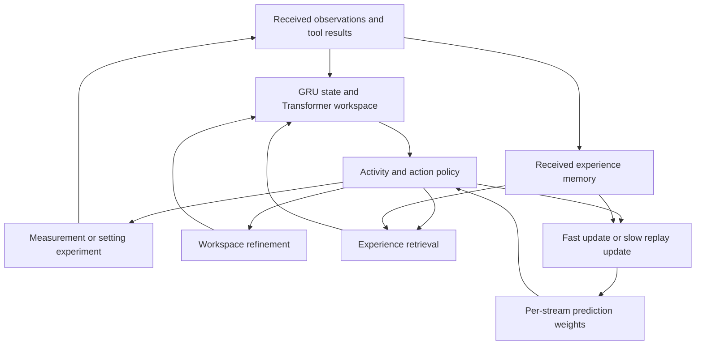

# A shared training path for continual decisions

This implementation connects the v0.9 scientific-task core to learned internal
activities, experience retrieval and deployment-time prediction updates. The
research question is whether choosing **how to compute and learn**, alongside
**what to measure and do**, improves performance over a changing task stream.

The implementation is runnable. Its new scientific-task performance has not yet
been measured. Existing v0.9 results remain results of the original model.

## Model



The existing core, candidate representations and action interface remain
trainable. Loading a v0.9 checkpoint preserves its action scores at initialization:
new action corrections start at zero and greedy activity selection starts with
ACT. The outer optimizer starts fresh. This allows the method to start from an
existing working policy while learning the additional mechanisms jointly.

| Part | Implementation |
| --- | --- |
| Observation update | One GRU update and one workspace refinement per received event. Additional computation does not ingest the event again. |
| Internal policy | ACT, REFINE, RETRIEVE, LEARN, CONSOLIDATE, WAIT. Availability depends on executable actions, received memories, pending tools and an internal compute budget. |
| Action interface | The existing 20 measurement requests and nine hypothesis-conditioned setting experiments. Native execution still uses the numerical and navigation tools. |
| Experience | A bounded per-stream tensor bank of selected-action features, returned test success and execution cost. Writes follow returned outcomes; retrieval is learned. |
| Prediction | Shared prediction weights plus fast and slow per-stream linear adapters. Predictions affect action scores through a learned projection. |
| Learning | LEARN updates fast weights; CONSOLIDATE updates slow weights from received experience. Both updates are differentiated through during outer training and remain executable without autograd during deployment. |
| Multimodal input | Optional projected encoder tokens attend into the same workspace. The present training dataset supplies structured observations; it does not train the multimodal path. |
| Asynchronous use | A session accepts unsolicited observations while one tool request is pending. It can continue internal work and then yield until another event arrives. |

For stored features X and targets Y, an update uses

`W <- W - sigmoid(eta) X^T (predictor(X) + X(W_fast + W_slow) - Y) / N`.

Fast weights decay at each received observation; slow weights remain until an
explicit model-state reset. This provides two retention timescales. It is a
prediction-adaptation mechanism, not yet general skill acquisition or a learned
latent world simulator. Memory features are stored at action selection time;
outer training uses truncated backpropagation through time.

`ContinualSession.receive()` consumes ordered events exactly once.
`tick()` returns an internal activity, a tool request with a request ID, or WAIT.
A result identifies the pending request. Observation arrival is separate from
tool completion. The synchronous DiscoveryWorld evaluator uses the same model
but does not simulate an independently moving world during internal computation.

## Training

A training tick selects an activity. Only ACT advances the recorded environment;
REFINE, RETRIEVE and the two update operations change model state. Received
outcomes are incorporated before a task ledger resets. State persists across
new tasks and resets at the end of the training lifetime.

The actor-critic return spans task boundaries. It includes task rewards,
measurement and test costs, and an explicit cost per internal activity. An
auxiliary loss predicts the returned test success and `log(1 + cost)`. The new
trainer does not use the simulator's hindsight action oracle. The received
feedback trains both the prediction interface and the activity/action policy.
Discounting is per model tick, not elapsed wall time.

Training uses the existing recorded-instrument calibration streams. Their
measurement/test costs are proxies of 1/5 operations. Native evaluation supplies
actual executed action counts to the new model. Both quantities must be reported
separately; improvement in replay does not establish native efficiency.

From the repository root, after unpacking the existing scientific-task data and
checkpoints described in [the task-stream study](../discoveryworld/ACTIVE_STREAM.md):

```bash
python -m experiments.continual_experiment.launch \
  --data runs/discoveryworld/active_experiments/data_large \
  --checkpoint "$CDM_CHECKPOINT" \
  --mixture-checkpoint runs/discoveryworld/calibration/mixture/shared_train_only_seed31/last.pt \
  --output runs/continual-experiment \
  --gpus 0 1 --seeds 201 202 --updates 1200 --batch 128
```

`CDM_CHECKPOINT` is the chosen v0.9 active-policy checkpoint. All arms start
from the same parent. The launcher runs one training per GPU and queues fourteen
jobs: two seeds for the full model, no-adaptation control, task-reset control,
and fixed additional refinement depths 0, 1, 2 and 4. `--dry-run` writes the exact
commands without launching training. GPU memory and throughput of this new path
must be measured on the target hardware; the launcher uses ordinary batched
PyTorch, without distributed training or a custom recurrent kernel.

Each run writes its configuration, per-update losses and activity counts,
completed-task records, and `last.pt`. Checkpoints use a fixed training endpoint;
this command does not select the best checkpoint on a test cohort. Shared
parameters are updated by the outer optimizer. Fast and slow adapters are
per-stream model state, not global optimizer updates at deployment.

## Native execution and comparisons

```bash
python -m experiments.discoveryworld.evaluate_active_stream \
  --continual \
  --checkpoint runs/continual-experiment/full_depth1_seed201/last.pt \
  --mixture-checkpoint runs/discoveryworld/calibration/mixture/shared_train_only_seed31/last.pt \
  --manifest experiments/discoveryworld/active_lifetime_comparison.json \
  --state-mode carry --workers 2 --threads 4 --device cpu \
  --initial-rng-root runs/discoveryworld/active_experiments/lifetime_native/initial_rng \
  --max-actions 400 --max-decisions 160 \
  --output runs/continual-experiment-native/full201
```

Use the corresponding checkpoint for every trained arm. Evaluate task-reset
training with `--state-mode reset`; the other trained controls use `carry`.
Also evaluate the full model with `reset` to measure the effect of retained state
at fixed weights. Evaluate the unchanged v0.9 parent without `--continual`.
Fixed-depth and no-adaptation modes are stored in the new checkpoint and apply
at deployment. Native records add internal-activity counts, adapter norms and
memory occupancy to the existing task outcomes and operation traces.

Compare completion, native operations including failures, first-task performance
after a relation returns, model runtime and internal activity counts. Report the
fixed-depth performance/compute curve, rather than treating an equal maximum
budget as equal computation. Use the same initial RNG snapshots and ordered
streams across methods. Group comparisons by independent task stream.

The existing 184-instance cohort is useful for regression comparison and is
already exposed to development. A paper result also needs a separately reserved
cohort fixed before these new trainings are evaluated. Continuing to optimize
that one cohort would not establish generalization.

## Completion of the research program

The immediate experiment is the entire path above: jointly learned computation,
action and runtime adaptation, evaluated on task streams. Improvements in one
measurement choice are intermediate outcomes of this experiment.

The full CDM objective additionally requires: useful multimodal training,
independent world time with delayed feedback, wider task families and tool
interfaces, and retention that transfers beyond short calibration streams.
Those extensions should keep this state/activity/feedback contract. They need
new training data and environment support; they cannot be obtained by increasing
the parameter count or GPU utilization alone.

## Local implementation checks

```bash
python -m pytest -q tests/test_continual_experiment.py
```

The checks cover checkpoint conversion, unchanged initial action scores,
multimodal-token gradients, internal computation without duplicate observation
updates, replay adaptation and outer gradients, asynchronous feedback, masked
environment execution, and training across task boundaries in all four modes.
Generated fixtures exercise the existing data format and environment classes;
they are not new benchmark results. No H100 training or new native performance
result is included in this change.
