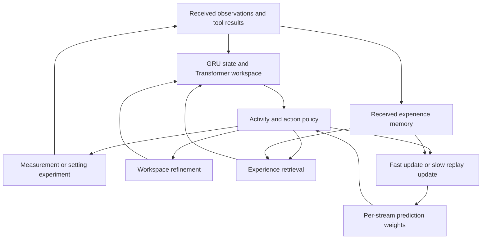

# A shared training path for continual decisions

This implementation connects the v0.9 scientific-task core to learned internal
activities, experience retrieval and deployment-time prediction updates. The
research question is whether choosing **how to compute and learn**, alongside
**what to measure and do**, improves performance over a changing task stream.

Eight joint trainings are running on two H100s, with two processes per GPU.
Their final scientific-task performance has not yet been measured. Existing
v0.9 results remain results of the original model.

## Run the comparison

Run from the repository root in the project Python environment, with the data
and checkpoints from [the v0.9 task-stream study](../discoveryworld/ACTIVE_STREAM.md).
These are the paths and settings used for the 2026-10-28 campaign:

```bash
python -m experiments.continual_experiment.launch \
  --data runs/discoveryworld/active_experiments/data_large \
  --checkpoint runs/discoveryworld/active_lifetime/carry_seed191/update1200.pt \
  --mixture-checkpoint runs/discoveryworld/calibration/mixture/shared_train_only_seed31/last.pt \
  --output runs/continual-experiment/joint_activity_20261028 \
  --gpus 0 1 --jobs-per-gpu 2 --seeds 201 202 \
  --updates 1200 --batch 128 --unroll 32 --memory-size 128 --gamma 0.99
```

The eight training jobs share a queue with two processes per GPU. `jobs.json`
records their exact commands; each run writes `config.json`, `training.jsonl`,
`tasks.jsonl` and its final `last.pt`. The launcher updates `finished.json` after
each process exits and writes `completion.json` when the campaign finishes.
Use an unused output directory for a new repetition.

The native evaluation queue can be started separately while training runs:

```bash
python -m experiments.continual_experiment.evaluate \
  --training-root runs/continual-experiment/joint_activity_20261028 \
  --output runs/discoveryworld/continual_experiment/native \
  --manifest experiments/continual_experiment/native_comparison.json \
  --mixture-checkpoint runs/discoveryworld/calibration/mixture/shared_train_only_seed31/last.pt \
  --initial-rng-root runs/discoveryworld/continual_experiment/native/initial_rng \
  --seeds 201 202 --parallel 3 --workers 6 --threads 1
```

It waits for successful training completion recorded in `completion.json`
or a per-job `finished.json`, then runs twelve native conditions: the four
trained conditions and two same-weight interventions for each seed. It uses the
final checkpoint, CPU inference, 400 native actions and 160 policy decisions
per instance. `evaluation_plan.json` contains every command;
`evaluation_completion.json` records finished conditions. Both entry points
accept `--dry-run` to write their plans without launching work.

## Model



The existing core, candidate representations and action interface remain
trainable. At initialization the learned-activity wrapper preserves the parent
policy under greedy execution: its action correction is zero and its activity
head selects ACT after the ordinary observation update. Training samples
activities and starts a fresh outer optimizer. The fixed-schedule control
deliberately executes its prescribed internal work before acting, so its initial
trajectory is not required to reproduce the parent trajectory.

| Part | Implementation |
| --- | --- |
| Observation update | One GRU update and one workspace refinement per received event. Additional computation does not ingest the event again. |
| Internal policy | ACT, REFINE, RETRIEVE, LEARN, CONSOLIDATE, WAIT. Availability depends on executable actions, received memories, pending tools and an internal compute budget. |
| Action interface | The existing 20 measurement requests and nine hypothesis-conditioned setting experiments. Native execution still uses the numerical and navigation tools. |
| Experience | A bounded per-stream tensor bank of selected-action features, returned test success and execution cost. Writes follow returned outcomes; retrieval is learned. |
| Prediction | Shared prediction weights plus fast and slow per-stream linear adapters. Predictions affect action scores through a learned projection. |
| Learning | LEARN updates fast weights; CONSOLIDATE updates slow weights from received experience. Both updates are differentiated through during outer training and remain executable without autograd during deployment. |
| Multimodal input | Optional projected encoder tokens attend into the same workspace. The present training dataset supplies structured observations; it does not train the multimodal path. |
| Asynchronous use | A session accepts unsolicited observations while one tool request is pending. It can continue internal work and then yield until another event arrives. |

Fast weights decay at each received observation; slow weights remain until an
explicit model-state reset. This provides two retention timescales. It is a
prediction-adaptation mechanism, not yet general skill acquisition or a learned
latent world simulator. Memory features are stored at action selection time;
outer training uses truncated backpropagation through time.

The activity and value heads read the current prediction error on received
experience in addition to the continuing state and activity budget. A fast or
slow update changes this error immediately. The scheduler can therefore learn
whether another update is useful before receiving another external observation.
The campaign keeps 128 received records in each stream.

`ContinualSession.receive()` consumes ordered events exactly once.
`tick()` returns an internal activity, a tool request with a request ID, or WAIT.
A result identifies the pending request. Observation arrival is separate from
tool completion. The synchronous DiscoveryWorld evaluator uses the same model
but does not simulate an independently moving world during internal computation.

## Learning objective

At model tick $n$, state $s_n$ contains the continuing GRU and workspace,
received experience, and fast/slow prediction weights. One activity policy
chooses $a_n$; if it chooses ACT, an action head selects an executable experiment
$u_n$. Their joint log probability in the policy-gradient loss is

$$
\log\pi_\theta(a_n,u_n\mid s_n)
=\log\pi^{\mathrm{activity}}_\theta(a_n\mid s_n)
+\mathbf{1}_{a_n=\mathrm{ACT}}\log\pi^{\mathrm{action}}_\theta(u_n\mid s_n).
$$

REFINE and RETRIEVE change the workspace used by subsequent decisions. LEARN
and CONSOLIDATE change the prediction for each candidate action. With its
normalized feature vector $x_u$ and two predicted outcomes,

$$
\widehat y_u=p_\theta(x_u)+x_u(W_f+W_s),
\qquad
\ell_u=\ell^{\mathrm{base}}_\theta(s_n,u)+v_\theta^\top\widehat y_u.
$$

The outcomes are test success and $\log(1+\text{execution cost})$; success is
zero for measurement requests. For $N$ valid received records $(X,Y)$, the
selected fast or slow update is

$$
W_j'=W_j-\sigma(\eta_j)\frac{X^\top[p_\theta(X)+X(W_f+W_s)-Y]}{N},
\qquad j\in\{f,s\}.
$$

This is the exact gradient step for squared replay error with a learned step
size. Within each 32-tick training window, later prediction and policy losses
differentiate through the update into the feature encoder and step size.
Discrete activity/action choices receive policy gradients; gradients do not
pass through the simulator. At a window boundary the state is retained and
its computation graph is detached. Shared weights stay fixed during native
execution, while the per-stream updates remain active.

The return uses the environmental clock. Let $\Delta_n=1$ for ACT and $0$
for an internal activity, and let $d_n$ mark the end of a complete task stream:

$$
G_n=r_n-c\,\mathbf{1}_{a_n\in\{\mathrm{REFINE,RETRIEVE,LEARN,CONSOLIDATE}\}}
+\gamma^{\Delta_n}(1-d_n)G_{n+1}.
$$

Here $r_n$ includes task reward and measurement/test cost, $c=0.001$, and
$\gamma=0.99$. This semi-Markov accounting charges internal work explicitly
without pretending that the environment advanced. Returns cross task boundaries
and stop at the lifetime boundary; a truncated window bootstraps from the value
head. The implemented loss is policy gradient + 0.5 × Huber value loss +
0.1 × Huber outcome-prediction loss − 0.01 × policy entropy. Its exact reductions
are in [`train.py`](train.py); the state and update operations are in
[`ContinualExperimentPolicy`](../../cdm/continual_experiment.py).

Three direct connections help locate this design. [RL²](https://arxiv.org/abs/1611.02779)
learns a recurrent policy whose state carries experience between episodes;
the present task streams also preserve state, while additionally exposing
explicit retrieval and prediction-weight updates. [Learning to learn by gradient
descent by gradient descent](https://arxiv.org/html/1606.04474v2) trains an update
rule through its later optimization losses; here the replay gradient has a fixed
form, with learned features and step sizes trained through subsequent losses.
[Adaptive Computation Time](https://arxiv.org/html/1603.08983v6) learns how much
recurrent computation to perform with a computation penalty. Here the policy
selects discrete kinds of internal work and external experiments using future
task return. The comparison tests whether these choices improve subsequent
decisions relative to the complete fixed schedule.

## Training

A training tick selects an activity. Only ACT advances the recorded environment;
REFINE, RETRIEVE and the two update operations change model state. Received
outcomes are incorporated before a task ledger resets. State persists across
new tasks and resets at the end of the training lifetime.

The trainer uses returned outcomes and task rewards; it does not use the
simulator's hindsight action oracle. The tick budget and external-action
discount describe computation and interaction counts, not elapsed wall time.

Training uses the existing recorded-instrument calibration streams. Their
measurement/test costs are proxies of 1/5 operations. Native execution records
actual action counts separately. The inherited recurrent event retains the
1/5 convention; actual native costs reach the prediction adapters through a
separate feedback target. Thus runtime adaptation receives costs different
from the replay target. The same-weight no-adaptation intervention measures
the effect of using these returned costs and successes, while the recurrent
input convention remains unchanged.

### Eight-run comparison

All conditions start from the same v0.9 model trained with carried state
(training seed 191). Seeds 201 and 202 independently initialize the added heads
and sample training activity; they are repetitions from one parent, not
independent pretrained models. Within each seed, conditions use the same
initialization and precomputed task-stream plan.

| Training condition | Internal activities | State at a new task |
| --- | --- | --- |
| `full` | Learned choice among action, refinement, retrieval and the two updates | Retained |
| `no_adaptation` | Learned choice; LEARN and CONSOLIDATE disabled, retrieval retained | Retained |
| `task_reset` | Same learned choices as `full` | All model state reset, including memory and adapters |
| `fixed_schedule` | REFINE → RETRIEVE → LEARN → CONSOLIDATE → ACT; skip the three memory-dependent operations when no experience is available | Retained |

The fixed schedule retains the full model's prediction, retrieval and update
paths. Its trainable components and losses are shared with the learned-schedule
condition; only activity selection is fixed. Each condition allows at most four
internal operations between actions, in addition to the single workspace
update that assimilates a received observation.

The default budget is 1,200 optimizer updates × 32 ticks × 128 streams:
**4,915,200 stream-ticks per run**. Different activity policies execute different
numbers of environment actions within that budget. This comparison fixes the
number of model decision opportunities, not training exposure, FLOPs or wall
time. Report completed tasks and actual external interactions alongside internal
activity counts, elapsed time and throughput. The memory holds 128 returned
experiences per stream; `--memory-size` changes that capacity for all conditions.

Each run writes its configuration, per-update losses, actual external
interactions, internal activity counts, elapsed time, adapter norms and memory
occupancy, plus completed-task records and `last.pt`. The launcher also records
each process's GPU, worker slot, exit status and wall time in `completion.json`.
Checkpoints use the fixed final update. Shared parameters are updated by the
outer optimizer; fast and slow adapters are per-stream model state and remain
updatable during deployment.

## Native execution and comparisons

[`native_comparison.json`](native_comparison.json) fixes 20 ordered native task
streams and 184 new instances, starting from scenario seed 9000. It covers all
ordered pairs of distinct native relation families, with two to four instances
per A–B–A segment. The initial-RNG directory holds shared simulator states.
The earlier 184-instance cohort remains a development and regression comparison;
the new manifest is fixed before evaluating these trained policies.

Use the corresponding checkpoint for every trained condition. Evaluate
task-reset training with `--state-mode reset`; the other trained conditions use
`carry`. The queue adds `full_reset` with task-boundary resets and
`full_discard_updates` with `--discard-adaptation`. The latter executes selected
LEARN/CONSOLIDATE calculations but discards their fast/slow weight changes;
retrieval remains available. It measures the use of updates at fixed shared
weights, and differs from separately training `no_adaptation`. Its subsequent
actions can diverge, so computing and discarding an update does not make whole
trajectories equal in cost. The unchanged v0.9 parent is evaluated without
`--continual`; fixed-schedule and no-adaptation settings in trained checkpoints
also apply at deployment.

The queue passes `--feedback-cost native`. For a single condition, the underlying
[`evaluate_active_stream.py`](../discoveryworld/evaluate_active_stream.py) also
supports `--feedback-cost replay`, which keeps the adapter's 1/5 cost targets.
Both settings preserve the inherited recurrent-event encoding. Exact selected
action predictions and subsequent outcomes are saved with the native decisions.

Report completion and actual native operations on all instances, including
failures, and costs on commonly completed instances. Separate the first and
later tasks in initial A, switched B and returned A. Record internal operations
and model runtime so a saved environment action is not mistaken for a saved
unit of computation. Use identical initial simulator states and task order,
with paired uncertainty calculated over complete task streams. Report the two
training repetitions separately: their shared evaluation instances do not
become twice as many independent observations.

## Completion of the research program

The immediate experiment is the entire path above: jointly learned computation,
action and runtime adaptation, evaluated on task streams. Improvements in one
measurement choice are intermediate outcomes of this experiment.

The full CDM objective additionally requires: useful multimodal training,
independent world time with delayed feedback, wider task families and tool
interfaces, and retention that transfers beyond short calibration streams.
Those extensions should keep this state/activity/feedback contract. They need
new training data and environment support; they cannot be obtained by increasing
the parameter count or GPU utilization alone.

## Local implementation checks

```bash
python -m pytest -q tests/test_continual_experiment.py \
  tests/test_continual_objective.py tests/test_continual_native.py
```

The checks cover checkpoint conversion, unchanged initial action scores,
multimodal-token gradients, internal computation without duplicate observation
updates, replay adaptation and outer gradients, asynchronous feedback, masked
environment execution, and training across task boundaries in all four modes.
Generated fixtures exercise the existing data format and environment classes;
they are not new benchmark results. H100 pilot runs exercised full and complete
fixed-schedule training before launching the eight-run comparison.
