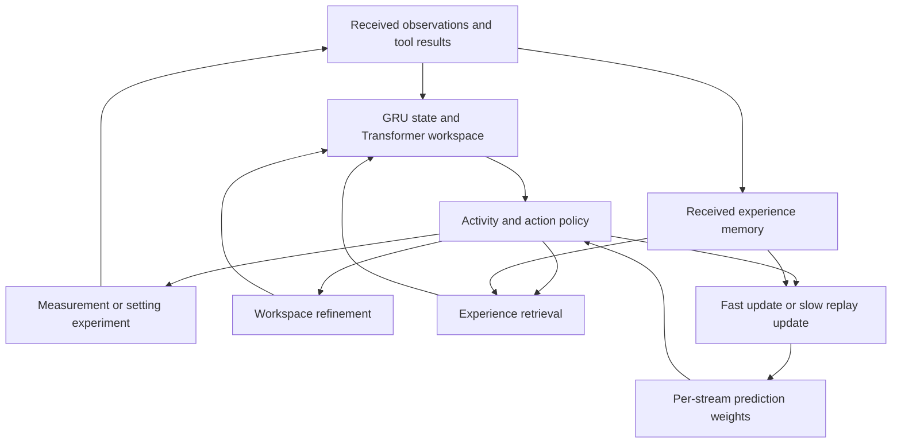

# A shared training path for continual decisions

This implementation connects the v0.9 scientific-task core to learned internal
activities, experience retrieval and deployment-time prediction updates. The
research question is whether choosing **how to compute and learn**, alongside
**what to measure and do**, improves performance over a changing task stream.

Eight joint trainings are running on two H100s, with two processes per GPU.
Their final scientific-task performance has not yet been measured. Existing
v0.9 results remain results of the original model.

## Model



The existing core, candidate representations and action interface remain
trainable. Loading a v0.9 checkpoint preserves its action scores at initialization:
new action corrections start at zero and greedy activity selection starts with
ACT. The outer optimizer starts fresh. This allows the method to start from an
existing working policy while learning the additional mechanisms jointly.

| Part | Implementation |
| --- | --- |
| Observation update | One GRU update and one workspace refinement per received event. Additional computation does not ingest the event again. |
| Internal policy | ACT, REFINE, RETRIEVE, LEARN, CONSOLIDATE, WAIT. Availability depends on executable actions, received memories, pending tools and an internal compute budget. |
| Action interface | The existing 20 measurement requests and nine hypothesis-conditioned setting experiments. Native execution still uses the numerical and navigation tools. |
| Experience | A bounded per-stream tensor bank of selected-action features, returned test success and execution cost. Writes follow returned outcomes; retrieval is learned. |
| Prediction | Shared prediction weights plus fast and slow per-stream linear adapters. Predictions affect action scores through a learned projection. |
| Learning | LEARN updates fast weights; CONSOLIDATE updates slow weights from received experience. Both updates are differentiated through during outer training and remain executable without autograd during deployment. |
| Multimodal input | Optional projected encoder tokens attend into the same workspace. The present training dataset supplies structured observations; it does not train the multimodal path. |
| Asynchronous use | A session accepts unsolicited observations while one tool request is pending. It can continue internal work and then yield until another event arrives. |

For stored features X and targets Y, an update uses

`W <- W - sigmoid(eta) X^T (predictor(X) + X(W_fast + W_slow) - Y) / N`.

Fast weights decay at each received observation; slow weights remain until an
explicit model-state reset. This provides two retention timescales. It is a
prediction-adaptation mechanism, not yet general skill acquisition or a learned
latent world simulator. Memory features are stored at action selection time;
outer training uses truncated backpropagation through time.

The activity and value heads read the current prediction error on received
experience in addition to the continuing state and activity budget. A fast or
slow update changes this error immediately. The scheduler can therefore learn
whether another update is useful before receiving another external observation.
The campaign keeps 128 received records in each stream.

`ContinualSession.receive()` consumes ordered events exactly once.
`tick()` returns an internal activity, a tool request with a request ID, or WAIT.
A result identifies the pending request. Observation arrival is separate from
tool completion. The synchronous DiscoveryWorld evaluator uses the same model
but does not simulate an independently moving world during internal computation.

## Training

A training tick selects an activity. Only ACT advances the recorded environment;
REFINE, RETRIEVE and the two update operations change model state. Received
outcomes are incorporated before a task ledger resets. State persists across
new tasks and resets at the end of the training lifetime.

The actor-critic return spans task boundaries. It includes task rewards,
measurement and test costs, and an explicit cost per internal activity. An
auxiliary loss predicts the returned test success and `log(1 + cost)`. Received
feedback trains both the prediction interface and the activity/action policy;
the trainer does not use the simulator's hindsight action oracle. The discount
factor applies when ACT advances the environment. Internal activities have
their explicit cost and do not add another discount step. Neither quantity is
elapsed wall time.

Training uses the existing recorded-instrument calibration streams. Their
measurement/test costs are proxies of 1/5 operations. Native execution records
actual action counts separately. The inherited recurrent event retains the
1/5 convention; actual native costs reach the prediction adapters through a
separate feedback target. Thus runtime adaptation receives costs different
from the replay target. The same-weight no-adaptation intervention measures
the effect of using these returned costs and successes, while the recurrent
input convention remains unchanged.

### Eight-run comparison

All conditions start from the same v0.9 model trained with carried state
(training seed 191). Seeds 201 and 202 independently initialize the added heads
and sample training activity; they are repetitions from one parent, not
independent pretrained models. Within each seed, conditions use the same
initialization and precomputed task-stream plan.

| Training condition | Internal activities | State at a new task |
| --- | --- | --- |
| `full` | Learned choice among action, refinement, retrieval and the two updates | Retained |
| `no_adaptation` | Learned choice; LEARN and CONSOLIDATE disabled, retrieval retained | Retained |
| `task_reset` | Same learned choices as `full` | All model state reset, including memory and adapters |
| `fixed_schedule` | REFINE → RETRIEVE → LEARN → CONSOLIDATE → ACT; skip the three memory-dependent operations when no experience is available | Retained |

The fixed schedule retains the full model's prediction, retrieval and update
paths. Its trainable components and losses are shared with the learned-schedule
condition; only activity selection is fixed. Each condition allows at most four
internal operations between actions, in addition to the single workspace
update that assimilates a received observation.

The default budget is 1,200 optimizer updates × 32 ticks × 128 streams:
**4,915,200 stream-ticks per run**. Different activity policies execute different
numbers of environment actions within that budget. This comparison fixes the
number of model decision opportunities, not training exposure, FLOPs or wall
time. Report completed tasks and actual external interactions alongside internal
activity counts, elapsed time and throughput. The memory holds 128 returned
experiences per stream; `--memory-size` changes that capacity for all conditions.

From the repository root, after unpacking the existing scientific-task data and
checkpoints described in [the task-stream study](../discoveryworld/ACTIVE_STREAM.md):

```bash
python -m experiments.continual_experiment.launch \
  --data runs/discoveryworld/active_experiments/data_large \
  --checkpoint "$CDM_CHECKPOINT" \
  --mixture-checkpoint runs/discoveryworld/calibration/mixture/shared_train_only_seed31/last.pt \
  --output runs/continual-experiment \
  --gpus 0 1 --jobs-per-gpu 1 --seeds 201 202 \
  --updates 1200 --batch 128 --unroll 32 --memory-size 128 --gamma 0.99
```

`CDM_CHECKPOINT` names the fixed carried-state parent above. The launcher queues
eight jobs and writes their exact commands and planned tick budgets to
`jobs.json`. `--dry-run` writes that file without starting training. One worker
per GPU is the default; `--jobs-per-gpu 2` permits two concurrent processes on
each GPU. Workers take the next queued job as capacity becomes available.
Concurrency changes scheduling, not model configuration. Use measured memory
and aggregate throughput to choose it.

Each run writes its configuration, per-update losses, actual external
interactions, internal activity counts, elapsed time, adapter norms and memory
occupancy, plus completed-task records and `last.pt`. The launcher also records
each process's GPU, worker slot, exit status and wall time in `completion.json`.
Checkpoints use the fixed final update. Shared parameters are updated by the
outer optimizer; fast and slow adapters are per-stream model state and remain
updatable during deployment.

## Native execution and comparisons

```bash
python -m experiments.discoveryworld.evaluate_active_stream \
  --continual \
  --checkpoint runs/continual-experiment/full_seed201/last.pt \
  --mixture-checkpoint runs/discoveryworld/calibration/mixture/shared_train_only_seed31/last.pt \
  --manifest experiments/continual_experiment/native_comparison.json \
  --state-mode carry --workers 2 --threads 4 --device cpu \
  --initial-rng-root runs/discoveryworld/continual_experiment/native/initial_rng \
  --max-actions 400 --max-decisions 160 \
  --output runs/continual-experiment-native/full201
```

[`native_comparison.json`](native_comparison.json) fixes 20 ordered native task
streams and 184 new instances, starting from scenario seed 9000. It covers all
ordered pairs of distinct native relation families, with two to four instances
per A–B–A segment. The initial-RNG directory holds shared simulator states.
The earlier 184-instance cohort remains a development and regression comparison;
the new manifest is fixed before evaluating these trained policies.

Use the corresponding checkpoint for every trained condition. Evaluate
task-reset training with `--state-mode reset`; the other trained conditions use
`carry`. In addition, evaluate the full checkpoint with task-boundary resets
and with its learning updates disabled. These same-weight interventions isolate
the use of retained state and online adaptation from differences in training.
Keep retrieval available in the no-adaptation intervention. Include the unchanged
v0.9 parent without `--continual`. Fixed-schedule and no-adaptation settings in
trained checkpoints also apply at deployment.

Report completion and actual native operations on all instances, including
failures, and costs on commonly completed instances. Separate the first and
later tasks in initial A, switched B and returned A. Record internal operations
and model runtime so a saved environment action is not mistaken for a saved
unit of computation. Use identical initial simulator states and task order,
with paired uncertainty calculated over complete task streams. Report the two
training repetitions separately: their shared evaluation instances do not
become twice as many independent observations.

## Completion of the research program

The immediate experiment is the entire path above: jointly learned computation,
action and runtime adaptation, evaluated on task streams. Improvements in one
measurement choice are intermediate outcomes of this experiment.

The full CDM objective additionally requires: useful multimodal training,
independent world time with delayed feedback, wider task families and tool
interfaces, and retention that transfers beyond short calibration streams.
Those extensions should keep this state/activity/feedback contract. They need
new training data and environment support; they cannot be obtained by increasing
the parameter count or GPU utilization alone.

## Local implementation checks

```bash
python -m pytest -q tests/test_continual_experiment.py \
  tests/test_continual_objective.py tests/test_continual_native.py
```

The checks cover checkpoint conversion, unchanged initial action scores,
multimodal-token gradients, internal computation without duplicate observation
updates, replay adaptation and outer gradients, asynchronous feedback, masked
environment execution, and training across task boundaries in all four modes.
Generated fixtures exercise the existing data format and environment classes;
they are not new benchmark results. H100 pilot runs exercised full and complete
fixed-schedule training before launching the eight-run comparison.
