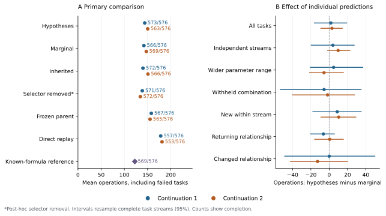
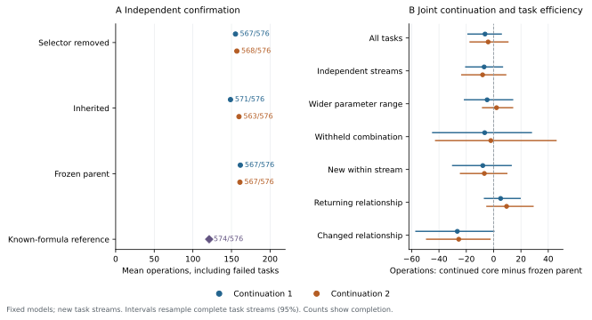

# Experimental decisions across changing response laws

This study follows the [integrated research direction](../../research/CONTINUAL_AGENT.md).
It first separates the value of experimental records from the value of training
their reader, then compares action representations on changing response laws.
The official DiscoveryWorld protocol remains unchanged. The new generators are
a digital extension with the same public observations and operation costs.

Six joint continuations and two 576-task digital cohorts are complete. Archived
observations remain useful on the primary mixed-law streams. Exposing individual
forecasts to a new learned action head does not establish an advantage over
marginal forecasts, and that head harms the original chemical tasks. Removing
it restores chemical performance. The resulting continuation has lower average
cost on the independent digital cohort, but its intervals include zero.

## Starting model: memory without extra training

The previously missing comparison is complete. Both original response parents
were evaluated with twelve experimental ledgers and fixed evidence weighting.
Predictors, within-task recurrence, tools and saved environment initializations
were preserved. This reuses the primary twenty-stream cohort; it is not another
independent test cohort.

| Mean operations over 240 chemical tasks | Continuation parent 911 | Continuation parent 912 |
|---|---:|---:|
| Original model without archived records | 78.22 | 84.30 |
| Original model with twelve ledgers | **66.84** | **69.34** |
| Earlier memory continuation with twelve ledgers | 69.77 | 72.43 |

Every model in this table completes 240/240 tasks. Adding memory to the original
parents saves 11.38 [4.71, 18.05] and 14.96 [9.85, 20.40] operations, using a
paired bootstrap of complete streams. The earlier continuation costs 2.93
[−3.09, 9.86] and 3.09 [−2.20, 8.91] more than these simpler starting models.
Its extra training therefore has no established benefit in this comparison.

New tasks still cost more with memory: 89.17 versus 79.17 and 93.17 versus 84.80.
Returns cost less: 44.51 versus 77.28 and 45.51 versus 83.79. These observations
motivate using the original parents for the next training, and examining action
selection when several old and new explanations remain possible.

## The representation being compared

The inherited actor receives a mixture prediction for each possible experiment.
The new selector can additionally read each archived predictor's responses
across the available experiments. A shared encoder represents each response
function; a candidate then queries that set. Mixture weights normalize the set,
and the computation is invariant to its ordering. Its final residual starts at
zero, preserving the parent's action scores before training.

Why preserve the functions? Two experiments can have the same marginal outcome
distribution while partitioning the possible relationships differently. Those
partitions can leave different future actions useful. Marginal uncertainty alone
does not encode that distinction. This is a motivation from belief-based decision
making, not a new theorem or a claim that the proposed neural encoder has already
learned an optimal policy.

The declared comparison has three independently continued conditions per parent:

| Condition | Action input and training |
|---|---|
| Inherited | Existing progress/cost term and task-return residual |
| Marginal | New selector of the same parameter size, receiving only mixture forecasts |
| Hypotheses | New selector receiving the individual forecasts and their weights |

All conditions update the shared recurrent core, workspace, response model and
task interfaces. The two new selectors receive the same longitudinal actor–critic
objective. Expert forecasts are detached on this action-gradient path; actual
chosen outcomes train the predictor. The new head outputs action-score residuals,
not calibrated remaining-cost estimates. It does not yet introduce latent
function particles inside the fresh component or autonomous archive writing.

## Response laws, task streams and budgets

Five response mechanisms are present during training:

- cosine response, retaining the official transition;
- anisotropic distance, with different weights on component dimensions;
- pair interactions, with nonlinear dependence on combinations of ingredients;
- inhibition above a component threshold;
- multiple successful compositions.

Each has an attainable solution among the public candidate actions. The physical
state retains `min(current rust, intrinsic response)`, so an unchanged result is
censored. Experiment and exit operations are charged, including unsuccessful
attempts and budget exhaustion. Generator parameters and task identities remain
inside the simulator. The model observes proportions, past measurements, current
rust and operation costs.

Twelve-task training streams contain new relationships, exact returns and changed
familiar targets. Ingredient counts remain fixed within a stream; parameters and
return order vary. A changed multiple-solution relationship may retain a useful
old solution, so recognizing a change is not required when the old action still
achieves the objective.

Six joint trainings are declared: three conditions, two parent continuations,
256 windows per run, batch 24, sixteen chemical and eight physical requests per
window. This is 98,304 chemical and 49,152 physical requests per condition.
Policies choose their own experiments and can finish different numbers of
tasks within that interaction budget. They share the generator and observation
interface, not identical outcome sequences or exactly equal floating-point work.
The final window is the endpoint; test outcomes do not select checkpoints.
The two continuations reuse existing parents rather than pretraining new cores.

The frozen development set has 192 tasks. The final set has 576 tasks in 48
streams: independently sampled parameters from trained mechanisms, wider parameter ranges, and
the withheld combination of interaction and inhibition. The combination uses
operators seen separately during training. It is not a wholly unspecified
physical law. Discrete targets, including exact cosine laws, can recur from
training; the first group establishes new-stream performance, not guaranteed
novelty of every law. The wider group expands the parameter support and still
overlaps the training range. Completion, operations including failures, and paired stream
intervals are reported by group and by new/changed/return exposure.

The observed state has four response levels. If a composition has intrinsic
level $f(q)$ and the device is currently at $r$, its returned level is
$\min(r,f(q))$. An unchanged reading therefore only bounds the intrinsic
response. The actions are 55 or 168 primitive compositions for three or four
ingredients, followed by a completion operation. Each composition costs
$6+\sum_i q_i+|\{i:q_i>0\}|$ operations, plus two after the first experiment;
preparation costs fourteen and completion costs four. Every condition receives
the same public observation fields: history, candidates and remaining budget.
Each policy generates its own history through its experimental choices.

The joint model contains approximately 47.84 million parameters. These runs use
structured scientific observations; no additional vision or language backbone
is invoked. The added selector contains 16,849 parameters and is trained
together with the existing core and prediction interfaces.

## Model-based references

Alongside frozen parents and the trained alternatives, a finite-grid belief
reference knows the five generating formulas. It does not receive the current
parameters, task identities or test answers. Its discretized prior has 1,155
functions for three ingredients and 3,864 for four. A likelihood floor of 0.005
accommodates grid mismatch; it is an approximation to the deterministic task.

Three fixed selection rules are compared on development data: immediate
completion per cost, completion plus information per cost, and a two-step
approximation with a geometric continuation estimate. The information rule is
selected by completion first, then operations. Its coefficient is fixed at 0.5.
This reference has generator knowledge unavailable to the neural model; it is
not a matched-information learned baseline or an optimality bound.

Cost-ordered enumeration and a privileged solver that knows the actual current
law measure two further reference points. The latter confirms achievable success
and cost with perfect information; it does not measure attainable performance
for a learner that must discover the law.

Two follow-up comparisons were added after the first candidate results. Direct
episodic retrieval reuses the existing rule: try a recently successful recorded
composition while it remains legal, then fall back to the frozen original model
without archive-based predictions. It receives twelve ledgers and no response
formula. A second comparison removes only the new selector from each trained
hypothesis model, retaining its trained core and predictors. This separates the
selector's execution effect from changes learned elsewhere in the model. Neither
follow-up changes the checkpoints or the frozen test tasks.

## Completed digital comparison

Each cell reports **completed tasks / 576; mean operations**, counting failed
tasks at their actual cost. The two columns are parent continuations, evaluated
on the same 48 streams. They do not double the number of independent test streams.

| Method | Continuation 911 | Continuation 912 |
|---|---:|---:|
| Frozen parent with twelve ledgers | 567; 158.09 | 565; 155.42 |
| Continued inherited actor | 572; 140.15 | 566; 150.91 |
| Continued marginal selector | 566; 142.17 | 569; 147.31 |
| Continued hypothesis selector | 573; 143.99 | 563; 150.33 |
| Same hypothesis models, selector removed | 571; 138.65 | 572; 134.43 |
| Original parent with direct recipe replay | 557; 178.40 | 553; 181.24 |
| Known-formula information reference | 569; 122.59 | Same reference |
| Cost-ordered enumeration | 487; 414.07 | Same reference |
| Privileged solver | 576; 30.23 | Same reference |



The hypothesis selector costs 1.82 [−16.24, 19.06] and 3.02 [−9.11, 14.23]
more operations than the same-size marginal selector. Neither establishes an
effect. Disabling archived predictions in the same hypothesis models increases
cost to 162.23 and 206.93: retaining them saves 18.23 [1.37, 36.44] and 56.60
[33.84, 82.99] operations. This supports the execution value of their archived
observations, without establishing superiority to an independently retrained
no-memory policy on these new families.

Removing the new selector gives a favorable post-hoc comparison with the
frozen parents: −19.44 [−31.29, −8.48] and −20.98 [−34.07, −9.09] operations.
We therefore exported these exact remaining weights as `core_only.pt` and
froze them before drawing one new confirmation cohort. There was no additional
training or checkpoint selection.

### Independent confirmation

The confirmation contains another 48 twelve-task streams with the same three
evaluation groups. The inherited actor continuations and frozen parents use
the same tasks. This cohort was drawn after the primary results and before
any confirmation outcome was examined.

| Method | Continuation 911 | Continuation 912 |
|---|---:|---:|
| Frozen parent with twelve ledgers | 567; 161.47 | 567; 160.93 |
| Continued inherited actor | 571; 148.73 | 563; 159.71 |
| Continued core, new selector removed | 567; 155.18 | 568; 156.93 |
| Known-formula information reference | 574; 121.12 | Same reference |



The selector-disabled continuation saves 6.30 [−5.61, 18.79] and 4.01
[−10.48, 17.23] operations relative to its frozen parent. It changes cost by
+6.45 [−4.59, 17.72] and −2.78 [−13.76, 8.46] relative to the independently
continued inherited actor. The larger primary-cohort improvements therefore
do not establish a stable overall advantage. We retain all conditions rather
than presenting the post-hoc primary result as confirmed performance.

The model-based reference remains more efficient in mean operations, using
response formulas unavailable to the neural policies. The learned model still
has one fresh-task prediction component: it has not learned a distribution
over competing unfamiliar response functions. A new action encoder alone does
not supply that missing representation.

Machine-readable results provide every task, group, exposure and paired stream
interval: [primary](results/response_families.json),
[confirmation](results/response_families_confirmation.json),
[training curves](results/response_families_training.csv).

## Retaining the original native tasks

Each entry is **completed tasks / 240; mean operations** on the original
shared-initialization cohort. The chemical and physical tasks alternate within
each stream, using separate states and shared core weights.

| Method | Chemistry 911 | Chemistry 912 | Physics 911 | Physics 912 |
|---|---:|---:|---:|---:|
| Frozen parent with twelve ledgers | 240; 66.84 | 240; 69.34 | 233; 115.40 | 229; 107.18 |
| Continued inherited actor | 240; 68.33 | 240; 65.61 | 224; 122.00 | 234; 109.03 |
| Continued marginal selector | 240; 72.21 | 240; 65.23 | 228; 119.88 | 230; 115.41 |
| Continued hypothesis selector | 239; 108.13 | 239; 77.94 | 233; 112.93 | 227; 114.45 |
| Same hypothesis models, selector removed | 240; 64.06 | 240; 67.70 | Same as above | Same as above |

The removal changes only chemical action scoring, leaving the trained core,
response model, memory and physical policy intact. It restores all chemical
completions and removes the large action-cost regression. Physics is unchanged
by this removal and has no consistent overall gain across continuations.
The frozen parents remain available; these results do not justify replacing
them with a generally stronger model.

[Native instances and paired comparisons](results/response_families_native.json)
include all six continuations, both frozen references and both selector removals.
This study executes 3,840 native tasks: 480 for the initial memory comparison,
2,880 for the six complete continuations, and 480 chemical-only removals.
Original reference outcomes are reused separately and are not counted as new
executions.

## Running the study

The [v0.15.0 release guide](../discoveryworld/RELEASE.md#response-law-transfer-and-memory-v0150)
provides all six endpoints, both selector-removed variants, original parents
and complete records. It includes a standalone evaluation command. Repeating
joint training also uses the earlier measured inputs listed below.

```bash
python -m experiments.continual_experiment.compare_parent_memory \
  --previous runs/continual_physics/experimental_memory_20261101 \
  --output runs/continual_physics/continual_belief_20261102/parent_memory

python -m experiments.continual_experiment.train_response_families \
  --previous runs/continual_physics/experimental_memory_20261101 \
  --output runs/continual_physics/continual_belief_20261102/train \
  --updates 256 --batch 24 --conditions hypotheses marginal inherited \
  --concurrency-per-gpu 2

python -m experiments.continual_experiment.evaluate_response_study \
  --root runs/continual_physics/continual_belief_20261102 \
  --previous runs/continual_physics/experimental_memory_20261101

python -m experiments.continual_experiment.confirm_response_models \
  --root runs/continual_physics/continual_belief_20261102 \
  --previous runs/continual_physics/experimental_memory_20261101

python -m experiments.continual_experiment.compile_response_results \
  --root runs/continual_physics/continual_belief_20261102
```

The original parents and training inputs are available in
[v0.14.0](https://github.com/Cherish0925/continual-decision-model/releases/tag/v0.14.0).
The same inherited checkpoint can be evaluated with the new digital evaluator.
Generated digital tasks need no external trajectory files. The standalone
generator was compared with the original training generator over 1,600 actions;
public observations, task boundaries and outcomes were identical.

This experiment addresses relationship-conditioned action and transfer. A
learned latent-context baseline, independent-time operation, revision of ongoing
inference and lasting consolidation remain separate parts of the integrated
research direction. The known-family reference and internal marginal comparison
do not replace RL²-style and VariBAD-style learned competitors.
