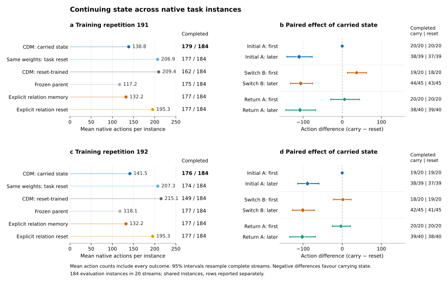

# Continuing state reuses recent experimental experience

Training across experimental instances made continuing state reduce repeated
work in both training repetitions. Compared with resetting the same model at
each new instance, retaining state reduced native actions by 32.9% and 31.7%,
while completing two more instances in each repetition. The benefit was
concentrated in later instances of an unchanged relation. The first instance
after a relation returned showed no clear efficiency gain.

The new trainings did not consistently outperform their frozen parents or the
explicit relation-memory reference. They establish useful cross-instance state
reuse, while exposing the cost of switching experimental hypotheses.

## Fixed native comparison

Each model completed the same 20 A–B–A streams, containing 184 distinct
Reactor Lab Normal instances. A and B identify different measured quantities
that determine a device setting. Every instance has new objects and calibration
coefficients; its measurement ledger and numerical fit start afresh. Relation,
phase and seed labels never enter the model. All methods share the numerical
tool, initial simulator randomness, and 400-action limit.

Each training repetition starts from its corresponding calibration-rehearsal
parent. Carry and reset-trained arms share initial weights, optimizer, task
sequence and budget: 1,200 updates, 128 parallel streams, 32 decisions per
unroll. Training updates 26.65 million parameters, including the GRU and
Transformer workspace. Gradients cross task boundaries within an unroll;
parameters remain fixed during native evaluation. Each final checkpoint was
selected in advance. See the [training and execution protocol](../ACTIVE_STREAM.md).

| Method | Repetition 191: completed | Mean actions | Repetition 192: completed | Mean actions |
|---|---:|---:|---:|---:|
| Carry-trained, state retained | 179/184 | 138.79 | 176/184 | 141.52 |
| Same weights, state reset between instances | 177/184 | 206.88 | 174/184 | 207.34 |
| Separately trained with task resets | 162/184 | 209.38 | 149/184 | 215.05 |
| Frozen rehearsal parent | 175/184 | 117.16 | 177/184 | 118.10 |
| Explicit last-successful-relation memory | 177/184 | 132.22 | shared evaluation | shared evaluation |
| Same explicit policy, relation reset | 177/184 | 195.30 | shared evaluation | shared evaluation |

The explicit reference measures and tests its most recently successful
candidate first, then searches remaining candidates using their current public
posterior. It retains only that candidate index across instances. Measurements,
coefficients and failures are rebuilt in each instance. This is a fixed policy,
not a trained CDM. Its two evaluations are shared by the training repetitions.
All ten evaluations finished without execution errors. Two repetitions on the
same 184 instances do not constitute 368 independent test instances.

The left panels show completion and actions together. The right panels compare
the same weights with retained versus reset state, separating the first and
later instances of each segment. Negative differences mean fewer actions with
state. Intervals resample whole streams, preserving dependence among their
instances; they do not estimate variation across training runs.

## Where the state helps

| Carry minus same-weight reset | Repetition 191 | Repetition 192 |
|---|---:|---:|
| All-instance action difference, 95% interval | −68.08 [−83.25, −52.36] | −65.83 [−79.61, −52.29] |
| Action difference on jointly completed instances | −68.88 (176 instances) | −67.90 (172 instances) |
| Later instances of initial A | −110.00 | −88.67 |
| First instance after switching to B | +36.65 | +1.60 |
| Later instances of B | −106.04 | −100.76 |
| First instance after returning to A | +5.90 | −3.35 |
| Later instances of returned A | −107.90 | −102.12 |

The first instance of each stream is identical under the same-weight state
intervention. The savings emerge after experience accumulates, and remain
large on jointly successful instances. Completion differences are small and
their stream-bootstrap intervals include zero.

Returning to A is a stricter test than continuing an unchanged relation. Both
models and their same-weight resets complete all 20 first-return instances.
Their action differences have intervals [−29.65, 43.80] and [−25.45, 20.75].
The present evidence therefore supports reuse of the current relation; it
does not establish rapid retrieval of an earlier relation after interference.

## Comparison with the starting capability

Relative to the corresponding frozen parent, repetition 191 gains five
completions and loses one; repetition 192 gains three and loses four. Mean
native actions increase by 21.64 and 23.42. The separately reset-trained
controls also deteriorate relative to the parents. A strong effect of removing
state from a trained model should therefore be distinguished from an overall
improvement over the previous successful policy.

The explicit memory reference completes 177 instances. Carry-trained models
gain two and lose none relative to it in repetition 191, then gain four and
lose five in repetition 192. Their average action costs are 6.57 and 9.29
higher, with intervals spanning zero. There is no consistent advantage over
this compact memory mechanism in the present comparison.

The native trajectories identify a concrete source of extra work. In repetition
191, the carry-trained model uses 1,478 fewer measurement actions than its
parent, but 5,459 more actions executing candidate tests and adjusting device
settings. In repetition 192 it uses 854 more measurement actions and 3,455 more
test/adjustment actions. Initial setup is unchanged at 2,760 actions per arm.
Thus testing and adjustment account for most of the added work in both runs.
The table-based training uses a fixed penalty for each test, while native test costs depend on setting
changes and local attempts. This discrepancy motivates learning from actual
execution costs. The decomposition locates the extra work; it does not alone
prove which training term caused it.

The current interfaces also discard information needed to price an action:
the executor records each device's current frequency, but the active policy's
candidate features omit it and the corresponding adjustment distance. Native
feedback encodes fixed measurement/test costs of 1 and 5 instead of the
observed operation count. These are concrete inputs and feedback paths to
connect in the next comparison; their effect still requires training and native
evaluation.

The issue is conditional cost, rather than a simple penalty-scale mismatch:
the average native test-to-measurement cost ratio is close to the training
ratio. A candidate that is cheap to reach from one current setting can be
expensive from another. Training additionally rewards closeness to a hidden
target within its replay environment; native feedback reports actual activation.
A comparison based on public outcomes and matched average penalties can test
whether these omitted execution conditions explain the extra work.

## Data and reproduction

- [Instance results](active_stream_instances.csv), including all failures.
- [Grouped summaries](active_stream_summary.csv) and [paired comparisons](active_stream_paired.csv).
- Native action costs by [instance](active_stream_native_cost_instances.csv) and [phase](active_stream_native_cost_breakdown.csv).
- [Native execution protocol](../active_lifetime_comparison.json), [analysis script](../summarize_active_stream.py), and [plot source](../plot_active_stream.py).
- [Model and record downloads](../RELEASE.md).

The shared explicit references appear in each repetition's CSV for pairing;
they must not be pooled as independent repeats. Full records restore
`runs/discoveryworld/active_experiments/lifetime_native/` and the four trainings
under `runs/discoveryworld/active_lifetime/`.

This study uses structured public observations and one workspace refinement per
decision. It measures state adaptation across instances of a scientific task.
Adaptive computation, deployment-time neural updates, and consolidation across
different scientific tasks remain separate capabilities to connect and train.
