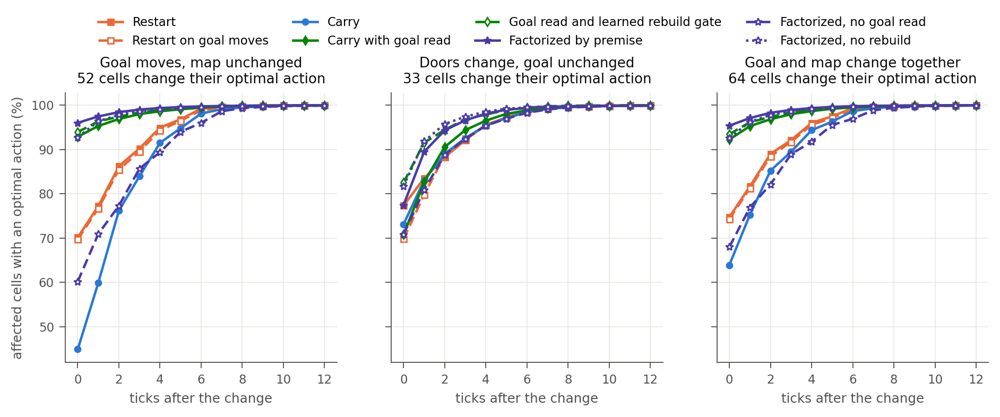
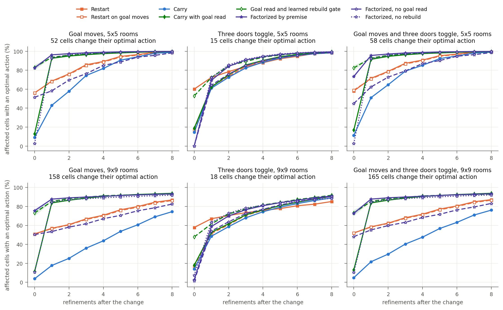
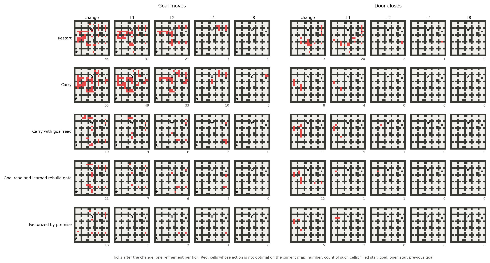
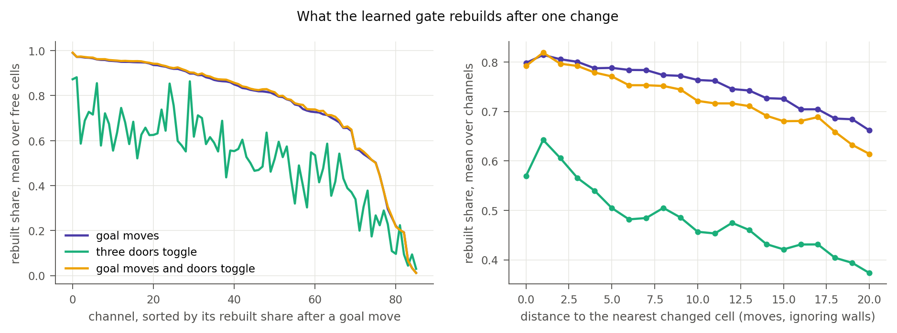
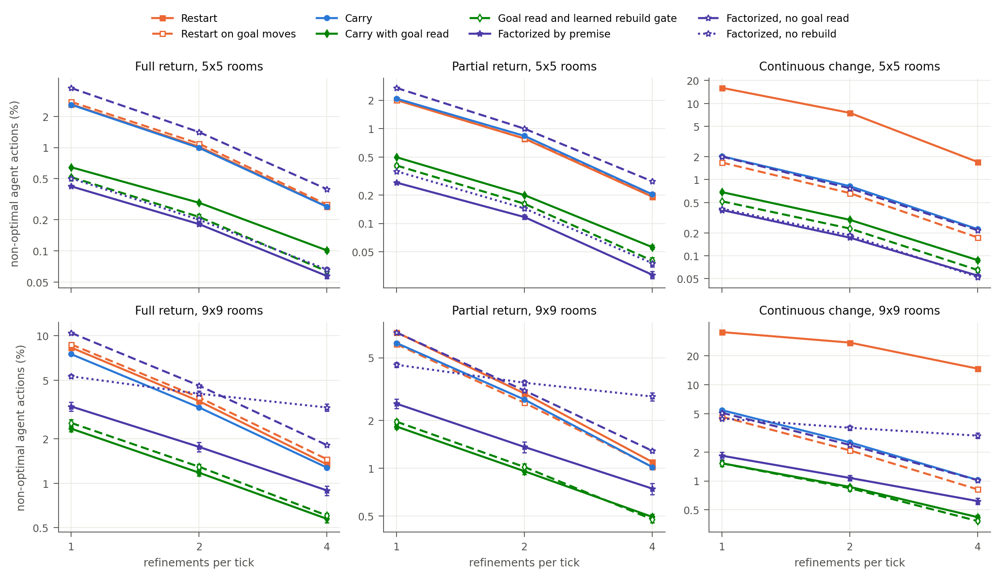
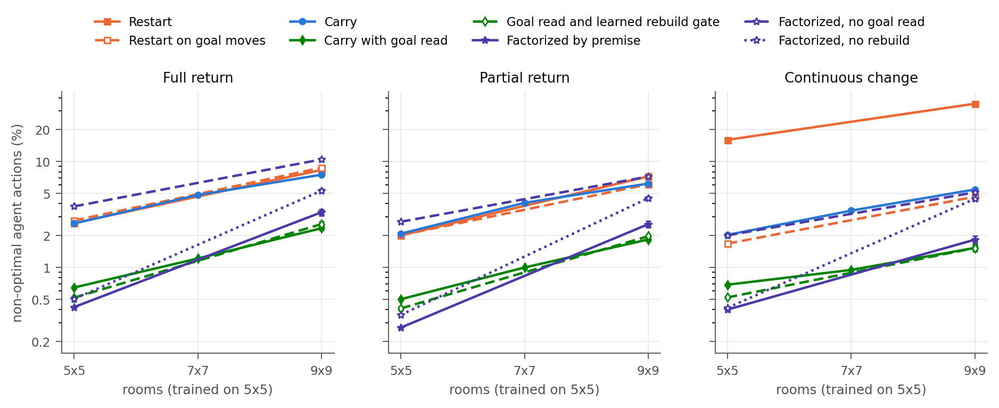
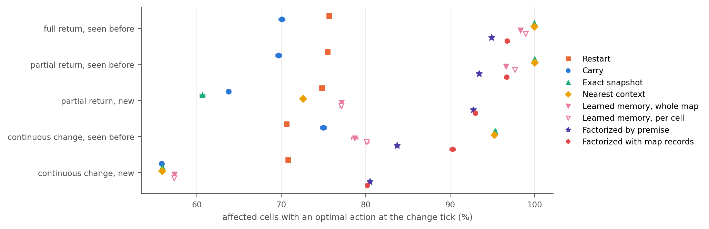

# Results: continuing computation in a changing maze

Setup and definitions are in [README.md](README.md). Each variant has five training seeds unless a table states fewer. Every model meets the same 1,024 held-out episodes of 96 ticks per regime and maze size; numbers are means across seeds ± standard error across seeds. `k` is the number of refinements per tick; the agent acts every tick. Mazes have 5×5 rooms (the training size) unless stated. All tables: [results/tables.md](results/tables.md); per-seed values: [results/eval_seeds.json](results/eval_seeds.json).

Two facts about the world shape the measurements. For every free cell, one goal-independent action is optimal for most goals; averaged over goals it is optimal on 83–84% of free cells ([`goal_blind.py`](goal_blind.py)). Map-wide accuracy therefore starts near 83% without any goal information, and the analysis scores the cells whose optimal action a change actually altered ("affected cells"). Second, agent-level error rates are small at the training size, so they are reported as the share of non-optimal moves.

## Findings

1. **Restart and carry fail under different changes.** Under continuous change with one refinement per tick, restart makes 16.0% non-optimal moves and earns a return of 0.68; carry makes 2.0% and earns 1.61 (the optimal policy earns 1.74). After a goal move, carry keeps routes to the old goal: from converged computation, 43.0% of the affected cells are right after one refinement, against 68.6% for restart.
2. **A goal change has to reach every cell; one read does it.** A refinement moves information about two cells, so a goal move travels as a wave. Adding the workspace read at the goal cell to every refinement (carry with goal read) raises the affected cells right after one refinement from 43.0% to 92.6%, and cuts non-optimal moves at k=1 from 2.0–2.6% to 0.5–0.7%. Removing the same read from the factorized planner leaves it no better than restart on goal moves (58.3% after one refinement).
3. **Rebuilding at the change makes the plan usable before any refinement.** With the read alone, only 12.9% of the affected cells are right before the first refinement, because the old plan is still in the workspace. A hand-made split into a map workspace and a goal workspace rebuilt from it reaches 82.5%; a learned per-cell, per-channel keep-or-rebuild gate on a single workspace reaches 83.0% without any split. After one refinement the hand split stays ahead (96.3% against 93.6% for the gate and 92.6% for the read alone).
4. **What the gate learned.** After a goal move it rebuilds 78% of the workspace on average, evenly across the maze, with 77 of 86 channels rebuilt by more than half. After three doors toggle it rebuilds 56%, more near the changed doors (0.57–0.66 next to them, 0.44–0.59 twenty cells away). About ten channels are kept through every kind of change. The gate learned which computation depends on the goal and which on the local map.
5. **At the training size the best planners act almost like the optimal policy.** With one refinement per tick the factorized planner earns 1.96, 1.87 and 1.73 in the three regimes against 1.97, 1.87 and 1.74 for the optimal policy on the current map, with 0.27–0.42% non-optimal moves.
6. **On larger mazes the single workspace with the goal read transfers best.** Trained on 5×5 and run on 9×9 at k=1, it makes 1.5–2.4% non-optimal moves, the factorized planner 1.8–3.3% and carry 5.5–7.5%. From converged computation on 9×9, every variant with the read plateaus at 92–94% of the affected cells after eight refinements, so part of the plan does not transfer.
7. **Stored workspaces help when a context returns, and much less than the read.** On exact returns at k=1, exact snapshots cut non-optimal moves from 2.60% (carry) to 1.42%; on partial returns they do not help (2.20%), and under continuous change nothing is stored that matches. Learned readers over stored workspaces reach 1.2–1.3% on full and partial returns and 1.8% under continuous change. The goal read is at 0.5–0.7% everywhere.
8. **Repair is learned from change.** Carry trained only on static mazes makes 27–31% non-optimal moves under change at any budget from one to eight refinements per tick: the shared block never learned to revise its own state.
9. **The planner's own readout shows where computation is needed.** When 1,024 agents with a full view share refinements, giving the extra ones to the agents whose action distribution moved most in their latest refinement brings non-optimal moves to 0.13–0.18% with 1.5 refinements per agent per tick on average, below uniform allocation with four refinements each (0.20–0.26%) and close to an oracle that reads the labels (0.10–0.14%).
10. **Measured in milliseconds, the gain of the read depends on maze size and batch size.** For one agent on an idle H100 a tick costs 0.91 ms for carry with one refinement and 1.01 ms with the goal read; at the training size carry with four refinements (1.33 ms) is as accurate as the read with two (1.18 ms). On 9×9 mazes the read with four refinements (1.54 ms) halves the errors of carry with four (1.33 ms). With 256 agents per batch, where compute rather than kernel launches sets the time, the factorized planner with one refinement (2.65 ms) makes 0.27–0.42% non-optimal moves against 0.82–0.99% for carry with two (2.67 ms).
11. **With a partial view, information limits performance before computation does.** When each agent sees only two cells around itself, doubling refinements adds at most 0.02 return, while giving one agent in sixteen a survey each tick adds 0.04–0.10. A learned survey value trained on branched rollouts beats fixed rotation by 0.026 in partial returns and not under continuous change.
12. **A deployed planner keeps learning from the mazes it meets, if its targets are anchored.** Moved from 5×5 to 9×9 rooms and updated online for 200 batches, the factorized planner's non-optimal moves fall from 1.90% to 0.73% with the exact solver on its observed maps as teacher, and to 0.91% when the teacher is a frozen copy of itself reading out 16 refinements deeper, with no external solver. Training toward its own live deeper readout collapses within 40–80 updates (97% non-optimal). Mixing in 5×5 episodes removes most forgetting on the old size.

## 1. Restart, carry and the goal read

Non-optimal moves (%) and return per episode, one refinement per tick, 5×5 rooms:

| Method | Full return | Partial return | Continuous change |
|---|---:|---:|---:|
| Restart | 2.62 · 1.74 | 2.01 · 1.72 | 16.04 · 0.68 |
| Restart on goal moves | 2.77 · 1.73 | 2.02 · 1.73 | 1.68 · 1.63 |
| Carry | 2.60 · 1.74 | 2.08 · 1.72 | 2.03 · 1.61 |
| Carry with goal read | 0.65 · 1.94 | 0.50 · 1.86 | 0.69 · 1.72 |
| Factorized by premise | 0.42 · 1.96 | 0.27 · 1.87 | 0.40 · 1.73 |
| Factorized, no goal read | 3.77 · 1.65 | 2.70 · 1.66 | 2.01 · 1.62 |
| Optimal policy | 0 · 1.97 | 0 · 1.87 | 0 · 1.74 |

Standard errors are below 0.06 points for every rate and below 0.01 for every return in this table.

## 2. One change from converged computation

Each planner converges for 32 refinements, then exactly one premise changes. Affected cells with an optimal action (%), 512 mazes, five seeds:

| Method | goal moves, r=0 | r=1 | r=2 | r=4 | three doors toggle, r=0 | r=1 | r=2 | r=4 |
|---|---:|---:|---:|---:|---:|---:|---:|---:|
| Restart | 56.0 | 68.6 | 76.1 | 89.2 | 60.1 | 72.4 | 78.5 | 88.0 |
| Carry | 9.2 | 43.0 | 57.8 | 81.9 | 14.5 | 61.1 | 72.5 | 88.4 |
| Carry with goal read | 12.9 | 92.6 | 95.0 | 97.5 | 18.8 | 62.3 | 75.2 | 90.3 |
| Goal read and learned rebuild gate | 83.0 | 93.6 | 96.0 | 98.0 | 53.0 | 72.3 | 84.7 | 93.8 |
| Factorized by premise | 82.5 | 96.3 | 97.5 | 99.0 | 0.1 | 69.4 | 84.1 | 94.3 |
| Factorized, no goal read | 51.5 | 58.3 | 69.6 | 85.1 | 0.0 | 64.2 | 75.9 | 90.0 |
| Factorized, no rebuild | 2.8 | 93.2 | 96.2 | 98.3 | 0.1 | 72.3 | 85.6 | 94.8 |

`r` counts refinements after the change; a goal move alters the optimal action of 52 cells on average, three door toggles of 15. The factorized planner's action head does not read the map input directly, so before its first refinement after a door change it still shows the old plan (0.1%). Standard errors across seeds are at most 3.0 points at r=0 and 0.5 points elsewhere; the full table, including 9×9 mazes, is in [results/tables.md](results/tables.md).

## 3. Budget and maze size

On 9×9 mazes at k=1, non-optimal moves (%): carry with goal read 2.35, 1.84, 1.53; goal read and learned rebuild gate 2.57, 1.97, 1.52; factorized 3.32, 2.56, 1.83; carry 7.51, 6.20, 5.45; restart 8.33, 7.24, 35.20 (full return, partial return, continuous change).

Time per tick for one agent on an idle H100 (observation, refinements, readout and move) against non-optimal moves (%, full return / partial return / continuous change):

| Planner | k | ms per tick | 5×5 rooms | 9×9 rooms |
|---|---:|---:|---|---|
| Carry | 1 | 0.91 | 2.60 / 2.08 / 2.03 | 7.51 / 6.20 / 5.45 |
| Carry | 2 | 1.06 | 0.99 / 0.84 / 0.82 | 3.27 / 2.72 / 2.52 |
| Carry | 4 | 1.33 | 0.27 / 0.20 / 0.22 | 1.28 / 1.02 / 1.02 |
| Carry with goal read | 1 | 1.01 | 0.65 / 0.50 / 0.69 | 2.35 / 1.84 / 1.53 |
| Carry with goal read | 2 | 1.18 | 0.29 / 0.20 / 0.30 | 1.18 / 0.96 / 0.87 |
| Carry with goal read | 4 | 1.54 | 0.10 / 0.06 / 0.09 | 0.57 / 0.49 / 0.42 |
| Goal read and learned rebuild gate | 1 | 1.24 | 0.52 / 0.41 / 0.52 | 2.57 / 1.97 / 1.52 |
| Goal read and learned rebuild gate | 2 | 1.42 | 0.21 / 0.16 / 0.23 | 1.29 / 1.02 / 0.84 |
| Factorized by premise | 1 | 1.44 | 0.42 / 0.27 / 0.40 | 3.32 / 2.56 / 1.83 |
| Factorized by premise | 2 | 1.83 | 0.18 / 0.12 / 0.17 | 1.76 / 1.36 / 1.08 |

At batch one the time is set by kernel launches, so the factorized planner's two sequential blocks cost more than their arithmetic. All latencies: [results/tables.md](results/tables.md). The factorized planner without the rebuild degrades most with size: on 9×9 at k=4 it makes 2.8–3.2% non-optimal moves, against 0.6–0.9% with the rebuild.

## 4. Stored computation

Stored workspaces restore earlier computation when the same map and goal return, which helps on full returns and little elsewhere; the read at the goal cell helps on every kind of change. Factorized with map records, which restores a stored map workspace whenever its map returns whatever the goal, matches the factorized planner (0.27–0.41% non-optimal moves at k=1); in these schedules the map workspace is repaired within a few refinements anyway, so restoring it adds little.

## 5. Shared budgets

With a full view ([`allocate.py`](allocate.py)), 1,024 agents share one carry planner; each tick every agent gets one refinement and the rest of the budget goes, in four rounds, to the agents with the highest priority. Non-optimal moves (%), three seeds, full return / partial return / continuous change:

| Rule | 5×5, 1.5 per agent | 5×5, 2 per agent | 9×9, 1.5 per agent | 9×9, 2 per agent |
|---|---|---|---|---|
| Same for every agent | – | 0.99 / 0.85 / 0.82 | – | 3.24 / 2.71 / 2.52 |
| Random agents | 1.64 / 1.33 / 1.27 | 1.08 / 0.92 / 0.86 | 4.82 / 3.93 / 3.53 | 3.41 / 2.80 / 2.58 |
| Most recent change | 0.17 / 0.12 / 0.96 | 0.14 / 0.11 / 0.53 | 1.13 / 0.97 / 3.23 | 0.86 / 0.69 / 2.21 |
| Lowest confidence | 0.68 / 0.19 / 0.23 | 0.16 / 0.12 / 0.16 | 3.23 / 2.25 / 2.28 | 1.11 / 0.95 / 0.91 |
| Largest last step | 0.15 / 0.13 / 0.18 | 0.15 / 0.12 / 0.15 | 1.05 / 1.04 / 1.18 | 0.87 / 0.85 / 0.90 |
| Wrong action (labels) | 0.14 / 0.10 / 0.12 | 0.15 / 0.12 / 0.13 | 0.79 / 0.65 / 0.71 | 0.85 / 0.69 / 0.72 |
| Same for every agent, 4 each | 0.26 / 0.20 / 0.23 | | 1.28 / 1.00 / 1.02 | |

The last step of a planner's own readout at the agent's cell is the only signal that stays close to the label oracle in every regime: recency of change fails under continuous change, where everything changes often, and low confidence needs a larger budget. About 0.1% of moves stay non-optimal at any budget at 5×5.

With a partial view, 1,024 agents each seeing two cells around itself share one planner; three seeds per planner, 5×5 rooms. Return per episode:

| Allocation | Carry with goal read, partial return | continuous | Factorized, partial return | continuous |
|---|---:|---:|---:|---:|
| One refinement each, no surveys | 1.736 | 1.562 | 1.744 | 1.572 |
| Two refinements each | 1.737 | 1.575 | 1.741 | 1.587 |
| Extra refinements by largest last change | 1.733 | 1.583 | 1.741 | 1.588 |
| Extra refinements by learned gain | 1.731 | 1.572 | 1.744 | 1.583 |
| Extra refinements by actual gain (labels) | 1.753 | 1.588 | 1.755 | 1.594 |
| Surveys for 1/16 of agents, rotation | 1.776 | 1.656 | 1.782 | 1.673 |
| Surveys, longest since last | 1.771 | 1.665 | 1.774 | 1.671 |
| Surveys, learned value | 1.802 | 1.654 | 1.789 | 1.663 |

Standard errors are 0.000–0.006. With a partial view most errors come from a stale map, which more computation cannot repair; the oracle that knows which agents an extra refinement would fix gains only 0.01–0.03.

Planners trained on what a moving agent sees ([`train_partial.py`](train_partial.py), three seeds; [`partial_eval.py`](partial_eval.py)), with the agent always moving. Return per episode, 1,024 episodes, 5×5 rooms:

| Planner | Partial return, full view | local view only | Continuous change, full view | local view only |
|---|---:|---:|---:|---:|
| Carry with goal read, trained on full maps | 1.857 | 1.736 | 1.718 | 1.562 |
| Goal read, trained on partial views | 1.763 | 1.712 | 1.678 | 1.602 |
| Goal read, partial views, age input | 1.815 | 1.735 | 1.689 | 1.589 |
| Factorized, trained on full maps | 1.871 | 1.746 | 1.732 | 1.573 |
| Factorized, partial views, age input | 1.843 | 1.756 | 1.708 | 1.597 |

Training on stale beliefs against the true map helps under continuous change with a local view (+0.024 to +0.040) and costs return when the agent sees the whole map, because the planner hedges against changes it cannot see. The age input recovers most of that loss when everything is current (1.815 against 1.763) but does not add to decisions under the local view. Two of six goal-read runs trained on partial views stayed at the goal-independent level (82% map accuracy) after 1,100 steps; they were replaced by new seeds.

One agent choosing each tick between moving, thinking and surveying ([`active.py`](active.py)) gained nothing over always moving: a tick spent standing still cost about as much as the extra computation or information returned (carry with goal read, continuous change, 256 episodes: always move 1.500, best survey schedule 1.506, learned activity head 1.494). The [continual agent](../continual_agent/README.md) therefore lets computation and surveys proceed while it moves.

## 6. Learning during operation

[`online.py`](online.py) deploys a planner trained on 5×5 rooms on 9×9 rooms. After each batch of 64 episodes of 32 ticks it takes one gradient step; held-out sets of 512 episodes measure 9×9 (adaptation) and 5×5 (retention) every 40 updates. Teachers: the exact solver on the observed maps; a frozen copy of the deployed network reading out 16 refinements deeper on the same episode; or the learner's own live readout 16 refinements deeper. Non-optimal moves (%) and return, mean of partial return and continuous change, seeds 0 and 1, one refinement per tick:

| Planner | Updates and teacher | 9×9 before → after 200 updates | 9×9 return | 5×5 before → after |
|---|---|---:|---:|---:|
| Carry with goal read | none | 1.73 | 0.360 | 0.61 |
| | 9×9, exact solver | 1.73 → 1.04 | 0.360 → 0.398 | 0.60 → 0.69 |
| | 9×9 and 5×5, exact solver | 1.73 → 1.09 | 0.360 → 0.388 | 0.60 → 0.66 |
| | 9×9, frozen copy | 1.73 → 1.11 | 0.360 → 0.384 | 0.60 → 0.70 |
| | 9×9, own live readout | 1.73 → 97.5 | 0.360 → −1.90 | 0.60 → 97.9 |
| Factorized by premise | none | 1.90 | 0.351 | 0.38 |
| | 9×9, exact solver | 1.90 → 0.73 | 0.351 → 0.400 | 0.38 → 0.50 |
| | 9×9 and 5×5, exact solver | 1.90 → 0.78 | 0.351 → 0.406 | 0.38 → 0.39 |
| | 9×9, frozen copy | 1.90 → 0.91 | 0.351 → 0.397 | 0.38 → 0.44 |
| | 9×9, own live readout | 1.90 → 97.4 | 0.351 → −1.90 | 0.38 → 98.2 |

Most of the gain arrives within the first 40 updates; 400 updates give no more. The frozen copy recovers 85–90% of the exact solver's gain: the network's own deep computation, held fixed, is a usable teacher for its fast readout, while the same computation with live weights lets shallow and deep readouts agree on a degenerate output. One update takes 1.2–1.3 s with the exact solver and 2.7–5.8 s with the frozen copy on a shared H100.

## Cost

| Planner | Parameters | Multiply–accumulates per cell per refinement | ms per tick, 1 agent, k=1 | 256 agents, k=1 |
|---|---:|---:|---:|---:|
| Carry (restart 0.97, snapshot 1.36, nearest 1.53 ms) | 0.60 M | 331,776 | 0.91 | 1.86 |
| Learned memory, per cell | 0.64 M | 331,776 plus the read | 2.22 | 6.60 |
| Carry with goal read (86 channels) | 0.61 M | 332,820 | 1.01 | 2.34 |
| Goal read and learned rebuild gate | 0.66 M | 332,820, plus 51,772 at ticks where the input changed | 1.24 | 3.14 |
| Factorized (2 × 60 channels) | 0.48 M | 324,540 | 1.44 | 2.65 |
