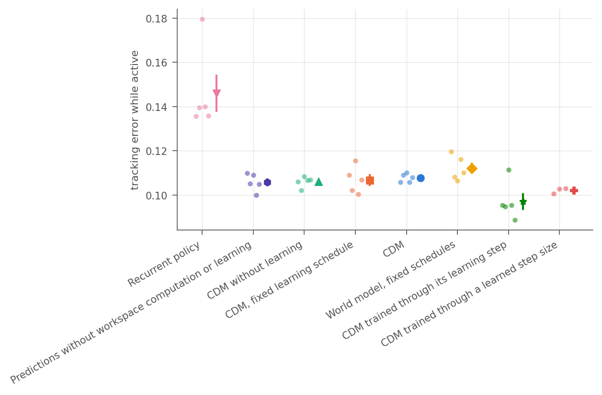
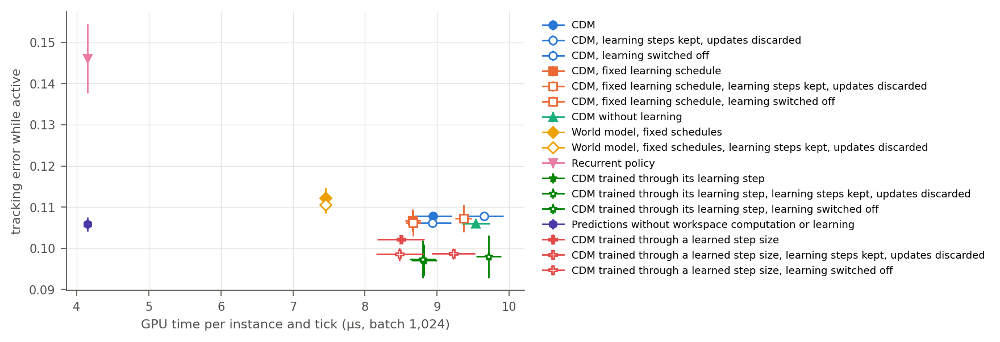

# Lifetime results

Setup, model and commands: [README](README.md). Error is the absolute tracking error while a request is active, averaged over one uninterrupted 16,384-tick lifetime on each of 512 newly sampled instruments; mean ± standard error over training seeds. Every setting of a model starts from the same random state, so settings of one model are compared under common random numbers. Reference points: random actions 0.305; a greedy controller that knows the true steady response 0.115, which ignores the dynamics and is not a bound ([references](results/references.json)).

All models below were trained after the corrections of [issue #1](https://github.com/Cherish0925/continual-decision-model/issues/1) (revision `2f7a174` for the seven principal settings, `aee4702` for the two-family and learned-step runs): 35.9 M parameters, 2·10⁷ interactions per seed.

## Summary

1. **Action-conditioned prediction carries the gain over the recurrent policy.** Training the predictor and supplying its predictions to the policy together lower error from 0.146 to 0.106; a recurrent policy trained with the same prediction loss but reading no prediction (`predict_hidden`, training) separates the two. Workspace refinements, online learning and the choice of when to learn add nothing measurable on top on these instruments.
2. **Learned allocation of observation and compute beats fixed schedules** (0.107 against 0.112).
3. **Training the shared network through the learning step gives the best model**: 0.097 on the training family and the lowest error on every held-out family, level with its learned-step version on the slowest. At deployment its updates are neutral on the training family, so the gain is not explained by the updates themselves.
4. **The instance's own updates, as trained, do not help and usually hurt** (+0.0015 ± 0.0003 against discarding them, five seeds), most with noisier sensors. A smaller step at test time removes the harm, and on unfamiliar slow dynamics the model trained through its step gains a little from its updates (−0.0031 ± 0.0016). Why the updates fail is not yet established by training comparisons; the candidate causes are listed below.
5. **One set of weights runs both process families**, at a cost against single-family models that saw twice as much of each family.
6. **Control continues while learning runs on its own stream** for up to 64 instances: a median response of 3.5–3.7 ms at a 10 ms period, with learning raising the p99 to 11–13 ms and leaving 5–8 % of steps on an action that does not answer the newest observation, so not a deadline guarantee. At 512 instances learning contends with control and 24–92 % of steps run behind the newest observation.

## Principal comparison

| Setting | Seeds | Error | Reward / 100 ticks | Refinements / tick | Measurements / 100 | Learning / 100 | GPU µs / tick |
| --- | ---: | ---: | ---: | ---: | ---: | ---: | ---: |
| Recurrent policy | 5 | 0.1461 ± 0.0084 | −9.04 | 0.00 | 18.9 | 0.0 | 4.15 |
| Predictions only | 5 | 0.1058 ± 0.0018 | −6.60 | 0.00 | 18.7 | 0.0 | 4.15 |
| + learned workspace computation (no learning) | 5 | 0.1061 ± 0.0011 | −6.90 | 1.47 | 17.4 | 0.0 | 9.54 |
| + learning on a fixed schedule | 5 | 0.1068 ± 0.0027 | −7.12 | 1.08 | 18.6 | 12.5 | 8.66 |
| + choosing when to learn (full setting) | 5 | 0.1078 ± 0.0009 | −7.23 | 1.14 | 19.9 | 13.5 | 8.94 |
| World model, fixed schedules | 5 | 0.1122 ± 0.0025 | −7.32 | 0.75 | 12.5 | 12.5 | 7.45 |
| CDM trained through its learning step | 5 | **0.0971 ± 0.0038** | −6.59 | 1.11 | 20.6 | 13.7 | 8.82 |
| Same, with a learned step size | 3 | 0.1022 ± 0.0008 | −6.89 | 1.01 | 21.1 | 14.4 | 8.50 |

GPU µs per tick is an estimate: each setting's refinement and learning rates converted with per-operation times measured per instance at batch 1,024 (4.15 µs for the control path, 3.67 per refinement, 4.45 per learning step), not an end-to-end measurement of each setting. Full table with prediction errors and the other settings: [results/main/table.md](results/main/table.md).

Read top to bottom, each row adds one ability. World prediction, as prediction supervision together with predictions supplied to the policy, lowers error by 0.040 (28 %). Learned refinement of the workspace adds nothing (0.1058 → 0.1061) and more than doubles the compute; online learning and the choice of when to learn add nothing further. With the same fixed learning, learned allocation of measurement and refinement (`fixed_learn`) beats fixed schedules (`world_model`) by 0.005. The loss through the learning step lowers error to 0.097, a tenth below the full setting.

## What the instance's own learning contributes

Each learning model is evaluated three times on the same instruments: as trained, with every chosen learning step kept but its adapter update thrown away (*discarded*), and with learning switched off so that its compute goes to refinement (*off*). Differences are paired by seed. The discarded setting keeps the simulated duration and nominal cost of each learning step but skips its gradient computation, so it is not a comparison at matched wall-clock compute.

Error, updates applied minus discarded:

| Model | Training family | Slow, narrow | Cheap noise 0.4 | Frequent changes |
| --- | ---: | ---: | ---: | ---: |
| Full setting | +0.0015 ± 0.0003 | +0.0010 ± 0.0018 | +0.0061 ± 0.0011 | +0.0015 ± 0.0010 |
| Fixed learning schedule | +0.0006 ± 0.0006 | +0.0024 ± 0.0007 | +0.0045 ± 0.0012 | +0.0016 ± 0.0005 |
| World model, fixed schedules | +0.0016 ± 0.0004 | +0.0012 ± 0.0011 | +0.0041 ± 0.0011 | +0.0020 ± 0.0007 |
| Trained through its learning step | −0.0002 ± 0.0009 | **−0.0031 ± 0.0016** | +0.0016 ± 0.0011 | −0.0008 ± 0.0005 |
| Same, learned step size (3 seeds) | +0.0036 ± 0.0008 | +0.0053 ± 0.0015 | +0.0049 ± 0.0007 | +0.0033 ± 0.0010 |

Error, learning on minus off:

| Model | Training family | Slow, narrow | Cheap noise 0.4 | Frequent changes |
| --- | ---: | ---: | ---: | ---: |
| Full setting | −0.0000 ± 0.0011 | −0.0000 ± 0.0050 | +0.0050 ± 0.0014 | +0.0009 ± 0.0015 |
| Fixed learning schedule | −0.0004 ± 0.0010 | +0.0005 ± 0.0028 | +0.0030 ± 0.0018 | −0.0001 ± 0.0008 |
| Trained through its learning step | −0.0009 ± 0.0015 | **−0.0045 ± 0.0021** | +0.0015 ± 0.0014 | −0.0009 ± 0.0012 |
| Same, learned step size (3 seeds) | +0.0034 ± 0.0006 | +0.0024 ± 0.0004 | +0.0052 ± 0.0009 | +0.0038 ± 0.0017 |

For models whose shared network was not trained through the learning step, applying the updates raises error on every family, most with noisier readings. Trained through the step, the network makes its updates neutral or useful, and useful on dynamics slower and narrower than any seen in training. The implementation suggests several candidate causes, each an established property of the code whose effect on performance still needs a training comparison: a learning step moves the adapter a fixed normalised distance whatever the size of the gradient; its targets are the noisy cheap readings, while precise readings never reach the adapter; the recent buffer mixes operating conditions around a switch; and the meta loss scores one step per window on a recorded trajectory, whereas deployment takes repeated steps about every seven ticks.

**Step size.** The step of 0.05 was set on an earlier one-actuator task. At test time, a step of 0.015 lowers the full setting's error by 0.0020 ± 0.0003 on the training family and makes its updates slightly better than discarding them (−0.0005 ± 0.0001); the model trained through its step reaches 0.0964 (five seeds each, [results](results/step_size.json)). Learning the step size through the meta loss drives it to 0.302, 0.312 and 0.303 in three seeds, six times larger, and the deployed updates of these models hurt on every family. That loss scores one step on the first half of a training window by the second half, whereas deployment takes a step about every seven ticks; the mismatch is consistent with the result, and training through the deployed sequence of updates is the comparison that can establish it.

**Residual error** ([`probe.py decisions`](probe.py), seed 0, 128 instruments × 3,000 ticks): mean absolute difference from the noise-free next output on identical states.

| Model | Shared predictor alone, action taken / all actions | With the instance adapter | Greedy choices differ | One-step regret, adapted / shared |
| --- | ---: | ---: | ---: | ---: |
| Full setting | 0.067 / 0.070 | 0.072 / 0.073 | 86 % | 0.057 / 0.055 |
| Trained through its learning step | 0.066 / 0.066 | **0.065 / 0.065** | 66 % | 0.051 / 0.052 |
| Same, learned step size | **0.056 / 0.058** | 0.075 / 0.077 | 92 % | 0.057 / 0.046 |

About 0.06–0.07 of the noise-free next output remains unexplained, a quarter of the sensor noise; not all of it is necessarily inferable from the agent's observations. The adapter of the model trained through its step removes a little of it; the plain adapter and the learned large step add to it. Training through a large step gives the best shared predictor of all, which the deployed updates then degrade ([probes](results/probes)).

**After a condition change** ([figure](results/main/error_after_switch.png)). Error is about 0.22 for 25 ticks after a change and falls to 0.13 by 50–100 ticks and 0.09 after 200. In the first 10–100 ticks the full setting is 0.004–0.005 worse with its updates applied than discarded, consistent with its adapter carrying the previous condition into the next. Conditions met before in the lifetime are only 0.002–0.005 easier than new ones, whether the model learns or not, so the single adapter, overwritten before a condition returns, provides no retention. Both learning models choose learning more often after a change, from 0.128 to 0.157 (full) and 0.135 to 0.169 (trained through the step) learning steps per tick at 10–25 ticks, and return to the baseline within a few hundred ticks; this is a frequency, not a step size. Without learning, the model raises its refinements instead.

## Held-out dynamics

Own setting of every model, five seeds (three for the learned step size). Quarter-size evaluations: 128 instruments × 4,096 ticks.

| Setting | Training family | Time constant 8–16, width 0.15–0.25 | Cheap noise 0.4 | A change every 150 ticks, half new |
| --- | ---: | ---: | ---: | ---: |
| Recurrent policy | 0.1461 ± 0.0084 | 0.3001 ± 0.0102 | 0.1616 ± 0.0082 | 0.1659 ± 0.0070 |
| Predictions only | 0.1058 ± 0.0018 | 0.2676 ± 0.0024 | 0.1202 ± 0.0025 | 0.1329 ± 0.0018 |
| + learned workspace computation (no learning) | 0.1061 ± 0.0011 | 0.2756 ± 0.0071 | 0.1214 ± 0.0027 | 0.1348 ± 0.0015 |
| + learning on a fixed schedule | 0.1068 ± 0.0027 | 0.2746 ± 0.0053 | 0.1287 ± 0.0055 | 0.1327 ± 0.0027 |
| + choosing when to learn (full setting) | 0.1078 ± 0.0009 | 0.2782 ± 0.0029 | 0.1249 ± 0.0006 | 0.1349 ± 0.0011 |
| World model, fixed schedules | 0.1122 ± 0.0025 | 0.2781 ± 0.0057 | 0.1350 ± 0.0026 | 0.1403 ± 0.0026 |
| CDM trained through its learning step | **0.0971 ± 0.0038** | 0.2621 ± 0.0151 | **0.1118 ± 0.0053** | **0.1210 ± 0.0043** |
| Same, with a learned step size | 0.1022 ± 0.0008 | **0.2598 ± 0.0161** | 0.1127 ± 0.0013 | 0.1253 ± 0.0010 |
| *True-steady greedy reference* | *0.115* | *0.224* | *0.115* | *0.113* |

On every family the recurrent policy is worst and the models trained through their learning step are best; the settings between them stay within a few thousandths of each other. On slower, narrower instruments all models fall short of the true-steady reference: holding the right action takes longer to pay off than a 60-tick request allows.

## One model across two process families

Error over the first 8,000 ticks of each lifetime, so that evaluations of different length are compared over the same span; 256 processes × 8,192 ticks for the two-family runs.

| Model | Instrument | Thermal |
| --- | ---: | ---: |
| Full setting, instruments only | 0.1083 ± 0.0010 (5) | 0.2444 ± 0.0098 (5) |
| Trained through its learning step, instruments only | 0.0970 ± 0.0037 (5) | 0.2272 ± 0.0205 (5) |
| Full setting, thermal processes only | 0.4078 ± 0.0032 (3) | **0.0670 ± 0.0006 (3)** |
| Full setting on both families | 0.1306 ± 0.0057 (3) | 0.0801 ± 0.0037 (3) |
| Same, without learning | 0.1322 ± 0.0069 (3) | 0.0891 ± 0.0030 (3) |
| Recurrent policy on both families | 0.1761 ± 0.0047 (3) | 0.0872 ± 0.0054 (3) |
| *True-steady greedy reference* | *0.115* | *0.091* |

Neither single-family model transfers: instruments-only models track thermal processes at 0.23–0.24, the thermal model tracks instruments at 0.41. The model trained on both runs both without being told which family a process belongs to, at 0.023 above the instrument model and 0.013 above the thermal model; each single-family model had twice as much experience of its family within the same 2·10⁷ interactions, so the gap cannot be attributed to interference between families. It keeps the advantage of prediction over the recurrent policy on both families. With learning switched off it tracks thermal processes 0.0076 ± 0.0051 worse, but with its updates merely discarded only 0.0004 ± 0.0010 worse, which points to its allocation of computation rather than the updates. The thermal model anticipates the two-state dynamics and beats the true-steady reference (0.067 against 0.091). Full table: [results/two_families/families.md](results/two_families/families.md).

## Acting against an independent clock

[`realtime.py`](realtime.py), idle H100, processes stepping every 10 ms for 3,000 steps. Each agent cycle absorbs, in order, every observation published since the previous cycle, learns from the action the process actually applied, and counts elapsed time in process steps; it then decides on its newest state. Response is the time from the newest published observation to the published action. A step *behind* is one the process ran on an action that did not answer the observation just before it, because the answer had not arrived. Rates use measured wall time.

| Model | Instances | Learning | Response p50 / p95 / p99 (ms) | Steps behind | Observations per decision | Error | Learning steps / s |
| --- | ---: | --- | --- | ---: | ---: | ---: | ---: |
| Full setting | 1 | on | 3.64 / 4.38 / 4.93 | 52 (1.7 %) | 1.01 | 0.085 | 11 |
| Full setting | 1 | off | 3.58 / 4.34 / 4.95 | 0 | 1.00 | 0.099 | 0 |
| Full setting | 64 | on | 3.65 / 7.57 / 12.61 | 229 (7.6 %) | 1.02 | 0.108 | 612 |
| Full setting | 64 | off | 3.53 / 3.79 / 4.80 | 18 (0.6 %) | 1.00 | 0.107 | 0 |
| Full setting | 512 | on | 8.09 / 11.83 / 14.06 | 2,760 (92 %) | 1.06 | 0.124 | 5,157 |
| Full setting | 512 | off | 4.08 / 5.42 / 10.89 | 124 (4.1 %) | 1.01 | 0.108 | 0 |
| Trained through its learning step | 64 | on | 3.50 / 4.96 / 11.31 | 161 (5.4 %) | 1.02 | 0.096 | 611 |
| Trained through its learning step | 512 | on | 5.80 / 10.65 / 13.80 | 711 (24 %) | 1.04 | 0.102 | 4,977 |

Up to 64 instances the median response stays near 3.6 ms and tracking matches the simulated evaluation (0.107–0.108 for the full setting, 0.096 for the model trained through its step). Learning on its own stream raises the p99 to 11–13 ms and leaves 5–8 % of steps behind, so this is not a deadline guarantee. At 512 instances five thousand learning steps per second share the GPU with control: the median response rises to 6–8 ms, a quarter to nearly all steps run behind, and the full setting tracks 0.016 worse than without learning. The workspace reads experience records one step older than in the simulated runtime, because nothing on the control path waits. Single-instance errors come from one 3,000-step lifetime each. Results: [full setting](results/realtime_full.json), [trained through its step](results/realtime_full_meta.json).

## Cost of training and of each operation

One training window of 131,072 transitions, measured alone on an H100 at width 1,024: four PPO epochs over minibatches of 64 streams with a 128-tick unroll ([stages](results/stages.json)).

| Setting | Collection | PPO update | Transitions per second | Peak memory |
| --- | ---: | ---: | ---: | ---: |
| Full | 2.28 s | 9.56 s | 11,071 | 15.9 GB |
| Full, trained through the learning step | 2.12 s | 11.21 s | 9,830 | 17.1 GB |
| Recurrent policy | 0.80 s | 1.48 s | 57,574 | 9.4 GB |

The update is 81 % of a window, most of it the recomputed workspace refinements of 8,192 rows per minibatch. One run saturates a GPU; three runs sharing one reach 10.5 k transitions per second together. A five-seed setting of 10⁸ transitions takes about 2.5 GPU-hours, the recurrent policy about 0.5.

[`latency.py`](latency.py), the same model on an idle H100 in BF16, fixed inputs ([results](results/latency.json)):

| Instances served together | Control path | One refinement | One learning step |
| --- | ---: | ---: | ---: |
| 1 | 1.91 ms | 1.00 ms | 1.04 ms |
| 256 | 2.01 ms | 1.34 ms | 1.27 ms |
| 1,024 | 4.25 ms | 3.75 ms | 4.56 ms |

With one instance controlled every 10 ms, the response from the scheduled start has a median of 2.89 ms and a p99 of 3.43 ms; with a learner running back to back on a second stream, 3.29 ms and 4.35 ms, and no missed periods up to 256 instances. At 1,024 instances a continuous learner saturates the GPU and every period is missed.

## A persistent state must keep one scale

The first campaign used a workspace whose refinement was a pre-norm Transformer block with residual updates and no normalisation of the slots themselves. Over a lifetime the slots grew linearly, by about 72 per tick: a slot norm of 3.6·10⁴ after 500 ticks and 1.4·10⁵ after 2,000. After a few hundred refinements each increment was negligible against the accumulated sum, so the workspace direction froze; bf16 storage of the window lost the increments; and the long-running training streams carried workspaces written under earlier parameters.

The training logs did not show the problem, because the policy trained on exactly that fleet. A fresh lifetime did:

| Setting (seed 0, first campaign) | Training log, last windows | Fresh 16,384-tick lifetime, 512 instruments |
| --- | ---: | ---: |
| Full | 0.110 | 0.175 |
| World model, fixed schedules | 0.111 | 0.197 |
| Recurrent policy (never refines) | 0.160 | 0.158 |

Every refinement now ends with a normalisation of each slot ([`cdm/core.py`](../../cdm/core.py)); slot norms stay at √width throughout training, and evaluation on fresh lifetimes agrees with the training logs.

## What the predictions were worth early in training

A probe of a first-campaign model (full setting without the goal term, 6.5·10⁶ interactions, [result](results/probe_no_goal_term_6.5M.json)) compared its policy with a greedy readout of its own predictions, which takes the action whose predicted next reading is closest to the setpoint:

| Control | Learning on | Learning off |
| --- | ---: | ---: |
| Trained policy | 0.235 | 0.242 |
| Greedy readout of the model's predictions | **0.194** | 0.315 |

The predictions held more than the policy had yet learned to use, which is why the control head carries a learned preference for actions predicted to reach the setpoint. Trained to the end, the policy exceeds the readout of its predictions (0.105 against 0.126 for the full setting at seed 0).

## Checkpoints trained before the corrections

Twelve checkpoints trained before the reset and accounting corrections, re-evaluated with the corrected metrics, are reported separately in [results/prefix_trainer](results/prefix_trainer): every prediction-based setting at 0.098–0.110 against 0.167 for the recurrent policy, and no measurable effect of learning, in agreement with the results above.

## What follows

- **Learning that serves retention.** A single adapter following recent experience cannot hold a condition until it returns. Adapters indexed by recognised condition, or a bank of them read by the workspace, are the next design to test.
- **The update that deployment takes.** Train the shared network through repeated small steps at the deployed rate rather than through one step per window, and learn the step size under that objective.
- **Less computation where it buys nothing.** On these instruments predictions alone match the full model at less than half the GPU time; the activity head should learn to refine only where refinement pays, and tasks that require longer inference are needed to test the workspace.
- **Learning beside control at scale.** Bound the learner's share of the GPU so that control keeps its deadlines at hundreds of instances.
- **Further families.** Navigation and delayed digital tools on the same core.
