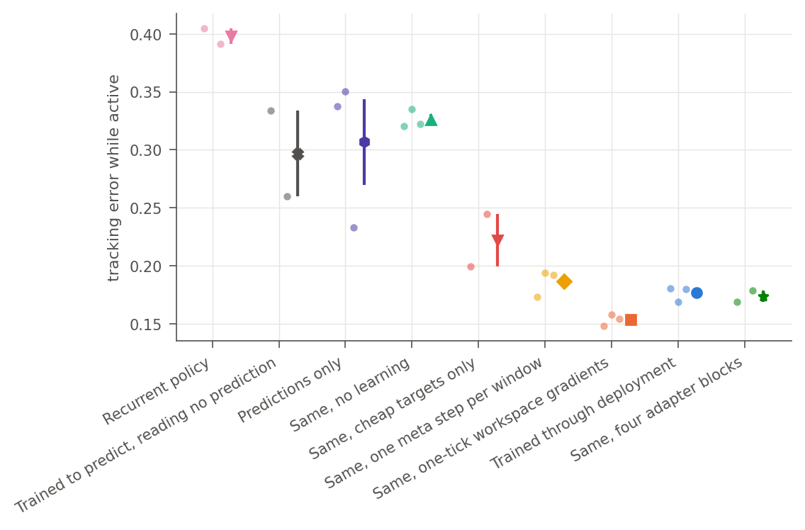
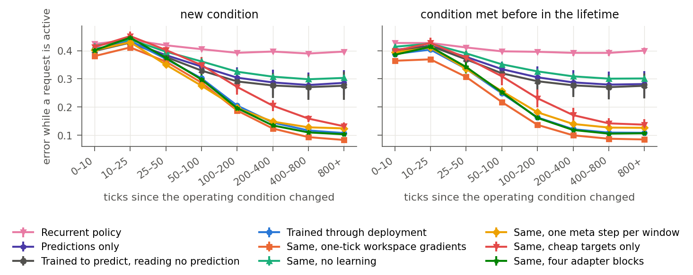

# Lifetime results

Setup, model and commands: [README](README.md). Two rounds of training on process lifetimes: the [second round](#second-round-training-through-deployment) trains the model through the process it is deployed in; the [first round](#first-round) trained eight settings that switch prediction, refinement, measurement choice and learning on and off, and found that the instance's own updates did not help.

## Second round: training through deployment

The first round trained the instance's learning, the workspace and the activity choice differently from how they ran. The second round trains the same core through the process it is deployed in ([README](README.md#training-through-deployment)):

- the predictor learns through the learning steps the agent actually took, each on the buffer it read, with returning precise readings as targets;
- the workspace is unrolled across 16 external events with a keep, revise or restart gate, and the policy reads predictions recomputed under the adapter in effect;
- activity options are valued on copies of a process.

Half the instrument requests ask for the largest output instead of a setpoint, so errors are not comparable with the first round. Every variant trains for 2·10⁷ interactions per seed with the training code of revision `123f13c`; later revisions add options without changing these runs.

Evaluation runs one uninterrupted lifetime of 8,192 ticks on each of 512 newly sampled instruments, every setting of a model on the same random stream; held-out families use 128 instruments × 4,096 ticks. Error is the distance from the setpoint, or the shortfall from the largest steady output, while a request is active; mean ± standard error over seeds.

### Summary

1. **The instance's own learning carries the result.**
   - Trained through its deployed learning steps, the model reaches 0.153 ± 0.003 with one-tick workspace gradients and 0.177 ± 0.004 with the workspace unrolled. The same model without learning reaches 0.326 ± 0.005, and predictions only 0.307 ± 0.037.
   - Keeping its updates instead of discarding them at matched compute lowers error by 0.154 ± 0.013 and 0.105 ± 0.009. On every held-out family the gain is 0.06–0.14. In the first round, keeping the updates cost 0.0015.
   - After a change of operating condition its error keeps falling for hundreds of ticks, from about 0.40 to under 0.10. Models that do not learn stay near 0.29.
2. **The objective is what makes learning pay; precise targets add to it.**
   - Trained through one step per window, the model reaches 0.186 ± 0.007 and needs its updates far less: discarding them costs 0.047 ± 0.013. Its learned step grows to η = 0.12, twice its value under the deployed objective.
   - Trained on cheap readings only, it is 0.045 worse than with precise targets.
3. **Unrolling the workspace across events did not help** (0.177 against 0.153) and roughly doubled the training time.
   - The trained gates do not use their choice: each model applies one option to every slot at every refinement, whatever the request or the condition.
   - The workspace's computation still pays in the one-tick model. Computing refinements but leaving the workspace unchanged raises its error by 0.046 ± 0.010.
4. **Following values of activity options measured on copies of a process was not tested.**
   - The values repeat only over a few ticks and when averaged.
   - A head trained on them does not predict fresh states.
   - The term through which the policy was to follow the head had a zero gradient, an implementation error since corrected. Its weight also stayed near zero, because the head did not predict.
   - A new activity head trained by PPO alone over the fixed model reaches the jointly trained model's error.
5. **Computation between requests pays a little.** Removing it raises error by 0.010–0.012 and saves 5–8 % of GPU power in real time.
6. **A bank of four adapter blocks collapses onto one block**, shared by every condition. Returning conditions are re-acquired faster than new ones only when the updates are kept, from what the single adapter still holds.
7. **One model runs instruments, thermal processes and vehicles** without being told which. It is behind single-family models on each family and, on thermal processes, level with predictions only.
8. **Control by imagined rollouts of the same model is worse than its control head.** Its one-step greedy readout is better on setpoint requests only.

### Principal comparison

| Model | Seeds | Error | Setpoint requests | Largest-output requests | Learning / 100 | Refinements / tick | Measurements / 100 | GPU µs / tick |
| --- | ---: | ---: | ---: | ---: | ---: | ---: | ---: | ---: |
| Recurrent policy | 2 | 0.398 ± 0.007 | 0.222 | 0.574 | 0.0 | 0.00 | 11.8 | 4.31 |
| Recurrent policy trained to predict, reading no prediction | 2 | 0.297 ± 0.037 | 0.156 | 0.437 | 0.0 | 0.00 | 7.2 | 4.31 |
| Predictions only | 3 | 0.307 ± 0.037 | 0.162 | 0.452 | 0.0 | 0.00 | 13.7 | 4.31 |
| Workspace, no learning | 3 | 0.326 ± 0.005 | 0.177 | 0.475 | 0.0 | 1.59 | 18.1 | 10.28 |
| Deployed learning, cheap targets only | 2 | 0.222 ± 0.023 | 0.160 | 0.284 | 23.6 | 0.77 | 17.0 | 8.98 |
| One meta step per window | 3 | 0.186 ± 0.007 | 0.132 | 0.241 | 25.1 | 0.77 | 18.5 | 9.09 |
| Deployed learning, workspace unrolled with gate (`cdm`) | 3 | 0.177 ± 0.004 | 0.132 | 0.221 | 27.4 | 0.76 | 20.3 | 9.23 |
| Deployed learning, one-tick workspace gradients (`cdm_truncated`) | 3 | **0.153 ± 0.003** | **0.118** | **0.189** | 28.4 | 0.62 | 18.7 | 8.79 |
| Same as `cdm`, four adapter blocks | 2 | 0.174 ± 0.005 | 0.143 | 0.205 | 26.4 | 0.76 | 18.9 | 9.13 |

GPU µs per tick converts each model's refinement and learning rates with per-operation times measured on a second-round model at 1,024 instances ([latency](results/latency_c6_truncated.json)); it is an estimate, not an end-to-end measurement. Full table with every evaluation setting: [results/second_round/main/table.md](results/second_round/main/table.md).

The models that do not learn are within a few hundredths of each other, and their seeds spread widely (predictions only: 0.233, 0.338, 0.350). Prediction supervision again matters more than prediction readout: trained to predict, the recurrent policy that reads no prediction is level with predictions only. Every model that learns through deployment is between 0.15 and 0.22.

### What the instance's own learning contributes

Own error, and below it error with updates kept minus discarded, every learning step computed in both (negative: lower with the updates):

| Model | Training family | Time constant 8–16, width 0.15–0.25 | Cheap noise 0.4 | A change every 150 ticks, half new |
| --- | ---: | ---: | ---: | ---: |
| Workspace, no learning | 0.326 ± 0.005 | 0.559 ± 0.006 | 0.362 ± 0.009 | 0.347 ± 0.006 |
| Deployed learning, `cdm_truncated` | 0.153 ± 0.003 | 0.434 ± 0.011 | 0.212 ± 0.005 | 0.230 ± 0.005 |
| kept minus discarded | −0.154 ± 0.013 | −0.142 ± 0.013 | −0.139 ± 0.013 | −0.087 ± 0.013 |
| Deployed learning, `cdm` | 0.177 ± 0.004 | 0.409 ± 0.006 | 0.211 ± 0.004 | 0.247 ± 0.004 |
| kept minus discarded | −0.105 ± 0.009 | −0.130 ± 0.009 | −0.108 ± 0.010 | −0.063 ± 0.006 |
| Four adapter blocks | 0.174 ± 0.005 | 0.388 ± 0.018 | 0.204 ± 0.009 | 0.249 ± 0.007 |
| kept minus discarded | −0.091 ± 0.013 | −0.116 ± 0.009 | −0.109 ± 0.004 | −0.052 ± 0.010 |

Held-out reports: [slow, narrow](results/second_round/slow_narrow/table.md), [noisy](results/second_round/noisy/table.md), [frequent changes](results/second_round/fast_change/table.md).

**Error after a change of operating condition** shows what the updates do.

- With the updates, error falls from about 0.40 in the first 25 ticks to 0.18 at 100–200 ticks and 0.09 after 400.
- With the same model's updates discarded, it stays at 0.29 from 100 ticks on, as it does for every model that does not learn.
- Conditions met before in the lifetime are re-acquired faster: 0.22 against 0.29 at 50–100 ticks for the one-tick model, and 0.14 against 0.19 at 100–200. This holds only when the updates are kept; with them discarded, returning and new conditions are equal.

**The adapter's predictions.**

- Against the noise-free next output, the adapter removes 28 % of the shared predictor's residual for the action taken (0.064 against 0.089, `cdm` seed 0, [probe](results/probes/cdm_seed0.json)). In the first round it added to it.
- In the first ten ticks after a change, the adapter still predicts the previous condition (0.270 against 0.257 for the shared predictor alone). From 25 ticks on it is better.

**When the model refines and learns after a change.** It refines most just after a change: 0.91 refinements per tick in the first ten ticks, against 0.65–0.72 later. It learns most once it has a few dozen readings of the new condition: 0.22 learning steps per tick at first, 0.29 at 50–100 ticks.

### The objective that makes learning pay

| Variant | Seeds | Own | Updates discarded | Kept minus discarded | Shared predictor alone | Learned η / κ |
| --- | ---: | ---: | ---: | ---: | ---: | --- |
| Deployed objective, `cdm` | 3 | 0.177 ± 0.004 | 0.281 ± 0.012 | −0.105 ± 0.009 | 0.224 | 0.064 / 0.73 |
| Deployed objective, cheap targets only | 2 | 0.222 ± 0.023 | 0.311 ± 0.030 | −0.088 ± 0.007 | 0.236 | 0.072 / 0.67 |
| One meta step per window | 3 | 0.186 ± 0.007 | 0.234 ± 0.018 | −0.047 ± 0.013 | 0.212 | 0.12 / 0.63 |

The prediction column is the error of the shared predictor alone against the cheap reading, on the states of the model's own trajectory.

**Under the deployed objective, the shared predictor becomes a starting point for the adapter.** On its own it predicts worse than the shared predictor of a model trained without learning (0.224 against 0.213), and with its adapter better (0.212).

**Under one meta step per window, the model relies less on learning.** Its shared predictor stays good on its own (0.212) and the updates add less. Its own error is close to the deployed objective's because it relies less on learning, not because its learning works as well. Its learned step grows to 0.12, as it grew to 0.30 in the first round.

**The deployed objective keeps the step small and lets it follow the gradient further.** It keeps η at 0.06–0.07 and lowers κ from 1.0 to 0.64–0.77, so a step follows the gradient further before its size is bounded.

**Without precise targets and sensor noise, the model is worse on every family.** The updates still contribute most of its gain.

### Workspace across events

| Model | Seeds | Own | Refinements kept, workspace not updated | Refinement options removed |
| --- | ---: | ---: | ---: | ---: |
| Workspace, no learning | 3 | 0.326 ± 0.005 | 0.353 ± 0.005 (2) | 0.364 ± 0.006 |
| `cdm_truncated` (one-tick gradients, no gate) | 3 | 0.153 ± 0.003 | 0.199 ± 0.008 | 0.191 ± 0.005 |
| `cdm` (16 events, gate, recomputed predictions) | 3 | 0.177 ± 0.004 | 0.259 ± 0.066 | 0.255 ± 0.066 |
| Vehicles only (`cdm_navigation`) | 2 | 0.256 ± 0.007 | 0.361 ± 0.080 | 0.355 ± 0.078 |

*Refinements kept, workspace not updated* computes and charges every chosen refinement but leaves the workspace as it was. It isolates what the workspace's computation contributes, through control and through the activity heads that read the workspace. Removing the refinement options instead also changes the rest of the activity: models then learn far more often (41 against 28 steps per 100 ticks for `cdm_truncated`).

**Unrolling did not help.** Unrolling the workspace over 16 external events, with the gate and recomputed predictions (`cdm`), did not improve on one-tick workspace gradients with cached predictions (`cdm_truncated`), and roughly doubled the training time (2.3–3.4 against 1.5 hours per run on shared GPUs).

**The trained gates do not use their choice**, before requests, during them, or after condition changes ([probes](results/probes)).

- In the instrument model of seed 0, the gate revises every slot at every refinement (keep and restart between 10⁻⁸ and 10⁻⁶), as an ungated refinement does.
- In the vehicle model of seed 0, it keeps every slot's content, so a refinement only re-applies the slot normalisation and its learned scale and shift.
- Continuing, revising and restarting unfinished inference are all available through the gate; each trained model uses only one of them.

**How much a model relies on its workspace differs between seeds** of the same configuration: one `cdm` seed loses 0.21 with its workspace frozen, the other two 0.01–0.03.

### Activities valued on copies of a process

[`branches.py`](branches.py) values the same 1,024 states (128 instruments × 8 points) twice with independent randomness, on the finished `cdm_truncated` model ([sampled](results/branches_sampled.json), [greedy](results/branches_greedy.json), [greedy, four sets averaged](results/branches_greedy_averaged.json)). Values are centred within each activity over its allowed options. The repeatable share is the correlation of the two measurements; *same best* is how often both name the same best option.

| Copies | Horizon | Measurement: repeatable share / same best | Compute: repeatable share / same best |
| --- | ---: | --- | --- |
| One sampled set | 4 | 0.46 / 0.60 | 0.18 / 0.38 |
| | 8 | 0.04 / 0.49 | 0.03 / 0.33 |
| | 16 | −0.09 / 0.51 | 0.08 / 0.33 |
| | 32 | −0.05 / 0.49 | −0.06 / 0.29 |
| One greedy set | 4 | 0.38 / 0.67 | 0.25 / 0.39 |
| | 8 | 0.09 / 0.58 | 0.05 / 0.32 |
| | 32 | 0.08 / 0.54 | −0.01 / 0.22 |
| Four greedy sets averaged | 4 | **0.78** / 0.79 | **0.69** / 0.37 |
| | 8 | 0.62 / 0.68 | 0.39 / 0.30 |

**What one activity choice does is buried, within a few ticks, in the variability of what follows.** Even with every disturbance shared, a different choice soon changes a control, and from then on the copies diverge. Only short horizons, greedy continuations and averaged sets give values that repeat.

**The activity-value head did not predict fresh states in either configuration.**

- With one sampled set over 32 ticks, the values give it nothing to learn: its out-of-sample R² on fresh copies stayed near zero.
- With four averaged greedy 4-tick sets (`cdm_b6`), the values repeat, but a head trained on 128 copied states per window still does not predict fresh states. Its out-of-sample R² stayed at or below zero through training, and on fresh states of the finished model its estimates correlate with averaged values at 0.16.

**Whether following such values helps the activity choice remains untested.** The policy was to follow the head through the expected advantage of every option, weighted by the head's out-of-sample R². In that term the baseline was computed from the same policy probabilities and left in the graph, so the term and its gradient were zero. The error is corrected in [`train.py`](train.py), with a test that the gradient moves probability toward better options. Because the weight also stayed near zero, the runs that were to follow the head (`cdm_b6`, and over the fixed model) trained their activity heads by PPO alone, like their counterparts:

- `cdm_b6` and `cdm_b6_ppo` diverged as runs of different seeds do (0.224 against 0.192, one seed each).
- Over the fixed `cdm_truncated` model, the two runs of a newly initialised activity head were identical.

**PPO alone trains a new activity head over the fixed model to the jointly trained model's error** (0.148 ± 0.001 over two seeds, against 0.148 for the model it was trained over). That head learns more often (30 against 22 steps per 100 ticks) and refines less (0.56 against 0.80 per tick).

### Computation between requests

**Learning, not refinement, is what pays between requests.**

- A request is active on 60 % of the ticks. The trained models learn as often between requests as during them (0.26–0.28 learning steps per tick in both) and refine slightly more between them.
- Removing refinement and learning between requests, without retraining, raises error by 0.012 ± 0.003 (`cdm_truncated`) and 0.010 ± 0.001 (`cdm`). Without learning, it raises error by 0.002.
- The policy does not move the lost learning into the requests: it takes 0.28 steps per tick during requests either way.

In real time, removing it saves 5 % of GPU power at 64 instances and 8 % at 512 ([below](#real-time-and-power)).

### A bank of adapter blocks

**With four adapter blocks weighed by a selector of the state (`cdm_bank`), the bank behaves as one adapter.**

- Each condition is served on 80–91 % of its ticks by one block, and in every instance that block is the same for all conditions met. The selector collapsed onto one block.
- Its error and update contribution match one adapter: 0.174 ± 0.005 against 0.177, updates contributing −0.091 ± 0.013.

**The selector learns only from predictions within a 128-tick window**, where one block serves as well as several. Retention pays hundreds of ticks later, beyond what that window can credit. Returning conditions are re-acquired faster with the bank as without it, in the same proportion.

### Three families

Own-setting error over the first 4,000 ticks of each lifetime, so that evaluations of 8,192 and 4,096 ticks are compared over the same span ([table](results/second_round/families/families.md)):

| Model | Instruments | Thermal processes | Vehicles |
| --- | ---: | ---: | ---: |
| Deployed learning, instruments only (`cdm`) | 0.184 ± 0.003 (3) | — | — |
| Deployed learning, vehicles only | 0.356 ± 0.024 (2) | — | 0.258 ± 0.006 (2) |
| Deployed learning, thermal only | 0.663 (1) | 0.075 (1) | — |
| Deployed learning, three families | 0.256 ± 0.008 (2) | 0.134 ± 0.027 (2) | 0.309 ± 0.002 (2) |
| Predictions only, three families | 0.342 ± 0.003 (2) | 0.128 ± 0.027 (2) | 0.382 ± 0.002 (2) |

**The three-family model (`cdm_all`) runs instruments, thermal processes and vehicles without being told which**, with a third of the streams for each.

- It is behind each single-family model. Each of those had three times as much experience of its family within the same interactions, so the gap cannot be attributed to interference.
- It keeps the advantage of learning over predictions only on instruments and vehicles. On thermal processes it is level with predictions only (0.134 against 0.128): updates contribute little there in any model (0.003 for the thermal-only model).
- Learning contributes on vehicles: discarding updates costs the vehicle-only model 0.039 ± 0.009 and the three-family model 0.095 ± 0.001 on vehicles.

**Neither single-family model transfers to instruments**: the vehicle model tracks them at 0.36 and the thermal model at 0.66.

### Control by imagined rollouts

[`planner.py`](planner.py) replaces the control head by the action whose imagined readings over a few ticks of holding it stay closest to the goal. It uses the model's own fast state, predictor and adapter; activities and the random stream are the model's own (256 instruments × 4,096 ticks, seed 0, [results](results/planner.json)).

| Model | Control head: all / setpoint / largest output | One imagined tick | Four imagined ticks |
| --- | --- | --- | --- |
| `cdm_truncated` | 0.149 / 0.115 / 0.182 | 0.165 / **0.108** / 0.222 | 0.182 / 0.117 / 0.248 |
| `cdm` | 0.183 / 0.131 / 0.236 | 0.175 / **0.111** / 0.240 | 0.182 / 0.118 / 0.248 |

**The greedy readout of the model's one-step predictions tracks setpoints better than the control head, and requests for the largest output worse.** The head explores where the readout repeats its best guess.

**Imagined rollouts of four ticks are worse on both**, since the fast state was never trained on events it imagines itself.

### Real time and power

[`realtime.py`](realtime.py) on `cdm_truncated` seed 0, with processes stepping every 10 ms for 3,000 steps ([results](results/realtime_c6_truncated.json)). The other processes on the GPU were paused, which leaves it at 213 W.

| Instances | Setting | Response p50 / p95 / p99 (ms) | Steps behind | Error | Learning steps / s | Power (W) | Energy per step (J) |
| ---: | --- | --- | ---: | ---: | ---: | ---: | ---: |
| 1 | own | 3.68 / 4.42 / 5.10 | 52 (1.7 %) | 0.150 | 22 | 216 | 2.16 |
| 1 | no learning | 3.66 / 4.28 / 4.78 | 0 | 0.360 | 0 | 211 | 2.11 |
| 1 | no computation between requests | 3.75 / 4.25 / 4.54 | 0 | 0.147 | 16 | 207 | 2.07 |
| 64 | own | 3.62 / 4.19 / 8.58 | 94 (3.1 %) | 0.156 | 1,424 | 273 | 2.73 |
| 64 | no learning | 3.50 / 3.92 / 5.19 | 23 (0.8 %) | 0.311 | 0 | 269 | 2.69 |
| 64 | no computation between requests | 3.74 / 11.66 / 13.84 | 749 (25 %) | 0.170 | 981 | 261 | 2.61 |
| 512 | own | 7.93 / 12.16 / 14.30 | 2,987 (99.6 %) | 0.180 | 10,800 | 529 | 5.29 |
| 512 | no learning | 4.14 / 8.32 / 12.43 | 238 (7.9 %) | 0.314 | 0 | 557 | 5.57 |
| 512 | no computation between requests | 7.55 / 8.63 / 10.34 | 2,853 (95 %) | 0.194 | 7,622 | 487 | 4.87 |

**Against an independent clock the model keeps what simulation showed: learning halves its error at 1 and 64 instances.**

- Up to 64 instances the median response stays near 3.7 ms.
- At 512 instances, ten thousand learning steps per second share the GPU with control. Nearly every step runs on an action older than the newest observation, at a cost of 0.024 in error against 64 instances.

**Removing computation between requests saves 5 % of power at 64 instances and 8 % at 512, for 0.014 more error.** Learning bunched into the requests then delays control: 25 % of steps run behind at 64 instances, against 3 % with learning spread over idle time.

**Learning costs about two refinements.** One learning step on the 64-entry buffer takes 7.66 ms for 1,024 instances, and a refinement 3.86 ms ([latency](results/latency_c6_truncated.json)). Training charged 1.82 refinements per learning step, the ratio measured on the pilot model.

## First round

Setup, model and commands: [README](README.md). Error is the absolute tracking error while a request is active, averaged over one uninterrupted 16,384-tick lifetime on each of 512 newly sampled instruments; mean ± standard error over training seeds. Every setting of a model starts from the same random state, so settings of one model are compared under common random numbers. Reference points: random actions 0.305; a greedy controller that knows the true steady response 0.115, which ignores the dynamics and is not a bound ([references](results/references.json)).

All models below were trained after the corrections of [issue #1](https://github.com/Cherish0925/continual-decision-model/issues/1) (revision `2f7a174` for the seven principal settings, `aee4702` for the two-family and learned-step runs, `66f62cc` for the recurrent policy trained to predict): 35.9 M parameters, 2·10⁷ interactions per seed.

### Summary

1. **Prediction supervision carries the gain over the recurrent policy.** A recurrent policy trained with the same prediction loss as the predicting settings, but reading no prediction, lowers error from 0.146 to 0.109; supplying the predictions to the policy as well gives 0.106, a difference within the spread of seeds. Workspace refinements, online learning and the choice of when to learn add nothing measurable on top on these instruments.
2. **Learned allocation of observation and compute beats fixed schedules** (0.107 against 0.112).
3. **Training the shared network through the learning step gives the best model**: 0.097 on the training family and the lowest error on every held-out family, level with its learned-step version on the slowest. At deployment its updates are neutral on the training family, so the gain is not explained by the updates themselves.
4. **The instance's own updates, as trained, do not help and usually hurt** (+0.0015 ± 0.0003 against discarding them, five seeds), most with noisier sensors. A smaller step at test time removes the harm, and on unfamiliar slow dynamics the model trained through its step gains a little from its updates (−0.0031 ± 0.0016). Why the updates fail is not yet established by training comparisons; the candidate causes are listed below.
5. **One set of weights runs both process families**, at a cost against single-family models that saw twice as much of each family.
6. **Control continues while learning runs on its own stream** for up to 64 instances: a median response of 3.5–3.7 ms at a 10 ms period, with learning raising the p99 to 11–13 ms and leaving 5–8 % of steps on an action that does not answer the newest observation, so not a deadline guarantee. At 512 instances learning contends with control and 24–92 % of steps run behind the newest observation.

### Principal comparison

| Setting | Seeds | Error | Reward / 100 ticks | Refinements / tick | Measurements / 100 | Learning / 100 | GPU µs / tick |
| --- | ---: | ---: | ---: | ---: | ---: | ---: | ---: |
| Recurrent policy | 5 | 0.1461 ± 0.0084 | −9.04 | 0.00 | 18.9 | 0.0 | 4.15 |
| Recurrent policy trained to predict, reading no prediction | 5 | 0.1088 ± 0.0024 | −6.79 | 0.00 | 19.4 | 0.0 | 4.15 |
| Predictions only | 5 | 0.1058 ± 0.0018 | −6.60 | 0.00 | 18.7 | 0.0 | 4.15 |
| + learned workspace computation (no learning) | 5 | 0.1061 ± 0.0011 | −6.90 | 1.47 | 17.4 | 0.0 | 9.54 |
| + learning on a fixed schedule | 5 | 0.1068 ± 0.0027 | −7.12 | 1.08 | 18.6 | 12.5 | 8.66 |
| + choosing when to learn (full setting) | 5 | 0.1078 ± 0.0009 | −7.23 | 1.14 | 19.9 | 13.5 | 8.94 |
| World model, fixed schedules | 5 | 0.1122 ± 0.0025 | −7.32 | 0.75 | 12.5 | 12.5 | 7.45 |
| CDM trained through its learning step | 5 | **0.0971 ± 0.0038** | −6.59 | 1.11 | 20.6 | 13.7 | 8.82 |
| Same, with a learned step size | 3 | 0.1022 ± 0.0008 | −6.89 | 1.01 | 21.1 | 14.4 | 8.50 |

GPU µs per tick is an estimate: each setting's refinement and learning rates converted with per-operation times measured per instance at batch 1,024 (4.15 µs for the control path, 3.67 per refinement, 4.45 per learning step), not an end-to-end measurement of each setting. Full table with prediction errors and the other settings: [results/main/table.md](results/main/table.md).

Read top to bottom, each row adds one ability. Training the recurrent state to predict the next reading for every action lowers error by 0.037 (25 %), although the policy never reads a prediction: the supervision shapes the state. Supplying the predictions to the policy adds 0.003 ± 0.003, within the spread of seeds. Learned refinement of the workspace adds nothing (0.1058 → 0.1061) and more than doubles the compute; online learning and the choice of when to learn add nothing further. With the same fixed learning, learned allocation of measurement and refinement (`fixed_learn`) beats fixed schedules (`world_model`) by 0.005. The loss through the learning step lowers error to 0.097, a tenth below the full setting.

### What the instance's own learning contributes

Each learning model is evaluated three times on the same instruments: as trained, with every chosen learning step kept but its adapter update thrown away (*discarded*), and with learning switched off so that its compute goes to refinement (*off*). Differences are paired by seed. The discarded setting keeps the simulated duration and nominal cost of each learning step but skips its gradient computation, so it is not a comparison at matched wall-clock compute.

Error, updates applied minus discarded:

| Model | Training family | Slow, narrow | Cheap noise 0.4 | Frequent changes |
| --- | ---: | ---: | ---: | ---: |
| Full setting | +0.0015 ± 0.0003 | +0.0010 ± 0.0018 | +0.0061 ± 0.0011 | +0.0015 ± 0.0010 |
| Fixed learning schedule | +0.0006 ± 0.0006 | +0.0024 ± 0.0007 | +0.0045 ± 0.0012 | +0.0016 ± 0.0005 |
| World model, fixed schedules | +0.0016 ± 0.0004 | +0.0012 ± 0.0011 | +0.0041 ± 0.0011 | +0.0020 ± 0.0007 |
| Trained through its learning step | −0.0002 ± 0.0009 | **−0.0031 ± 0.0016** | +0.0016 ± 0.0011 | −0.0008 ± 0.0005 |
| Same, learned step size (3 seeds) | +0.0036 ± 0.0008 | +0.0053 ± 0.0015 | +0.0049 ± 0.0007 | +0.0033 ± 0.0010 |

Error, learning on minus off:

| Model | Training family | Slow, narrow | Cheap noise 0.4 | Frequent changes |
| --- | ---: | ---: | ---: | ---: |
| Full setting | −0.0000 ± 0.0011 | −0.0000 ± 0.0050 | +0.0050 ± 0.0014 | +0.0009 ± 0.0015 |
| Fixed learning schedule | −0.0004 ± 0.0010 | +0.0005 ± 0.0028 | +0.0030 ± 0.0018 | −0.0001 ± 0.0008 |
| Trained through its learning step | −0.0009 ± 0.0015 | **−0.0045 ± 0.0021** | +0.0015 ± 0.0014 | −0.0009 ± 0.0012 |
| Same, learned step size (3 seeds) | +0.0034 ± 0.0006 | +0.0024 ± 0.0004 | +0.0052 ± 0.0009 | +0.0038 ± 0.0017 |

For models whose shared network was not trained through the learning step, applying the updates raises error on every family, most with noisier readings. Trained through the step, the network makes its updates neutral or useful, and useful on dynamics slower and narrower than any seen in training. The implementation suggests several candidate causes, each an established property of the code whose effect on performance still needs a training comparison: a learning step moves the adapter a fixed normalised distance whatever the size of the gradient; its targets are the noisy cheap readings, while precise readings never reach the adapter; the recent buffer mixes operating conditions around a switch; and the meta loss scores one step per window on a recorded trajectory, whereas deployment takes repeated steps about every seven ticks.

**Step size.** The step of 0.05 was set on an earlier one-actuator task. At test time, a step of 0.015 lowers the full setting's error by 0.0020 ± 0.0003 on the training family and makes its updates slightly better than discarding them (−0.0005 ± 0.0001); the model trained through its step reaches 0.0964 (five seeds each, [results](results/step_size.json)). Learning the step size through the meta loss drives it to 0.302, 0.312 and 0.303 in three seeds, six times larger, and the deployed updates of these models hurt on every family. That loss scores one step on the first half of a training window by the second half, whereas deployment takes a step about every seven ticks; the mismatch is consistent with the result, and training through the deployed sequence of updates is the comparison that can establish it.

**Residual error** ([`probe.py decisions`](probe.py), seed 0, 128 instruments × 3,000 ticks): mean absolute difference from the noise-free next output on identical states.

| Model | Shared predictor alone, action taken / all actions | With the instance adapter | Greedy choices differ | One-step regret, adapted / shared |
| --- | ---: | ---: | ---: | ---: |
| Full setting | 0.067 / 0.070 | 0.072 / 0.073 | 86 % | 0.057 / 0.055 |
| Trained through its learning step | 0.066 / 0.066 | **0.065 / 0.065** | 66 % | 0.051 / 0.052 |
| Same, learned step size | **0.056 / 0.058** | 0.075 / 0.077 | 92 % | 0.057 / 0.046 |

About 0.06–0.07 of the noise-free next output remains unexplained, a quarter of the sensor noise; not all of it is necessarily inferable from the agent's observations. The adapter of the model trained through its step removes a little of it; the plain adapter and the learned large step add to it. Training through a large step gives the best shared predictor of all, which the deployed updates then degrade ([probes](results/probes)).

**After a condition change** ([figure](results/main/error_after_switch.png)). Error is about 0.22 for 25 ticks after a change and falls to 0.13 by 50–100 ticks and 0.09 after 200. In the first 10–100 ticks the full setting is 0.004–0.005 worse with its updates applied than discarded, consistent with its adapter carrying the previous condition into the next. Conditions met before in the lifetime are only 0.002–0.005 easier than new ones, whether the model learns or not, so the single adapter, overwritten before a condition returns, provides no retention. Both learning models choose learning more often after a change, from 0.128 to 0.157 (full) and 0.135 to 0.169 (trained through the step) learning steps per tick at 10–25 ticks, and return to the baseline within a few hundred ticks; this is a frequency, not a step size. Without learning, the model raises its refinements instead.

### Held-out dynamics

Own setting of every model, five seeds (three for the learned step size). Quarter-size evaluations: 128 instruments × 4,096 ticks.

| Setting | Training family | Time constant 8–16, width 0.15–0.25 | Cheap noise 0.4 | A change every 150 ticks, half new |
| --- | ---: | ---: | ---: | ---: |
| Recurrent policy | 0.1461 ± 0.0084 | 0.3001 ± 0.0102 | 0.1616 ± 0.0082 | 0.1659 ± 0.0070 |
| Recurrent policy trained to predict, reading no prediction | 0.1088 ± 0.0024 | 0.2671 ± 0.0068 | 0.1253 ± 0.0024 | 0.1361 ± 0.0030 |
| Predictions only | 0.1058 ± 0.0018 | 0.2676 ± 0.0024 | 0.1202 ± 0.0025 | 0.1329 ± 0.0018 |
| + learned workspace computation (no learning) | 0.1061 ± 0.0011 | 0.2756 ± 0.0071 | 0.1214 ± 0.0027 | 0.1348 ± 0.0015 |
| + learning on a fixed schedule | 0.1068 ± 0.0027 | 0.2746 ± 0.0053 | 0.1287 ± 0.0055 | 0.1327 ± 0.0027 |
| + choosing when to learn (full setting) | 0.1078 ± 0.0009 | 0.2782 ± 0.0029 | 0.1249 ± 0.0006 | 0.1349 ± 0.0011 |
| World model, fixed schedules | 0.1122 ± 0.0025 | 0.2781 ± 0.0057 | 0.1350 ± 0.0026 | 0.1403 ± 0.0026 |
| CDM trained through its learning step | **0.0971 ± 0.0038** | 0.2621 ± 0.0151 | **0.1118 ± 0.0053** | **0.1210 ± 0.0043** |
| Same, with a learned step size | 0.1022 ± 0.0008 | **0.2598 ± 0.0161** | 0.1127 ± 0.0013 | 0.1253 ± 0.0010 |
| *True-steady greedy reference* | *0.115* | *0.224* | *0.115* | *0.113* |

On every family the recurrent policy is worst and the models trained through their learning step are best; the settings between them stay within a few thousandths of each other. Prediction supervision without readout matches predictions only on slower, narrower instruments and trails it by 0.003–0.005 with noisier sensors or more frequent changes. On slower, narrower instruments all models fall short of the true-steady reference: holding the right action takes longer to pay off than a 60-tick request allows.

### One model across two process families

Error over the first 8,000 ticks of each lifetime, so that evaluations of different length are compared over the same span; 256 processes × 8,192 ticks for the two-family runs.

| Model | Instrument | Thermal |
| --- | ---: | ---: |
| Full setting, instruments only | 0.1083 ± 0.0010 (5) | 0.2444 ± 0.0098 (5) |
| Trained through its learning step, instruments only | 0.0970 ± 0.0037 (5) | 0.2272 ± 0.0205 (5) |
| Full setting, thermal processes only | 0.4078 ± 0.0032 (3) | **0.0670 ± 0.0006 (3)** |
| Full setting on both families | 0.1306 ± 0.0057 (3) | 0.0801 ± 0.0037 (3) |
| Same, without learning | 0.1322 ± 0.0069 (3) | 0.0891 ± 0.0030 (3) |
| Recurrent policy on both families | 0.1761 ± 0.0047 (3) | 0.0872 ± 0.0054 (3) |
| *True-steady greedy reference* | *0.115* | *0.091* |

Neither single-family model transfers: instruments-only models track thermal processes at 0.23–0.24, the thermal model tracks instruments at 0.41. The model trained on both runs both without being told which family a process belongs to, at 0.023 above the instrument model and 0.013 above the thermal model; each single-family model had twice as much experience of its family within the same 2·10⁷ interactions, so the gap cannot be attributed to interference between families. It keeps the advantage of prediction over the recurrent policy on both families. With learning switched off it tracks thermal processes 0.0076 ± 0.0051 worse, but with its updates merely discarded only 0.0004 ± 0.0010 worse, which points to its allocation of computation rather than the updates. The thermal model anticipates the two-state dynamics and beats the true-steady reference (0.067 against 0.091). Full table: [results/two_families/families.md](results/two_families/families.md).

### Acting against an independent clock

[`realtime.py`](realtime.py), idle H100, processes stepping every 10 ms for 3,000 steps. Each agent cycle absorbs, in order, every observation published since the previous cycle, learns from the action the process actually applied, and counts elapsed time in process steps; it then decides on its newest state. Response is the time from the newest published observation to the published action. A step *behind* is one the process ran on an action that did not answer the observation just before it, because the answer had not arrived. Rates use measured wall time.

| Model | Instances | Learning | Response p50 / p95 / p99 (ms) | Steps behind | Observations per decision | Error | Learning steps / s |
| --- | ---: | --- | --- | ---: | ---: | ---: | ---: |
| Full setting | 1 | on | 3.64 / 4.38 / 4.93 | 52 (1.7 %) | 1.01 | 0.085 | 11 |
| Full setting | 1 | off | 3.58 / 4.34 / 4.95 | 0 | 1.00 | 0.099 | 0 |
| Full setting | 64 | on | 3.65 / 7.57 / 12.61 | 229 (7.6 %) | 1.02 | 0.108 | 612 |
| Full setting | 64 | off | 3.53 / 3.79 / 4.80 | 18 (0.6 %) | 1.00 | 0.107 | 0 |
| Full setting | 512 | on | 8.09 / 11.83 / 14.06 | 2,760 (92 %) | 1.06 | 0.124 | 5,157 |
| Full setting | 512 | off | 4.08 / 5.42 / 10.89 | 124 (4.1 %) | 1.01 | 0.108 | 0 |
| Trained through its learning step | 64 | on | 3.50 / 4.96 / 11.31 | 161 (5.4 %) | 1.02 | 0.096 | 611 |
| Trained through its learning step | 512 | on | 5.80 / 10.65 / 13.80 | 711 (24 %) | 1.04 | 0.102 | 4,977 |

Up to 64 instances the median response stays near 3.6 ms and tracking matches the simulated evaluation (0.107–0.108 for the full setting, 0.096 for the model trained through its step). Learning on its own stream raises the p99 to 11–13 ms and leaves 5–8 % of steps behind, so this is not a deadline guarantee. At 512 instances five thousand learning steps per second share the GPU with control: the median response rises to 6–8 ms, a quarter to nearly all steps run behind, and the full setting tracks 0.016 worse than without learning. The workspace reads experience records one step older than in the simulated runtime, because nothing on the control path waits. Single-instance errors come from one 3,000-step lifetime each. Results: [full setting](results/realtime_full.json), [trained through its step](results/realtime_full_meta.json).

### Cost of training and of each operation

One training window of 131,072 transitions, measured alone on an H100 at width 1,024: four PPO epochs over minibatches of 64 streams with a 128-tick unroll ([stages](results/stages.json)).

| Setting | Collection | PPO update | Transitions per second | Peak memory |
| --- | ---: | ---: | ---: | ---: |
| Full | 2.28 s | 9.56 s | 11,071 | 15.9 GB |
| Full, trained through the learning step | 2.12 s | 11.21 s | 9,830 | 17.1 GB |
| Recurrent policy | 0.80 s | 1.48 s | 57,574 | 9.4 GB |

The update is 81 % of a window, most of it the recomputed workspace refinements of 8,192 rows per minibatch. One run saturates a GPU; three runs sharing one reach 10.5 k transitions per second together. A five-seed setting of 10⁸ transitions takes about 2.5 GPU-hours, the recurrent policy about 0.5.

[`latency.py`](latency.py), the same model on an idle H100 in BF16, fixed inputs ([results](results/latency.json)):

| Instances served together | Control path | One refinement | One learning step |
| --- | ---: | ---: | ---: |
| 1 | 1.91 ms | 1.00 ms | 1.04 ms |
| 256 | 2.01 ms | 1.34 ms | 1.27 ms |
| 1,024 | 4.25 ms | 3.75 ms | 4.56 ms |

With one instance controlled every 10 ms, the response from the scheduled start has a median of 2.89 ms and a p99 of 3.43 ms; with a learner running back to back on a second stream, 3.29 ms and 4.35 ms, and no missed periods up to 256 instances. At 1,024 instances a continuous learner saturates the GPU and every period is missed.

### A persistent state must keep one scale

The first campaign used a workspace whose refinement was a pre-norm Transformer block with residual updates and no normalisation of the slots themselves. Over a lifetime the slots grew linearly, by about 72 per tick: a slot norm of 3.6·10⁴ after 500 ticks and 1.4·10⁵ after 2,000. After a few hundred refinements each increment was negligible against the accumulated sum, so the workspace direction froze; bf16 storage of the window lost the increments; and the long-running training streams carried workspaces written under earlier parameters.

The training logs did not show the problem, because the policy trained on exactly that fleet. A fresh lifetime did:

| Setting (seed 0, first campaign) | Training log, last windows | Fresh 16,384-tick lifetime, 512 instruments |
| --- | ---: | ---: |
| Full | 0.110 | 0.175 |
| World model, fixed schedules | 0.111 | 0.197 |
| Recurrent policy (never refines) | 0.160 | 0.158 |

Every refinement now ends with a normalisation of each slot ([`cdm/core.py`](../../cdm/core.py)); slot norms stay at √width throughout training, and evaluation on fresh lifetimes agrees with the training logs.

### What the predictions were worth early in training

A probe of a first-campaign model (full setting without the goal term, 6.5·10⁶ interactions, [result](results/probe_no_goal_term_6.5M.json)) compared its policy with a greedy readout of its own predictions, which takes the action whose predicted next reading is closest to the setpoint:

| Control | Learning on | Learning off |
| --- | ---: | ---: |
| Trained policy | 0.235 | 0.242 |
| Greedy readout of the model's predictions | **0.194** | 0.315 |

The predictions held more than the policy had yet learned to use, which is why the control head carries a learned preference for actions predicted to reach the setpoint. Trained to the end, the policy exceeds the readout of its predictions (0.105 against 0.126 for the full setting at seed 0).

### Checkpoints trained before the corrections

Twelve checkpoints trained before the reset and accounting corrections, re-evaluated with the corrected metrics, are reported separately in [results/prefix_trainer](results/prefix_trainer): every prediction-based setting at 0.098–0.110 against 0.167 for the recurrent policy, and no measurable effect of learning, in agreement with the results above.

## What follows

**Retention that training can credit.** A selector of adapter blocks trained within 128-tick windows serves every condition from one block, because retention pays hundreds of ticks later. Training windows or value targets must reach a condition's return before retention can be learned:

- training across a return with stored adapters;
- a retention loss on a condition's earlier experience;
- recognising a condition explicitly from its prediction errors.

**Activity values that generalise across states.** Values from copies of a process repeat only over a few ticks and when averaged, and a head trained on 128 states per window does not predict fresh states. Before they can guide the policy, they need far more copied states, or a value target that does not pass through the variability of the continuation:

- the immediate change in prediction error;
- the information a measurement adds.

**Inference that continues.** Unrolling the workspace across events neither helped nor taught the gate to keep or restart work. Tasks whose decisions depend on inference that spans many events, such as planning around several walls or search over many conditions, are where this can be tested; on vehicles behind walls refinement already matters.

**Learning beside control at scale.** At 512 instances learning takes the GPU from control. Bound the learner's share so that control keeps its deadlines, and move learning into quiet intervals, which in real time also lowers power.

**Delayed digital tools.** Tools are not yet part of the shared core.
