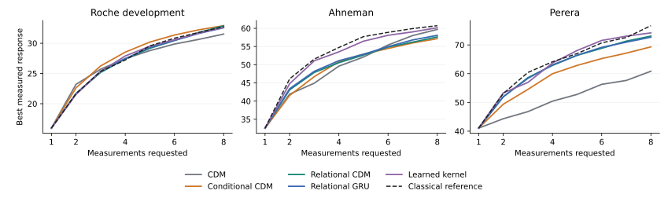

# Choosing measurements on experimental reaction screens

Can a small policy use the result of one experiment to choose a better next one on an unfamiliar reaction? Given the reagents on a recorded screen, choose eight distinct conditions. After each choice, only the selected measurement is returned. The objective is the best measured response found within the eight choices. This is retrospective selection among measured conditions: it does not simulate an unrecorded reaction or operate laboratory hardware.

## Data and separation

The [Roche study](https://doi.org/10.1021/acscentsci.5c02031) reports experimental screening on drug-like molecules. We use [the authors' v1 table](https://github.com/georg-wuitschik-Roche/zScore-App/blob/a7fa5d0311218cfa7e4a743be92be05bb6fb8824/frontend/public/data/v1.parquet): 67,202 rows and 42 reaction types. The response is reduced product peak area on a 0–100 scale, not isolated chemical yield. Each screen holds the notebook, plate, reaction type, two functional-group annotations and readout field fixed. Conditions describe base, catalyst, ligand, additive, coupling reagent and up to three solvents. Indistinguishable conditions are represented by the median recorded response. We keep screens with at least 12 distinct conditions, including flat screens.

| Split | Reaction types | Notebooks | Screens |
| --- | ---: | ---: | ---: |
| Train | 22 | 297 | 877 |
| Development | 8 | 134 | 350 |
| Final | 7 | 50 | 173 |

The 1,400 retained screens contain 48,586 condition values from 53,647 measurement rows. Whole reaction types and notebooks are disjoint. The split depends on names and notebook counts, never responses. No model input contains a notebook ID, well position, reaction type, full-screen rank, z-score or unrequested measurement. All policies get the same first random probe and shuffled menu for a given screen and start. Source rows are historical and available menus were chosen by chemists; this protocol does not estimate performance on arbitrary reagents.

## What is trained

The neural policies use the repository's [GRU and Transformer workspace](../../cdm/core.py) and [experimental action interface](../../cdm/active_experiment.py). A fixed hash encodes each public reagent name and role, without fitting a vocabulary to target responses. The policy learns from its own selected measurements. Actor–critic training uses the increase in the best response; an auxiliary target is the response to the next selected experiment, predicted before it is revealed. No demonstration teacher or unselected outcome is used for these neural losses.

| Policy | Access to returned measurements |
| --- | --- |
| CDM | The GRU and workspace ingest each new event. The workspace can read earlier events from this screen. |
| GRU | Same stream of actions and readings, separate training, no workspace or retrieval. |
| CDM, no readings | Same CDM architecture, trained separately with the response amplitudes hidden. Actions, remaining budget and selection reward during training are retained. |
| Conditional CDM | The same core plus a [learned action similarity and prior](../../cdm/conditional_measurement.py). A ridge solve propagates measured residuals to other candidates. The predicted mean and remaining uncertainty directly affect scores; the core learns the additional value for later choices. |
| Conditional CDM, no readings | The same conditional architecture, separately trained. Pending uncertainty can depend on selected locations, but no response amplitude enters the policy. |

For the same-weight comparison, also run each trained CDM unmodified with response amplitudes hidden. The classical references are random selection, a static reagent prior estimated from all source training labels, categorical kernel UCB with that prior, the same kernel with its mean updates disabled (diversity alone), and a local kernel starting at a constant mean and using no training labels. The methods share public reagent descriptions. The neural policies use hashed descriptions; the classical kernel tests literal equality. Recurrent and workspace policies share a query budget; their compute costs differ.

## Source development results

Eight seeds, five separately trained policies per seed, width 32 and four slots. Each ran 160 updates of 16 screens with eight measurements: **819,200 training lookups across 40 checkpoints**. Repeated selections are not new laboratory measurements. Within each screen, best-so-far peak area is averaged over four common starts; screens are averaged within notebook, then notebooks within reaction type, then types equally.

| Policy | Best after 4 | Best after 8 |
| --- | ---: | ---: |
| Random | 27.89 | 31.67 |
| Static source prior | 28.73 | 32.49 |
| Kernel UCB, source prior | 27.29 | 32.63 |
| Local kernel, no source training | 27.23 | **32.74** |
| GRU | 26.98 | 31.01 |
| CDM | 26.88 | 30.95 |
| Conditional CDM | 27.03 | **31.92** |

Hiding readings at deployment changed the original CDM's final score by less than 0.001 points on average. With the learned conditioning path, exposing the readings gained **0.60 points** over the very same weights without readings (7 of 8 seeds). The first two seeds motivated that comparison; the six further seeds averaged +0.63. The equal-budget separately trained conditional model without readings scored 30.31. These are development results. Useful feedback does not establish superiority to a simpler optimizer: the local kernel still leads here.

[Per-seed and per-family results](results/development.json) · [All matched curves](results/development_curves.npz) · [40 downloadable checkpoints and training configurations](https://github.com/Cherish0925/continual-decision-model/tree/5ec3e4b2f1ca936fc5f99a4023ca15afea6fb024/models/measured_reactions) · [Frozen checkpoint digests](results/endpoints.json). Extract the eight seed archives into the same run directory to repeat evaluation without training. The curve array is ordered by condition, matched screen/start, then measurement.

## Frozen transfer to other laboratories

Use the same forty fitted policies, fixed condition encoder, eight-query budget and four common starts. Evaluate two distinct source workbooks from the [reaction-yields archive](https://github.com/rxn4chemistry/rxn_yields/tree/d9e6b87ce1b881978490d68bfc00021e3b48127a/data):

- [Ahneman et al.](https://doi.org/10.1126/science.aar5169): one screen per aryl halide, actions described by ligand, base and additive; use the reported yield. Read only `FullCV_01`; the other shuffled sheets repeat records.
- [Perera et al.](https://doi.org/10.1126/science.aap9112): one screen per reactant pair, actions described by catalyst, ligand, base and solvent; use the reported UV product-area response.

The adapter maps published columns to existing reagent roles, trims outer whitespace and does not learn reagent identities or transform chemical structures. Neither weights, source priors nor hyperparameters are fit on these datasets; a reading may change predictions within a screen. Reagent nomenclature and response scales differ, so report each study separately. These are new laboratories and screens, not a claim that both reaction families were absent from source training.

The [protocol and 40 checkpoint hashes](https://github.com/Cherish0925/continual-decision-model/commit/35ff4ea74edebb989ccf75f7230a3d9d03f2ca4c) were committed before scoring. Both datasets supply 15 substrate screens; Ahneman has 3,955 measured conditions and Perera 5,760. No weights or feature mappings were fit to either one. Scores below are the best response found with eight probes, averaged over four common starts and the 15 screens. Neural scores also average the same eight training seeds.

| Policy | Ahneman (reported yield) | Perera (UV product area) |
| --- | ---: | ---: |
| Random selection | 59.04 | 70.29 |
| Static source prior | 59.04 | 74.75 |
| Kernel UCB with source prior | 59.47 | **76.70** |
| Kernel diversity with source prior, no returned amplitudes | **60.73** | 71.77 |
| Local kernel, no source training | 60.28 | 74.89 |
| GRU | 59.42 | 66.48 |
| CDM | 58.32 | 64.12 |
| Conditional CDM | **60.01** | **72.07** |
| Conditional CDM, separately trained without readings | 58.44 | 72.60 |

Enabling actual measurements in the **same trained conditional weights** added 2.10 points on Ahneman (7/8 seeds positive) and 2.64 on Perera (8/8). The analogous changes in the original CDM were +0.06 and −0.14. The response update therefore affected useful choices at new laboratories, but it did not deliver the highest overall result. On Perera the separately trained no-readings policy also scored higher than the conditional policy. Comparisons are paired within each source; absolute scores should not be compared across the two columns. The seven final Roche families have not been scored.

[All external scores](results/external.json) · [Matched per-screen curves](results/external_curves.npz).

## Larger training and a representation comparison

The 4 November GPU campaign completed the declared 40 trainings: width 128,
eight slots, 1,000 updates of 64 screens and 20,480,000 total training lookups.
Eight seeds (101–108) ran across 32 A100 GPUs. Individual training took 24–70
seconds, excluding process startup and evaluation. All endpoints use the
fixed update count. The conditional model has 867,345 total parameters; this
is a new small instantiation of the shared core implementation, not the native
55-million-parameter policy or one set of weights spanning all applications.

| Policy | Roche development | Ahneman | Perera |
| --- | ---: | ---: | ---: |
| CDM | 31.52 | 59.70 | 60.85 |
| GRU | 31.37 | 59.96 | 62.22 |
| CDM trained without readings | 32.05 | 65.10 | 70.43 |
| Conditional CDM | 32.91 | 57.16 | 69.33 |
| Conditional CDM trained without readings | 31.94 | 60.35 | 63.77 |
| Best original classical reference | 32.74 | 60.73 | 76.70 |

The source-development advantage over the best classical reference is small.
External performance is lower than the earlier width-32 conditional model.
Enabling readings in the same conditional weights still helps on average:
+0.78, +2.96 and +4.40 points, respectively. Useful feedback and overall
transfer performance therefore remain distinct. Width, batch size, update
count and seeds all changed from the earlier study; this is not an isolated
training-duration intervention. The seven final reaction families remain unused.

The second completed comparison fixes this larger training budget and tests whether
reagent-name representations contribute to poor transfer. Five alternatives
use the same source screens and seeds: a learned categorical kernel with the
named policy; a relation-only CDM; a relation-only GRU; a separately trained
relation-only CDM without readings; and the learned kernel without a recurrent
action scorer. The last condition learns only kernel/prior parameters.
All are trained from selected experimental outcomes, without demonstrations.

The relation-only inputs describe equality of reagent roles, frequencies in
the visible menu, and the returned measurements associated with those roles.
Consistent one-to-one renaming leaves these inputs and predictions unchanged.
The kernel learns which roles carry predictive information. These choices use
established [categorical Bayesian optimization](https://proceedings.mlr.press/v119/ru20a.html)
and [learned kernels](https://proceedings.mlr.press/v51/wilson16.html); their
basic operations are not new inventions. The experiment tests whether the
recurrent policy adds useful decisions beyond the kernel and whether removing
arbitrary name dependence improves transfer. The two external datasets have
already informed this redesign and now serve as external development
comparisons. Final source-family evaluation remains separate.

| Policy, eight training seeds | Roche development | Ahneman | Perera |
| --- | ---: | ---: | ---: |
| Categorical kernel, named CDM inputs | 32.58 | 58.19 | 68.52 |
| Relation-only CDM | 32.89 | 57.63 | 73.07 |
| Relation-only GRU | 32.57 | 58.08 | 72.69 |
| Relation-only CDM trained without readings | 32.03 | 58.59 | 70.68 |
| Learned kernel without a recurrent action scorer | 32.63 | 60.17 | 74.20 |

Enabling readings in the same relation-only CDM improves the Roche endpoint
by **1.37 points** (95% paired interval 0.43–2.45), Ahneman by **0.57**
(−1.58–2.32), and Perera by **7.68** (3.74–12.60). All eight seeds improve
on Roche and Perera. Relative to the named conditional CDM, Perera increases
by 3.74 points, but the interval spans −2.92–11.26. Neither the CDM–GRU
comparison nor the CDM–learned-kernel comparison establishes a stable gain.
Removing name dependence is therefore insufficient to produce an overall
advantage. The strongest classical reference remains competitive on Roche
and leads on the two external datasets; the learned no-readings portfolio
also remains particularly strong on Ahneman.

The intervals resample training seeds and whole experimental groups: reaction
types on Roche and substrate screens in each external study. They retain
paired starts and average screens within notebooks before averaging Roche
types. They describe this study's variation, not the entire space of chemistry.



Lines average eight seeds and four common starts. Each panel retains its own
published response scale. The classical curve is the strongest original
reference for that dataset. All ten trained policies, individual seeds,
feedback-removal comparisons and intervals are in the
[paired comparison](results/comparison.json). The
[first GPU campaign](results/scale_development.json) and
[representation campaign](results/relations_development.json) each completed
40 models and 20,480,000 training lookups. Their external results are retained
[separately](results/scale_external.json) for
[both comparisons](results/relations_external.json).

These experiments identify a useful observation-to-prediction pathway.
Extra persistent computation has not yet improved it reliably beyond a GRU
or a learned kernel. The next decision experiment must make the consequence
of a measurement and the cost of waiting part of the same objective; more
passes over these fixed tables cannot establish that capability.

## Run

```bash
python -m experiments.measured_reactions.campaign train-dev --data runs/measured_reactions/table.npz --out runs/measured_reactions/relations --devices cuda:0,cuda:1 --modes categorical,relational,relational_gru,relational_blind,relational_kernel
```

Pass the same `--modes` and `--seeds` to `report` and `external` for this
comparison. When external evaluation is split across machines,
`python -m experiments.measured_reactions.merge_external --input part1 --input part2 --out merged`
combines disjoint seed results and checks their common starts.
`python -m experiments.measured_reactions.compare --input scale_results --input relation_results --out comparison --plot`
recreates the paired intervals and figure. All eight final endpoints are used;
development scores do not select one checkpoint per method.

Both GPU campaigns used Python 3.12.13, Torch 2.11.0+cu128 and NumPy 2.2.6.
Source preparation used PyArrow 25.0.0 on the training hosts. A separate local
Torch 2.14 evaluation was interrupted by a native-library fault; the second
campaign's external results were completed with the cloud runtime. No failed
evaluation contributes a partial model score.

From the repository root, install the `neural` and `measured-reactions` extras and obtain the two upstream repositories at the revisions linked above. The preparation and transfer commands check the source file hashes. Raw experimental tables are not redistributed.

```bash
python -m experiments.measured_reactions.prepare /path/to/zScore-App/frontend/public/data/v1.parquet runs/measured_reactions/table.npz
python -m experiments.measured_reactions.campaign train-dev --data runs/measured_reactions/table.npz --out runs/measured_reactions/development --devices cpu,cpu,cpu,cpu --seeds 41,73,109,127,149,173,197,223 --width 32 --slots 4 --batch 16 --updates 160
python -m experiments.measured_reactions.report --runs runs/measured_reactions/development --data runs/measured_reactions/table.npz --out runs/measured_reactions/results
python -m experiments.measured_reactions.external --source-table runs/measured_reactions/table.npz --runs runs/measured_reactions/development --ahneman /path/to/rxn_yields/data/Buchwald-Hartwig/Dreher_and_Doyle_input_data.xlsx --perera /path/to/rxn_yields/data/Suzuki-Miyaura/aap9112_Data_File_S1.xlsx --out runs/measured_reactions/results
```

The GPU campaign defaults to width 128, eight slots and eight seeds, with 1,000 updates of 64 parallel screens per policy: **40 independent jobs, 20,480,000 training lookups**. `plan` prints the budget without launching work; `train-dev` trains or reuses matching completed jobs and scores development only. `test` is a separate command for a fixed set of endpoints. Keep the seven final source families out of policy and hyperparameter selection. For two servers, assign disjoint `--seeds` and let each name its own GPUs; only one machine needs to run the classical references. A native checkpoint may initialize the shared core with `--init-native`; the experimental readout is then trained on the source screens, so this is a different study from the randomly initialized one above.

```bash
python -m experiments.measured_reactions.campaign plan --data runs/measured_reactions/table.npz --out runs/measured_reactions/scale
python -m experiments.measured_reactions.campaign train-dev --data runs/measured_reactions/table.npz --out runs/measured_reactions/scale --devices cuda:0,cuda:1
```
