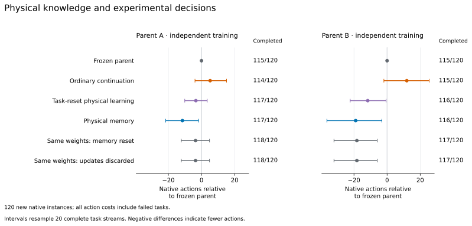

# Learning physical predictions across experiments

The model preserves uncertain scientific relationships across tasks, then
recalibrates them from the next task's measurements. These beliefs determine
predicted device settings and enter the experimental action policy. This changes
what online learning affects: acquired knowledge can change physical predictions,
in addition to predictions of operation cost or success.

## Physical belief and task memory

The [belief model](../../cdm/experimental_belief.py) maintains affine hypotheses
over measured quantities. For each hypothesis it represents uncertainty about
the intercept and slope. A new task starts with the shared learned prior and a
bounded set of Gaussian summaries of previous task posteriors. A learned coefficient-drift
distribution allows an earlier relation to recur with a new calibration.
Current measurements and publicly observed working settings determine the
relative evidence for each candidate context and relation.

The stored object is an uncertain predictive relationship. It does not contain
a scenario seed, a hidden relation label, or a future target setting. Within a
task, inference is recomputed from the available ledger, so reading the same
ledger twice does not count the evidence twice. Completing a task stores its
posterior once. Reset and computed-and-discarded controls remove this
cross-task information while retaining within-task calibration.

The implementation accepts an arbitrary feature count. This experiment uses
nine measured quantities and single-feature affine relationships, an explicit
hypothesis class. Its 73 shared trainable parameters describe coefficient
priors, observation noise, relation weights, context drift and memory weight.
Task-specific Bayesian updates change the predictive state. These updates are
distinct from SGD updates of the shared neural action core.

## Predictive training

[Data preparation](data.py) uses 1,663 recorded training worlds. Labels are
settings publicly observed while a reactor was active. Density, temperature,
quantum gap and spectra use their first recorded returns. Radiation uses the
minimum of up to 32 actual recorded measurements. This offline prediction study
reveals all selected readings before predicting a setting; acquiring those
readings is not free in the separate native task evaluation.

Each training stream contains two tasks under relationship A, two under B, then
two under A again. Each task has a fresh physical calibration. The model first
uses the two initial working settings to predict the first target. Only after
scoring that prediction is its public working setting revealed. The second
target is then predicted, revealed and incorporated into task memory.
Generating relation identities arrange the stream but never enter the model.

Half of training streams retain the recorded tasks. The other half practice
alternative affine relationships: a selected measured quantity and the two
original support settings define a new relationship, which generates target
settings. This extends the original four training relations to all nine
quantities. It is generated practice on recorded measurements, not additional
native simulator observations.

Two training repetitions use seeds 211 and 212. Both inherit the same numerical
prior, with independently initialized drift and memory parameters and independent
stream samples. Each runs 500 updates with 64 streams of six tasks, or 192,000
task presentations. The loss is predictive negative log likelihood in Hz, and
gradients pass through remembered task posteriors. A matched episodic model has
the same initialization, stream samples and budget, but resets memory at every
task. Final checkpoints use the fixed final update without validation selection.
All four trainings completed; [pretraining.csv](results/pretraining.csv) records
their budgets and measured runtime.

## Held-out physical predictions

The comparison uses 64 held-out source worlds, arranged into 128 six-task streams
per condition. A source world never repeats within one stream. Worlds recur
across streams, so the 1,536 predictions per condition are not 1,536 independent
physical instances. All compared methods receive the same stream and public
evidence.

Three conditions separate the recorded setting distribution from broader
calibrations:

- **Native:** recorded readings and observed working settings.
- **Alternative relationships:** generated affine relations through the two
  recorded support settings, using the held-out measured quantities.
- **Wider calibration:** the alternative tasks additionally receive a new
  per-task frequency scale in 0.35–2.0 and offset in −1,000–1,000 Hz. Some
  predictions lie outside the simulator's control range; this is a numerical
  prediction stress test, not a native task completion result.

The following table reports the mean absolute error of the mean under the
highest-probability relation. Slash-separated values are the two training
repetitions. Mixture means, predictive likelihoods and the other interventions
are included in [prediction.csv](results/prediction.csv).

| Model and deployment memory | Native MAE, Hz | Alternative MAE, Hz | Wider-calibration MAE, Hz |
| --- | ---: | ---: | ---: |
| Original numerical prior, no cross-task memory | 83.72 | 818.50 | 999.05 |
| Initial physical memory, before new training | 46.03 / 46.04 | 728.90 / 728.18 | 923.54 / 923.54 |
| Episodic training, memory retained at evaluation | 47.06 / 47.06 | 725.78 / 727.70 | 905.61 / 915.40 |
| Through-memory training, memory reset at evaluation | 169.54 / 181.45 | 858.74 / 861.09 | 1,010.82 / 1,009.58 |
| Through-memory training, memory retained | 118.03 / 137.23 | 639.83 / 628.43 | 860.62 / 838.93 |

Preserving learned physical posteriors improves predictions relative to resetting
the same model. Training through memory further improves the generated
relationship and wider-calibration conditions relative to episodic training.
It does not preserve the best native point predictions: initial memory and
episodic training are better on that measure. Lower predictive likelihood loss
alone does not establish a uniformly better experimental policy.

On the first prediction after A returns, the two through-memory models have
native MAE of 1.12 and 1.11 Hz, versus 175.21 and 197.96 after resetting memory,
and 404.26 and 467.82 when retaining only the last context. All 128 returning
predictions are within 2 Hz of the recorded successful setting. Initial memory
already reaches 1.22 and 1.23 Hz, with 126/128 within that interval. These
comparisons attribute much of this recovery to the new memory representation;
they do not attribute all of it to training through memory. A recorded
successful setting is not the simulator's hidden exact resonance, so this
interval count is not a task completion count. Phase-specific results are in
[prediction_phases.csv](results/prediction_phases.csv).

## What remains difficult

Two calibration pairs generally fit an affine function of each candidate
quantity. They need not identify which quantity actually determines the output.
Memory can supply a useful prior, but an unfamiliar calibration can still
require a distinguishing experiment.

The [error decomposition](results/prediction_mechanisms.csv) makes this problem
visible. In the wider-calibration condition, 70.1–72.3% of first-target
predictions select the wrong relationship. Those selections account for more
than 99.99% of absolute error. Conditioning the numerical prediction on the
generating relationship gives only 0.077 Hz MAE; this is an explanatory
calculation using evaluation metadata, not an available policy input. After the
first target's public working setting is revealed, wrong-relation selection
falls to 1.2%, and second-target MAE falls to 9.40 Hz. All selected features are
visible in this prediction protocol, so missing-feature treatment cannot explain
this particular failure.

The remaining ambiguity connects prediction to active experimentation. A failed
setting supplies information about which predictions are inconsistent with
actual feedback. Evaluating and using that information requires the measured
setting and its activation result; hidden target distances are unnecessary.
The frozen pretraining and native comparisons above do not yet condition their
physical posterior on those failed-setting intervals.

## Initial native task comparison

The pretrained belief was connected to the existing calibration-rehearsal action
policy without changing that policy's weights. Thirty new development instances
form five ordered task streams. Measurements are chosen and paid for in the
actual simulator; each method has the same public interfaces and 400-action
budget. This comparison tests the transfer from full-reading prediction to
partially observed action.

| Method | Completed | Mean native actions, including failures |
| --- | ---: | ---: |
| Calibration-rehearsal parent, seed 183 | 30/30 | 107.33 |
| Explicit relation-memory reference | 29/30 | 145.83 |
| Initial physical memory | 30/30 | 107.17 |
| Pretrained physical memory, seed 211 | 30/30 | 102.27 |
| Same weights, computed memory updates discarded | 30/30 | 105.40 |
| Pretrained physical memory, seed 212 | 30/30 | 102.27 |
| Same weights, computed memory updates discarded | 30/30 | 105.40 |

Both pretrained memories produce the same trajectories on this cohort. Relative
to discarding their updates, they save 94 native actions, concentrated in three
instances. First-return instances do not improve. The five-stream uncertainty
interval for the comparison with the seed-183 parent includes zero. This is a
development result that supports further joint training, not evidence of a
general capability advantage. The second action parent, seed 184, separately
completes 30/30 at 124.50 actions; it is the starting point for the second joint
training repetition.

Native records are under `runs/physical_belief/native_development/`, including
the per-instance comparisons in `comparisons/`. The joint action-training and
independent confirmation study use separately recorded conditions.

## Joint physical learning and experimental control

The [joint trainer](train_policy.py) connects physical prediction to both
information acquisition and device control. Nine relation tokens describe the
current means, uncertainty, relation probabilities and support counts. They
enter the same Transformer workspace as the received experimental evidence.
Consequently, the model can use previous physical knowledge when deciding which
quantity to measure, before a setting experiment is available. The setting
executor then uses the same physical prediction that informed the policy.

Each of two independently trained action parents has three continuations:

| Training condition | Physical prediction | Across-task physical memory |
| --- | --- | --- |
| Ordinary continuation | Existing fixed numerical prior | None |
| Task-reset physical learning | Trainable shared physical prior | Reset for each task |
| Physical memory | Trainable prior and context retrieval | Preserved within the task stream |

Every condition updates the GRU, Transformer workspace, evidence projections
and action/value heads: 26,653,443 trainable policy parameters. Physical-learning
conditions also update the 73 predictive parameters. Training through the
resulting posteriors lets subsequent prediction and action losses shape the
knowledge transferred between tasks. The neural task state resets at task
boundaries in every condition; within-task computation remains persistent.
One workspace refinement per received event is fixed across conditions.

The budget is 400 updates, 128 parallel streams and 16 experimental decisions
per update, or 819,200 decisions per training. Half of complete training
lifetimes retain actual measured tasks and publicly observed working settings.
The remainder use generated alternative calibrations. All conditions in a
repetition share the same independently generated task plan and initial parent.
The budget matches experimental decisions; policies complete different numbers
of training tasks (38,927–43,539), so task exposure is not identical.
Objects do not repeat within a lifetime. Policy observations exclude generating
relations, schedule positions, and unreceived results.

The objective combines actor–critic returns, physical predictive likelihood,
entropy and a small action-distribution anchor to the frozen parent. Future
working settings are supervised loss targets, never inputs to the policy.
An unmeasured candidate relation remains in that predictive likelihood: masking
it would incorrectly force the measured alternatives to explain an outcome
they may not determine. The physical likelihood directly trains the 73 belief parameters; policy,
value, entropy and action-anchor losses train the neural core. Policy gradients
can also pass through the physical tokens into the belief. Executed settings
connect prediction to task returns.

Final checkpoints are fixed at update 400. The [confirmation protocol](native_confirmation.json)
contains 120 new native instances in 20 ordered A→B→A streams. Both frozen
parents and the explicit relation-memory policy are references. The complete
comparison includes separately trained task-reset models and same-weight
reset/computed-and-discarded interventions. Navigation, measurements, scalar
adjustments and failures all contribute to the 400-action native budget.
The simulator's actual activation criterion, rather than the training replay's
8 Hz proxy, determines task completion.

Belief-conditioned action and learned experimental design connect this study to
[VariBAD](https://arxiv.org/abs/1910.08348) and
[Deep Adaptive Design](https://proceedings.mlr.press/v139/foster21a.html).
The present experiment studies reusable physical posterior knowledge and its
effect on decisions made by the continuing neural core, including when a
previous relationship returns with a fresh calibration.

## Native confirmation after joint training

All six trainings reached their fixed final checkpoint. Each received 819,200
experimental decisions; together they cover 4,915,200 training decisions.
[Training records](results/joint_training.csv) include actual parameter updates,
wall time, memory use and loss summaries. These runs do not show a large
reduction in physical predictive NLL; the demonstrated gain is in native task
execution. The
complete native comparison has 13 conditions on the same 120 fresh instances,
or 1,560 executions. These executions are repeated measurements of 120
instances, not 1,560 independent tasks.

| Method | Parent A: completed | Parent A: mean actions | Parent B: completed | Parent B: mean actions |
| --- | ---: | ---: | ---: | ---: |
| Frozen calibration-rehearsal parent | 115/120 | 117.18 | 115/120 | 125.91 |
| Ordinary continuation | 114/120 | 122.40 | 115/120 | 137.80 |
| Task-reset physical learning | 117/120 | 113.77 | 116/120 | 114.22 |
| Physical memory and joint training | **117/120** | **105.63** | **116/120** | **106.93** |
| Same trained weights, memory reset | 118/120 | 113.58 | 117/120 | 107.65 |
| Same trained weights, memory computed and discarded | 118/120 | 113.58 | 117/120 | 107.65 |

The explicit relation-memory reference completes 117/120 with 148.88 actions.
All costs include navigation, acquisition, settings and unsuccessful tasks.
Parent A and B are independently trained starting policies; their continuations
use seeds 221 and 222. The same instances and initial simulator randomness are
used in every condition.



The complete learned method reduces actions by **9.9% and 15.1%** relative to
its corresponding frozen parent, with two and one additional completions.
Relative to ordinary continuation it saves 16.77 and 30.87 actions per task.
Resampling the 20 complete ordered streams gives 95% intervals of
[−21.64, −1.77] and [−36.35, −3.13] actions against the parents, and
[−28.44, −5.57] and [−53.86, −9.32] against ordinary continuation.
The completion-difference intervals include zero; the extra completed tasks do
not establish a population-level completion advantage.

The memory intervention gives a more qualified result. Retaining memory saves
7.94 actions in repetition A (95% interval [−15.33, −1.96]) and 0.72 in B
([−12.89, 10.41]) relative to computing and discarding the same updates. Each
retained-memory model completes one fewer task. Both trained task-reset models
also improve on their parents. The overall result therefore supports joint
physical prediction and action training; it does not attribute all improvement
to cross-task memory.

The first task after a previous relationship returns still does not improve.
Against discarding memory, it costs 4.60 and 3.00 more actions, with two and one
fewer completions among the 20 first-return instances. The strong offline
recovery with all readings supplied has not become reliable recovery when the
policy must choose and pay for those readings. That is the remaining connection
between remembering a relationship and actively acquiring the evidence needed
to use it.

The [public-ledger reconstruction](results/native_memory_cases.csv) follows all
six instances whose completion changes under the memory intervention. Across
51 setting attempts, reconstructed physical means agree exactly with the saved
predictions. A positive temperature-task case shows a direct physical effect:
with the same ledger, memory moves the second target prediction from about
2,691.10 to 2,738.24 Hz, and both retained-memory models complete the instance.
The three first-return losses already assign 0.98–1.00 probability
to the correct radiation relation. In one case, closely spaced support readings
around 43.96 and 44.60 are extrapolated to a target reading of 23.30; changes of
0.02–0.04 in later support readings shift the proposed frequency by tens of Hz.
Removing memory while keeping the same ledger changes the failed predictions by
only about 0.02–4 Hz. The actual retained/discarded trajectories acquire different
readings and spend different actions, so these failures do not isolate a pure
memory-parameter effect. They expose a concrete limitation: input measurement
error and the successful-setting tolerance are not yet propagated through the
physical posterior. The policy also spends attempts on low-probability
alternatives after a setting fails, instead of consistently improving the
relevant calibration. The reconstruction script is
[analyze_native_memory.py](analyze_native_memory.py).

[All instance results](results/native_instances.csv) and
[paired stream-level comparisons](results/native_summary.json) preserve every
condition, including task-reset training, memory interventions and phase results.
The intervals describe variability over these ordered native streams; two
training repetitions do not establish architecture-wide or task-wide transfer.
The native experiment uses structured observations and one fixed internal
refinement per event. It does not yet demonstrate useful learned computation
scheduling or a single trained model across different scientific domains.

## Learning from observed failed settings

A failed physical test constrains the unknown resonance. If a device containing
the intended object does not activate at frequency \(f\), its resonance is outside
\((f-2,f+2)\) Hz. The [interval-conditioning implementation](../../cdm/censored_observation.py)
uses this observation to update every relation hypothesis, including uncertainty
within each hypothesis. It integrates the union of excluded intervals, so
repeated settings and overlapping intervals do not count as independent evidence.

[Offline replay](replay_failures.py) uses all 29 completed failed tests in 14
instances from the seed-211 development deployment. The operator recorded 623
actual, explicitly non-activating setting attempts, after checking the public
object and reactor identities. Navigation errors, interrupted dialogs and budget
exhaustion do not qualify. Each comparison begins from the same physical
prediction logged before a test. Its update receives only the actual failed
settings available by that boundary. A later publicly observed working setting
provides a ±2 Hz scoring interval; it never enters the update. All 29 boundaries
have such a later observation, and none is removed based on its prediction error.

The history-aware masking control reproduces the existing controller's rule:
exclude failed relation choices until a relevant support or current-target
measurement changes. This is necessary to compare against the existing use of
failure history, rather than only the last failed choice.

| Forecast update | Later working-interval NLL | Point MAE, Hz | Changed relation choices |
| --- | ---: | ---: | ---: |
| No failure update | 7.8341 | 1,944.57 | 0/29 |
| Mask the latest failed relation | 7.7296 | 1,793.62 | 3/29 |
| Mask all currently failed relations | **7.6097** | 1,400.81 | 7/29 |
| Exclude settings from the latest test | 7.7111 | 1,624.11 | 4/29 |
| Exclude all observed failed settings | 7.6104 | **1,393.56** | 7/29 |

Interval probabilities are integrated exactly from the original Gaussian
mixture after subtracting the excluded interval union. Point predictions use
the conditional mean of the most probable relation. The two history-aware
methods choose the same relation at all 29 boundaries. Interval conditioning
slightly shifts their setting predictions but does not improve mean interval
likelihood over the existing mask. Thus the apparent advantage over a
single-failure mask mainly comes from preserving more history. This cohort
does not establish an additional advantage from interval conditioning.

The result identifies both a usable mechanism and its present limit: observed
failures can update physical predictions without hidden labels, but the current
local tests largely reproduce the information already retained by relation
masking. These are fixed-history forecasts, not reexecutions of an alternative
policy, and the 29 boundaries share 14 instances. The large remaining errors
also show that failure feedback alone has not resolved relation ambiguity.
Full results are in [failure_feedback.csv](results/failure_feedback.csv), with
every boundary in [failure_feedback_boundaries.csv](results/failure_feedback_boundaries.csv).

```bash
python -m experiments.physical_belief.replay_failures \
  --native-root runs/physical_belief/native_development/pretrain211_carry \
  --output runs/physical_belief/public_failure_replay/pretrain211
```

## Reproduce the physical prediction study

From the repository root, extract the existing measured-data and numerical-prior
artifacts, then run:

```bash
python -m experiments.physical_belief.train \
  --data runs/discoveryworld/active_experiments/data_large \
  --mixture-checkpoint runs/discoveryworld/calibration/mixture/shared_train_only_seed31/last.pt \
  --output runs/reproduced_physical_belief/seed211 \
  --device cuda:0 --seed 211 --updates 500 --batch 64 --segment-length 2

python -m experiments.physical_belief.evaluate_prediction \
  --data runs/discoveryworld/active_experiments/data_large \
  --checkpoint runs/reproduced_physical_belief/seed211/last.pt \
  --initial-checkpoint runs/reproduced_physical_belief/seed211/initial.pt \
  --reference-mixture runs/discoveryworld/calibration/mixture/shared_train_only_seed31/last.pt \
  --output runs/reproduced_physical_belief/seed211/prediction_unique \
  --device cuda:0 --streams 128 --segment-length 2
```

Repeat with seed 212. Add `--mode reset` to training for the matched episodic
control. Prediction records retain the actual inputs' source identities,
predictions made before label disclosure, and subsequent labels. Generate the
compact tables with [summarize_prediction.py](summarize_prediction.py).


## Reproduce the joint policy comparison

The [download guide](../discoveryworld/RELEASE.md#physical-prediction-and-action-v0110)
provides both independently trained parents, the prepared measurement data,
physical pretraining checkpoints and native simulator randomness. With those
paths restored, start the matched six-condition training:

```bash
python -m experiments.physical_belief.launch_policy \
  --output runs/reproduced-physical-joint --updates 400 --batch 128 --unroll 16
```

Each final `policy.pt` records whether it expects physical-context tokens.
For the complete model, pass its paired `belief.pt` to
[evaluate_native.py](evaluate_native.py). Ordinary continuation uses the original
numerical prior with the same added context-token interface. All conditions use
one workspace refinement and reset neural task state at native task boundaries.
The downloaded records retain the complete invocation for every condition.
