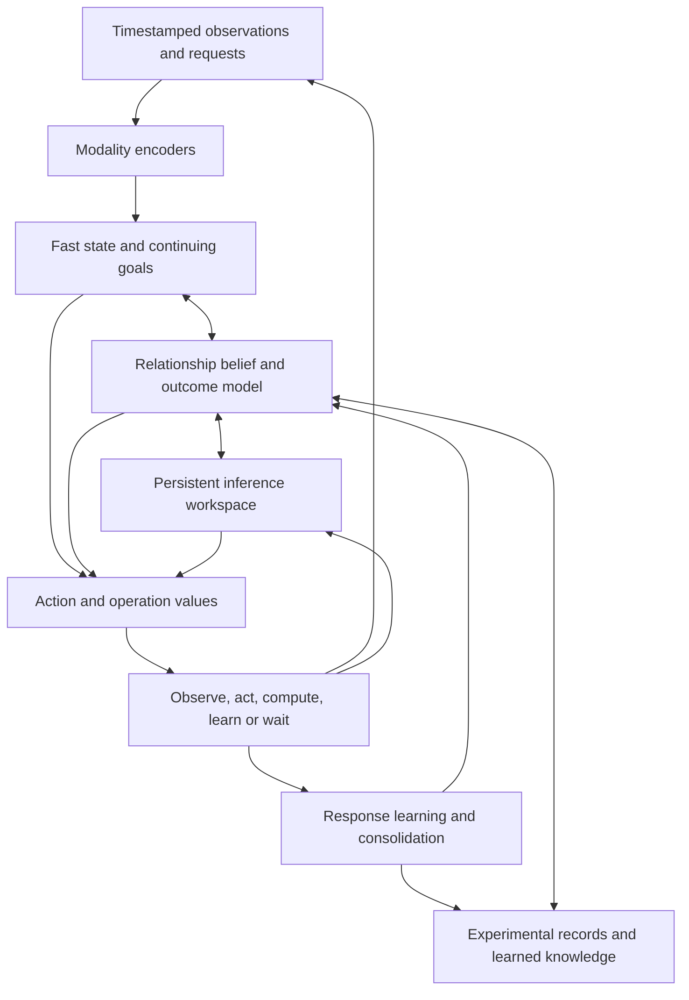

# Continual Decision Model: research and implementation direction

**Working source:** [`aecc237`](https://github.com/Cherish0925/continual-decision-model/tree/aecc237ecb191685d7e3b4f9f80565a78fdc9976), following v0.14.0. This is the current research direction, not a claim that the proposed model has been trained. The [result synthesis](MEMORY_AND_EXPERIMENTS.md) contains the calculations and corrections behind the choices below.

**Build a model whose experience improves its next experiment, whose ongoing inference can be revised as observations arrive, and whose learned policy chooses when to act, observe, compute and learn.** Preserve the fast action path while these operations run. A user request changes the goals of this continuing process; it need not start a new process.

The next implementation should connect a predictive belief over old and new relationships to action values, then train the same state and operation interface on task changes and independently advancing time. Keep the existing GRU, workspace and strongest released policies as starting points. Do not make increasing their size the explanation for a missing capability.

## 1. What the results change

The project has useful task-local response learning and experimental memory. On the primary 240-task chemistry cohort, twelve ledgers with a fixed reader cost 69.77 / 72.43 operations, versus 78.22 / 84.30 for the frozen initial policies. All complete the tasks. These are different weights as well as different memory settings; the missing frozen-parent-plus-memory comparison matters. A second cohort supports twelve versus six ledgers, not the unrun comparison against the original parent.

A training-derived, known-family Bayesian replay is much more competitive with CDM than the earlier test-derived-prior calculation suggested. Its reported Normal mean is 60.0, against CDM's 59.0 / 63.1; its Challenge information heuristic is 79.9, against 80.6 / 81.7. These estimates motivate moving beyond the official response family. They do **not** establish a universal optimum or a small remaining improvement ceiling: the reference knows the response law, uses an assumed recurrence process, and is not exactly optimized on Challenge.

| Capability | What exists | Next substantive result |
| --- | --- | --- |
| Active experiments | Policies choose measurements and complete experiments from returned observations | Useful choices under changed response laws, costs and recurrence |
| Persistent state | GRU and workspace retain state; ledgers survive apparatus changes | Retained inference reduces the cost of revision after new observations |
| Online adaptation | Four-step response fitting improves actions within the tested chemistry task | Adaptation outside the chosen similarity geometry and after interference |
| Long-term memory | Raw ledgers support returns; capacity limits retention | Recall, adaptation of related knowledge, and handling of unavailable old knowledge |
| Internal computation | Activity interfaces and refinement operations exist | Learned allocation improves the quality–latency–compute tradeoff |
| Consolidation | Design and some update interfaces exist | Later tasks improve after replayed records are no longer available |
| Continuous operation | Earlier process experiments advance a clock during inference | One learned model handles asynchronous input, delayed feedback and task changes |
| Multimodal interaction | Pretrained image/text interfaces exist separately | Perceptual information changes useful actions in the continuing model |
| Initiative | Autonomous task execution exists | A standing goal causes useful self-initiated observation or action without another prompt |

The scientific-task path currently stores about 47.82M parameters, with 32.71M trainable in its joint continuation. The earlier 0.428B image/text path is a different configuration. Do not add inactive encoders or teachers to the parameter count of a measured policy.

## 2. The scientific question

An experiment can improve the physical state while reducing what later experiments can reveal. A remembered solution can be worth trying immediately, or it can be the wrong first action when several relationships remain plausible. Internal computation can resolve that choice, but its delay can also make the action obsolete.

Study these effects through one objective: future task performance under the actual costs of observations, actions, elapsed time and computation. The candidate contribution is a learned representation and update rule that preserve the information needed for that decision across task changes. A mixture of models, a recurrent state, Bayesian weighting and a value network each have precedents; their presence is not the contribution.

Three linked questions organize the work:

1. **Relationship learning:** can the model infer and adapt an unfamiliar response law, reuse a related one, and reject an unsuitable one from the observations it chooses?
2. **Continuing computation:** can it retain useful partial inference, revise it when conditions change, and spend further computation only when that improves subsequent actions?
3. **Lasting improvement:** can experience improve later tasks through both explicit recall and changes to shared predictive or action knowledge?

Official chemistry is a useful regression task for the first question. A family-changing digital stream and a timed process are the next applications. They must use the same state, prediction and operation interfaces, so results accumulate into one model rather than separate demonstrations.

## 3. Model structure and state

Use the existing recurrent backbone first. Make predictive uncertainty, retained knowledge and pending work addressable; do not require every memory or outstanding task to fit inside one unstructured vector.

The state is

$$
S_t=(h_t,Z_t,b_t,D_t,M_t,\eta_t,G_t,P_t;\omega).
$$

| State | Meaning | Lifetime and update |
| --- | --- | --- |
| $h_t$ | Current context and recent events | Fast recurrent update on an observation, action return or meaningful timer event |
| $Z_t$ | Partial predictions, candidate plans and computation progress | Refined in bounded chunks; locally revised or restarted when its assumptions change |
| $b_t$ | Uncertainty about current state and response relationships | Predict forward through actions and time; condition on returned observations |
| $D_t$ | Current investigation's actual observations | Append as results arrive; retains action and capture times |
| $M_t$ | Prior investigations and reusable knowledge | Read, append, summarize or evict; persistence outlasts a task |
| $\eta_t$ | Fast adaptive parameters and optimizer state | Update from received outcomes; scope is an investigation or inferred context |
| $G_t$ | Standing objectives, current subgoals and progress | Revised by requests and learned subgoal choice |
| $P_t$ | Pending measurements, actions and slow computations | Tracks application time, dependencies and expected return time |
| $\omega$ | Shared encoders, predictor, policy and learned prior | Offline training and deliberate consolidation |

Shared weights do not require a single shared h/z for unrelated instruments. Use addressed investigation state with a common learned transition. Compare cross-task carry, within-task recurrence and workspace refinement separately; resetting h/z only at a task boundary does not justify removing it inside the task.

### A belief that represents both remembered and unfamiliar relationships

Let $\xi$ denote a response relationship. Initially it may be an explicit parameter vector in a finite simulator; the learned version uses an inferred latent variable or a posterior over model parameters. Each retained investigation contributes a distribution $q_m(\xi\mid D_m)$, not just one deterministic forecast. A fresh component represents possibilities not explained by currently available records:

$$
b_0(\xi)=r_t\sum_m\pi_m q_m(\xi\mid D_m)+(1-r_t)p_\omega(\xi\mid G_t,\text{public context}).
$$

Here $r_t$ is the probability of useful reuse from the **available, compatible** memory. It is not automatically the environment's global return frequency: an old relationship may have been evicted. The fresh component must handle that case as well as genuinely new relationships. Overlapping components are allowed; sum their mass rather than pretending their source labels are distinct physical truths.

Implement a bounded weighted set of hypotheses, with enough samples within the fresh component to represent its uncertainty. Normalize the weights inside each component before applying its mixture mass; increasing the particle count must not increase its prior probability. Rejuvenation needs proposals with support beyond the surviving particles. Resampling alone cannot introduce a missing response law. Log predictive fit and effective sample size; low fit can trigger broader proposals or a model update, rather than endless duplication of existing particles.

For a static relationship and an observation returned from action $a_t$:

$$
b_{t+1}(\xi)\propto b_t(\xi)\,p_\omega(o_{t+1}\mid \xi,a_t,S_t).
$$

Score the observation before fitting to it. If a shared predictor or fast update changes the likelihood model, rebuild affected posterior terms from retained observations or use a justified correction; accumulating the same observation twice is not additional learning. A changing physical process also needs a state-transition model. Late observations cannot in general be added to a current-state posterior without accounting for intervening actions.

### Preserve the information available from an experiment

In the official chemistry task, $O=\min(\rho,L)$, where $\rho$ is current rust and $L$ is the latent reaction level. Thus

$$
p(O=o\mid\rho)=p(L=o)\ (o<\rho),\qquad
p(O=\rho\mid\rho)=\sum_{l\geq\rho}p(L=l).
$$

An unchanged measurement is an interval of possible latent responses. Training it as an exact latent level discards the observation semantics.

The information baseline uses

$$
I(\xi;O\mid a,S)=H\!\left[\sum_k w_k p_k(O\mid a,S)\right]
-\sum_k w_k H[p_k(O\mid a,S)].
$$

The index $k$ ranges over relationship hypotheses, including alternatives inside the fresh component. Information about **archive identity alone** becomes zero when no archives exist, even if an experiment is informative. Predictive entropy equals the expression above only when responses are deterministic conditional on a hypothesis. With observation noise it also includes irreducible noise.

Information gain is a baseline, not the final action objective. Choose an action using expected remaining cost:

$$
Q(S,a)=c(S,a)+\mathbb E_{o,\Delta t}\left[V\big(T(S,a,o,\Delta t)\big)\right].
$$

The successor includes changed physical state, posterior, elapsed time, pending work and remaining budget. In chemistry, successful experiments terminate only after the native exit action is charged. A drop from rust 3 to 1 changes what future experiments can distinguish; this consequence must reach V. In a timed process, the world evolves during computation as well as during tool execution.

A few summary scalars are useful features but need not be sufficient. Provide the value/selector with a permutation-invariant encoding of weighted hypotheses and candidate-conditioned predictions. Two actions can have identical marginal outcome distributions yet leave different posterior partitions and future action costs. Entropy, success probability and top weight alone cannot always represent this difference.

### Memory, adaptation and consolidation

Keep raw observations as the stable record and derived hypotheses as replaceable summaries. Their roles differ:

- **Recall:** identify an old relationship and reuse it.
- **Transfer:** use old experience to learn a changed relationship with fewer observations.
- **Consolidation:** change shared knowledge so later performance improves after raw records are unavailable.

Store record count, observation times, model version and retrieval history. Recency and frequency may inform reuse priors, but duplicating an archive should not arbitrarily multiply belief in a relationship. Compare fixed recency, likelihood weighting and learned retrieval at equal memory bytes. Estimate reuse as a soft inference problem when task identity is ambiguous.

Do not merge two investigations solely because one recipe succeeds in both. The official success threshold admits nearby targets with a common successful action, and other response families can have several solutions. Preserve distinguishable records or a mixture until their predictive equivalence is adequate for the decisions being made. Eviction by expected future value is a candidate to compare with recency, not a prerequisite for the first model.

Quiet-period work can fit a better prior, rehearse difficult predictions, compress recurring decision procedures, or distil the predictor. Train it on subsequent observations and task performance. Generated rollouts are model predictions; they are not additional measured data. Test the benefit after removing or withholding the records used for consolidation, including both frequent old relationships and new tasks. Keep raw-memory recall as a separate comparison.

### Initiative, interruption and communication

The model chooses its next activity from a standing goal: request an observation, execute an action, retrieve, refine, update, consolidate or wait. Subgoals are proposed and selected for expected progress on that goal. Include cases where no new prompt arrives, where an opportunity can be missed, and where acting immediately is worse than waiting. Initiative can already be learned in discrete tasks; independent time additionally tests whether it remains useful under delay.

The runtime delivers events and executes the chosen operations. Timestamp observations at capture and arrival, actions at application, and tool results with their originating request. It does not supply the answer to when the model should think or learn. Human requests enter through the same goal/event interface.

Keep a cheap action readout available from the latest usable state. Slow computations run in bounded chunks and return their source observation interval and dependencies. On a new observation, revise dependent work; do not discard all computation just because a global counter changed. A delayed result updates the ongoing process, not an old snapshot of the whole agent. Use an action-history buffer and fixed-lag state reconstruction where required. Choose chunk durations from measured latency; GPU kernels are not assumed to be preemptible mid-operation.

Numeric actions and typed tool calls are primary outputs. Language and other decoders express the goal, status or selected action when communication is useful. Image/text encoders can be reused with trained projections; latent vectors from unrelated models are not interchangeable without alignment. Add audio or video when a task actually uses their information, with capture times and missing-modality masks. Measure the whole active path rather than claiming multimodality from an installed interface.

## 4. Training the model's decisions

Use a continuing stream as the sampling unit: new investigations, interrupted work, recurring relationships and changed goals. Keep both successful and unsuccessful observations. Separate train, development and final streams by response parameters, generating mechanisms, recurrence schedules and random seeds.

The basic record contains observation and capture/arrival times, action and application time, returned outcome, native cost, pending work, state/model version and later task return. Simulator-only identities and branches can produce training targets, but cannot enter the deployed agent's observations. Teach on the states visited by the current policy; a fixed demonstration dataset cannot cover every new action the learner selects.

Train three quantities together, with staged initialization:

1. **Predictive state:** received-outcome likelihood, including censoring, noise and delay. Compare history conditioning, trained fast updates and a learned similarity model. Supervise latent parameters only where the training simulator exposes them; identify the representation used at deployment.
2. **Action value:** remaining task cost and completion under the remaining budget. Use exact dynamic programming for small finite teachers, then branch estimates or actor–critic targets where exact planning is unavailable. A teacher optimized under a wrong family is a comparison, not the target definition of correct behavior.
3. **Operation value:** later action improvement from retrieval, another refinement, a parameter update or consolidation, minus its actual computation and elapsed-time cost.

One usable objective is

$$
\mathcal L=\lambda_o[-\log p_\omega(o_{t+1}\mid S_t,a_t)]
+\lambda_v\ell(V_\omega(S_t),G_t^{\mathrm{cost}})
+\lambda_q\ell(Q_\omega(S_t,\cdot),Q^{\mathrm{teacher}}_t)
+\lambda_\pi\mathcal L_{\mathrm{actor}}
+\lambda_f\mathcal L_{\mathrm{future}}.
$$

Use masks where a teacher or future target is absent. Weights must reflect loss scales on development data. Terminal and budget-exhaustion states need explicit targets; successful-only cost regression rewards policies that fail cheaply. Distillation can initialize action values, but regressing an optimal value does not guarantee reproduction of an information heuristic. If initial behavior must match an inherited policy, use an explicit action-preserving adapter and compare its initial outputs.

Train through the **actual deployed** number of fast update steps, their observation order and their parameter scope. Compare retained versus discarded updates to identify the mechanism, and independently trained alternatives to compare methods. Detaching expert forecasts on an actor path is a design choice that should be named; it does not mean that the actor lacks a task-return objective.

For a computation choice u, paired continuations from the same received history estimate

$$
\mathrm{VoC}(u\mid S)=\mathbb E[C_{\mathrm{future}}\mid S,\text{act now}]
-\mathbb E[C_{\mathrm{future}}\mid S,u]
-\lambda_c C_{\mathrm{compute}}(u).
$$

Both continuations must advance the world for their actual durations. Waiting for a pending measurement is another competitor. A small action-value gap is not sufficient reason to compute: the uncertainty may require another observation, or extra computation may leave the action unchanged.

Long-term memory and consolidation need later-use returns. Sample returns after intervening tasks and compare useful record retention against a matched alternative at those future states. Full backpropagation through an entire lifetime is not required: use truncated sequence training plus later-use sampling and value targets. Across a window boundary, carry the state and bootstrap if the process is still alive; do not treat a data window as task termination.

## 5. Applications and comparisons

### Experiment streams with changing response laws

Keep the official DiscoveryWorld task and its published protocol unchanged. Add a separately named digital extension with different response generators: metric response, ingredient interaction, inhibition, multiple solutions, noisy measurements and gradual drift. Choose a compact learnable class that includes several of these mechanisms during training. Hold out parameter ranges, combinations and selected mechanisms separately.

Training only on cosine and testing only on wholly unspecified laws measures failure under extrapolation; it cannot by itself establish that a different architecture will learn those laws. State what structural prior the learner can express, and include an observation-rich upper reference to distinguish insufficient information from insufficient learning. Reserve generator families before tuning. A relabeled task is a permutation problem, not automatically a new scientific law.

Vary return frequency, gaps and interruptions. Distinguish an exact return, a changed familiar law, an old law absent from memory, and a genuinely new law. The model sees only public context and chosen outcomes. Match action costs and achievable success; matching the marginal entropy of a random first observation does not match sequential identification difficulty.

Compare at least:

- the frozen initial policy and that same policy with twelve ledgers and fixed weighting;
- the strongest current twelve-ledger continuation;
- a separately trained recurrent meta-RL policy (RL²-style) and a latent-context policy (VariBAD-style);
- direct retrieval and a cost-aware known-family Bayesian policy, with their information advantages stated;
- the proposed belief/value model with and without online updates, long-term memory and extra internal computation.

RL² and VariBAD are direct learned competitors, not optional rewards for passing an internal ablation. Use equal observations, tools, memory budgets where applicable, training interactions and tuning opportunities. Report sample and wall-clock efficiency separately. A published language-agent baseline becomes essential if claiming general DiscoveryWorld competence; current structured-tool results cannot be compared to a text agent merely by model size.

### A process that advances during inference

Extend the existing process-control setting with delayed, multi-rate observations, queued actions, regime changes and deadlines. Keep one goal active over a long run. Then add perception where it resolves a real ambiguity, for example a delayed beam image plus fast power readings in a digital optical-alignment model. Actual instrument work follows a measured simulator-to-device transition; no specific camera, actuator or GPU latency is assumed here.

Include three cases: an unprompted measurement prevents a later loss; waiting for a pending observation is best; and a longer computation misses the useful action time. Compare fixed-period and event-triggered controllers, the strongest task-specific control method, and learned operation choice at comparable total compute. A recurrent fixed-rate controller is a stronger opponent than an agent forced to restart on every event. A paused-world run isolates delay; it is a reference, not automatically a performance upper bound when other aspects differ.

Measure task success or control quality, new/return cost, recovery after a regime returns, capture-to-action delay, decision latency p50/p99, throughput, peak memory and energy per completed task. Decompose environment, encoding, prediction, memory, refinement and update time. Report native operations including failures, paired differences by stream, and variation across independently trained seeds. Task counts shared across conditions are not independent replications.

### Durable learning

After a learning period, compare a model that consolidated with one using an equal idle-compute budget without retaining the update. Remove the training ledgers from both before the later test, and compare independently trained no-consolidation and ordinary replay references as well. Test old competence and new-task learning speed. This distinguishes useful changes to shared knowledge from keeping a larger lookup table.

## 6. Implementation order and compute

The deliverable is one continuing model with these operations connected to action, not a growing list of dormant modules. Organize work into substantial changes with an executable comparison at each dependency boundary.

**2 November execution update.** The [response-law study](../experiments/continual_experiment/RESPONSE_FAMILIES.md)
completes the frozen-parent comparison, the hypothesis/marginal action
representation comparison and joint training across five generated mechanisms.
Original parents plus twelve ledgers provide the better starting policy.
The additional set-based action head has no established advantage and causes
native chemical regression; removing it restores that capability. Its favorable
primary-cohort mean does not become a stable overall gain on independent streams.

The next implementation should learn uncertainty within unfamiliar response
functions and update that uncertainty from chosen observations. The present
fresh component still supplies one marginal prediction. Retain the inherited
actor as the working action reference; test learned relationship beliefs against
recurrent and latent-context policies before adding another action encoder.
Independent-time inference and lasting consolidation remain parts of the same
objective, with their original evaluation requirements intact.

| Work | Concrete change | Result that determines the next choice |
| --- | --- | --- |
| Establish the starting policy | Load each original parent with twelve ledgers and fixed weighting, retaining its response predictor and within-task h/z | Whether memory continuation training improved on simply adding memory to the stronger parent |
| Expose the belief to action | Add per-relationship predictions and a masked set encoder; preserve the inherited selector as a named mode | Whether useful distinctions are lost by marginal prediction alone |
| Learn response and action together | Train the relationship posterior, observation model and cost-to-go on diverse streams; compare learned and fixed metrics | Whether learning transfers beyond the official geometry and competes with recurrent/latent-context methods |
| Reuse computation under time | Integrate pending events, bounded refinement and the independent clock | Whether retaining/revising work improves action quality at a measured latency budget |
| Learn computation and consolidation | Train operation values and later-use updates in the same streams | Whether the learned schedule and retained parameter changes improve future tasks over equal-cost alternatives |
| Scale what works | Increase streams, exposure, memory and model size separately | Which resource increases capability, and where inference cost outweighs the benefit |

The initial selector comparison is bounded: one declared cohort and settings, with the existing predictor unchanged. Use it to choose initialization and features; do not spend successive releases tuning the same official family. Run the broader response-family and timed studies as the principal work.

### File-level implementation map

The following names are proposed additions unless an existing module already covers the function. Inspect current implementations before creating duplicates.

| Location | Required work |
| --- | --- |
| `cdm/experimental_memory.py` | Preserve raw observations; expose compatible records and mixture weights; compare recency/frequency without conflating duplicate slots with new knowledge |
| `cdm/conditional_response.py`, `cdm/response_replay.py` | Add a relationship-conditioned prediction path; retain history conditioning; compare learned similarity and deployed-step fitting |
| Proposed `cdm/relation_belief.py` | Weighted relationship hypotheses, within-fresh uncertainty, likelihood updates, rejuvenation and component-mass normalization |
| `cdm/experiment_value.py` | Implemented hypothesis/candidate action residual; calibrated next-state cost and time remain unimplemented |
| `experiments/continual_chemistry/reaction.py` | Expose per-hypothesis forecasts to the selector; retain inherited, information and value modes; preserve h/z for the first comparison |
| `experiments/continual_chemistry/active_environment.py` and a separate extension module | Parameterized response laws, sampled recurrence and changed-law returns without changing official-task semantics |
| `experiments/continual_experiment/` | Frozen-parent-plus-memory comparison; new stream manifests; recurrent and latent-context training; stage results at fixed endpoints |
| `cdm/core.py`, `cdm/recurrent_feedback.py` | Keep the current recurrent/workspace reference; add revision and operation choices only when they affect the acting path |
| Existing process runtime plus a timed experiment entry point | Capture/arrival/application timestamps, independently advancing process, pending results and computation chunks |
| Existing replay and training modules | Later-use sampling, parameter consolidation, stream-level evaluation and cost accounting |

Reuse pretrained perception for competent inputs, not as a substitute for learning the decision mechanism. Keep a GRU-plus-MLP baseline. Compare bounded attention, matrix recurrence or a scan-friendly state update only if sequence throughput or state capacity is the measured limitation. A backbone change and a belief/learning change should not be inseparable in the first result.

### Two H100s and CPU workers

Start with one complete learner and one matched learned baseline on the two H100s, with batched simulator streams and a CPU pool for native execution and finite-state teacher labels. Alternate devices across replications if their performance differs. If inference collection becomes the bottleneck, temporarily assign a GPU to batches of rollouts and reuse the collected trajectories. Use actual throughput to set the worker count.

Batch hypotheses, candidates and environments; bucket bounded computation depths instead of launching many tiny per-particle kernels. Use mixed precision where numerically appropriate, keeping likelihood accumulation and normalization at adequate precision. Cache frozen encoder outputs by input and encoder version. Archived predictions currently depend on h/z, shared weights and query state; caching them once per task changes the model unless that dependence is separately removed and compared.

Profile one representative end-to-end batch, then run the declared training and evaluation jobs without repeated tiny pilots. Use additional A100s, when available, for independent seeds, data production or evaluation before introducing heterogeneous synchronous training. Keep best checkpoints according to development task return and later-task learning, not solely prediction loss. A GPU running continuously is a resource-use fact; the learned choice to do useful work or wait is the capability.

## 7. What a convincing research result would contain

A paper should connect a precise learning mechanism to a capability that simpler alternatives do not provide at the same resources. For this direction, the central result is useful reuse and adaptation across changed relationships, with internal computation chosen according to its later action value. It needs the following supporting results:

- a compact statement of what the belief/update/value representation changes relative to latent-context meta-RL and likelihood-weighted memory;
- gains over independently trained recurrent and belief-based methods, across fresh streams and more than one response family;
- an explanation of when prior knowledge helps, when it hurts, and when the environment makes discrimination expensive;
- useful operation selection under an independently moving process, and lasting learning after raw records are unavailable;
- quality–cost–latency curves and independent training repetitions, with a common model and consistent interfaces.

Publish the strongest result the experiments actually establish, even if a simpler architecture wins. The full CDM objective remains the organizing direction; a subexperiment should resolve a part of that objective rather than redefine it.

The closest mechanisms and their relevance are listed in [the focused comparison](../ref/BELIEF_AND_COMPUTATION.md). The [original question brief](OPEN_QUESTIONS_V014.md) remains the record of what motivated this synthesis. Completed native experiments remain in their original result files.
