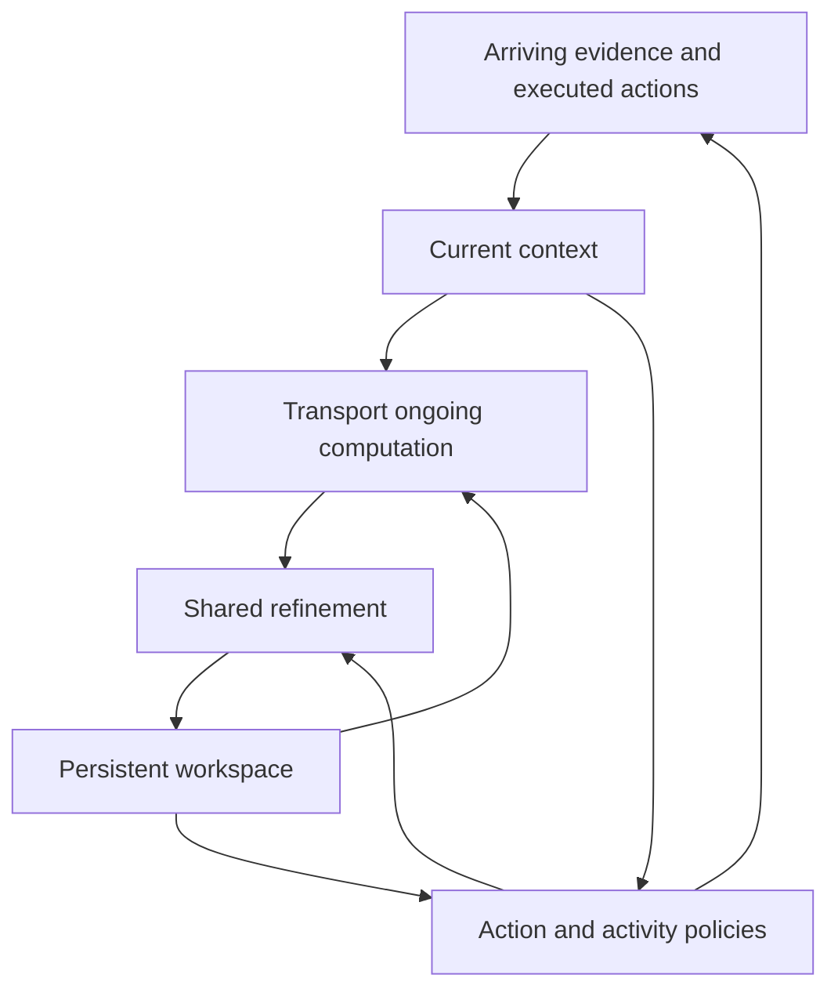

# Current mechanism study

CDM aims to sustain perception, self-directed computation, action, and learning in one long-running model. This study develops a specific part of that programme: **how unfinished internal computation should change when new evidence arrives**.

## The proposed model contribution

A shared refiner develops a persistent workspace. An evidence-conditioned transport operation changes that workspace before refinement continues, while an action readout can use fresh evidence throughout. We propose learning the representation, refiner, and transport together from interrupted task trajectories. The research question is whether this preserves useful computation at a lower total cost than restarting, ordinary recurrence, replanning, or correcting only the output.

The central object is the continuing computation, not a list of cognitive module names. A recurrent event encoder and Transformer workspace are implementation choices. The contribution would have to reside in the learned state transition, its training, and measured benefit.

| Document | Purpose |
| --- | --- |
| [Computation transport](COMPUTATION_TRANSPORT.md) | Explicit state update, finite-progress training target, conditional mathematical analysis, and model integration. |
| [Closest prior work](TRANSPORT_PRIOR_ART.md) | Ten close antecedents and the comparisons needed to establish an actual contribution. |
| [Numerical experiment](../experiments/transport/README.md) | Executable controlled study, configuration, and reproduction instructions. |
| [Experiment results](../experiments/transport/RESULTS.md) | Measured results and the research decision supported by them. |

## What this study establishes

The numerical experiment uses explicit quadratic objectives so that the current optimum, residual, and computational cost can be inspected. A trained polynomial transport and a finite-progress diagnostic test component behavior. They do not implement the proposed multimodal neural core, learned activity selection, physical robot control, or lifelong parameter learning.

Prediction-correction, optimizer sensitivity, learned warm starts, recurrent metareasoning, and low-rank derivative propagation are established methods. The study attributes those foundations and uses them as controls. Neither a local bound nor a successful numerical example establishes priority for the full model.

## Decision from the first experiment

The tested equilibrium-style transport loses to accelerated gradient, conjugate gradient, a same-weights current-residual control, and an approximately CPU-latency-matched gradient baseline in every tested regime. This implementation is not selected as a demonstrated CDM core.

The finite-progress diagnostic reveals a more consequential distinction. On unseen interruption depths, learning to reconstruct the same intermediate state lowers relative state error from 0.3715 to 0.0558, yet increases the quadratic objective gap from 0.49594 to 0.76091. Reproducing an earlier computation stage can preserve unnecessary error. **The model should preserve useful work as judged by subsequent outcomes; it should be free to reorganize or advance that work.** Branch matching is therefore only an auxiliary training signal, not the objective defining a successful model. These numbers concern a separate offline diagnostic, not closed-loop agent performance.

## Connection to the complete CDM

The mechanism is intended to support a broader continuous process:

An activity policy would decide which observation, internal computation, retrieval, or learning operation is useful. A fast action policy would continue acting while deeper computation develops. Experience consolidation would make repeated useful reasoning cheaper on later tasks. Each is a capability to train and evaluate; the transport experiment measures none of them by assumption.

The next model experiment should use a trainable shared refiner with a fixed-capacity workspace, a small transport operation, and a fresh-evidence action readout. Its decisive comparisons are a generic recurrent update, a learned initializer, action-only correction, and state transport, with matched information and measured total latency. Repeated interruptions and state interventions must determine whether the workspace retains useful computation beyond immediate output correction.

The broader architecture and application programme remain in [RESEARCH.md](../RESEARCH.md). The [initial design](../DESIGN.md) is retained as the earlier engineering baseline; it should not be read as a final model or an originality claim.
